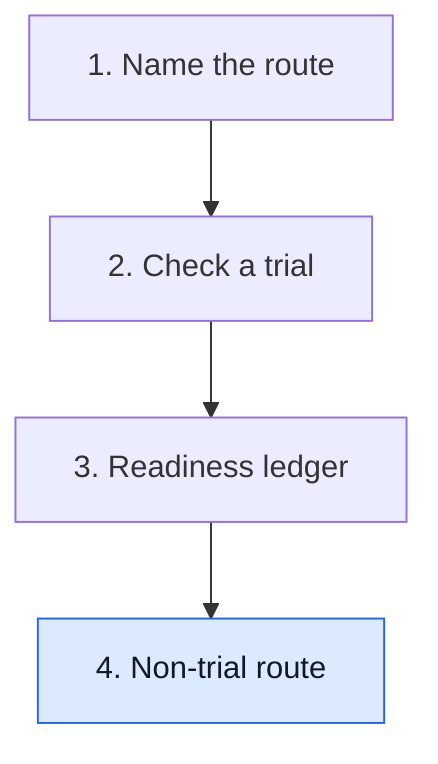

# Walk the non-trial route

**When no trial fits, a U.S. physician can ask for one patient's access to an investigational drug through a single-patient expanded-access request. The company must agree to supply it, the physician files a short FDA form, and an institutional review board (IRB) reviews it.**

**Before you start:** [Clinical trials versus expanded access](/wiki/education/concepts/access-and-regulation/trials-and-access/clinical-trial-vs-expanded-access) explains why expanded access exists and its timing rules. [IND versus marketing applications](/wiki/education/concepts/access-and-regulation/trials-and-access/ind-vs-bla) explains what an Investigational New Drug (IND) application is.

## Where this step sits

Lesson 1 named the routes and lesson 3 built the readiness ledger. This lesson walks the non-trial branch, step by step, so the "pathway and review" row of the ledger has concrete answers.

## The steps and their owners

For a non-emergency individual-patient request, FDA lists these steps [1]:

| Step | Owner | What happens |
|---|---|---|
| 1. Supplier agreement | The company | Agrees to provide the drug and usually sends a **letter of authorization** that lets FDA refer to the company's existing IND for manufacturing and safety data |
| 2. Submission | Treating physician | Files **Form FDA 3926**, the short individual-patient expanded-access form, or the longer general IND forms; FDA also accepts an online eRequest |
| 3. Review board | IRB | Reviews the request; a physician using Form 3926 may ask for review by the IRB chair or a designated member instead of a full meeting |
| 4. Consent | Physician and patient | Written informed consent on an IRB-approved form |
| 5. Start | Physician | Treatment may begin 30 days after FDA receives the request, or sooner if FDA says so |

FDA reports that it allows about 99% of expanded-access requests to proceed [1]. The usual bottleneck is step 1: a company is not required to supply its drug and may decline. For cancer drugs, FDA's Oncology Center of Excellence runs **Project Facilitate**, a pilot that helps oncology clinicians prepare these requests [2].

Emergency requests follow a faster path: the physician contacts FDA by phone first, then files the written form afterward [1].

## Who pays

Federal rules let the company charge for an investigational drug only with **prior written FDA authorization** [3]. For a single patient it may recover only **direct costs**: making, shipping and storing the drug for that use. It may not charge for research, development or commercial-scale manufacturing [3]. Larger expanded-access programs may also recover monitoring and administrative costs. Insurance coverage of the surrounding care (visits, scans, managing side effects) is a separate question for the insurer.

## Worked example: Mara's request

Mara's oncologist wants a drug that is in phase 2 trials, but Mara does not meet any open trial's criteria.

1. The oncologist asks the company. It agrees and sends a letter of authorization.
2. The oncologist completes Form FDA 3926 with Mara's history and the treatment plan, and asks for IRB chair review.
3. The IRB chair approves; Mara signs the consent form.
4. Thirty days after FDA received the form, with no hold, treatment can start.
5. The company says it will not charge. If it had, the ledger would record the FDA charging authorization and what the amount covers.

Every step has a named owner, so the family's questions go to the right person.

## What can go wrong at this step

- Treating FDA as the gatekeeper misses the usual blocker, the company's decision to supply.
- Treating a letter of authorization as permission to treat skips FDA, the IRB and consent.
- Assuming the drug is free, or that a charge is unregulated, skips the charging rule.
- Calling a time-sensitive plan an emergency misuses the emergency path.

## Try it

A company agrees to supply a drug for one patient and quotes a price covering the drug plus a share of its research costs. Is that allowed?

**Answer:** No. With FDA authorization it may recover direct costs of making and shipping the drug for this use, but not research and development costs.

## Explain it back

"For single-patient access, the company decides ___, the physician files ___, and the ___ reviews it."

**One possible answer:** "Whether to supply the drug; Form FDA 3926 with the letter of authorization; institutional review board, with FDA allowing treatment after 30 days unless it acts sooner."

## Takeaway

**Single-patient access runs through five owners: company, physician, FDA, IRB and patient. The company's yes usually comes first and matters most.**

**Back to:** [Understand access to an experimental therapy](/wiki/education/guides/accessing-experimental-therapy/index).

## Sources and scope

U.S. drugs and biologics only; devices differ. Source-checked November 7, 2026; expert and learner review pending. Mara is fictional.

1. [FDA: Expanded access, how to submit a request (forms)](https://www.fda.gov/news-events/expanded-access/expanded-access-how-submit-request-forms) — steps, Form FDA 3926, letter of authorization, IRB chair review, 30-day start and the 99% figure.
2. [FDA Oncology Center of Excellence: Project Facilitate](https://www.fda.gov/about-fda/oncology-center-excellence/project-facilitate).
3. [21 CFR 312.8: charging for investigational drugs](https://www.ecfr.gov/current/title-21/chapter-I/subchapter-D/part-312/subpart-A/section-312.8).
