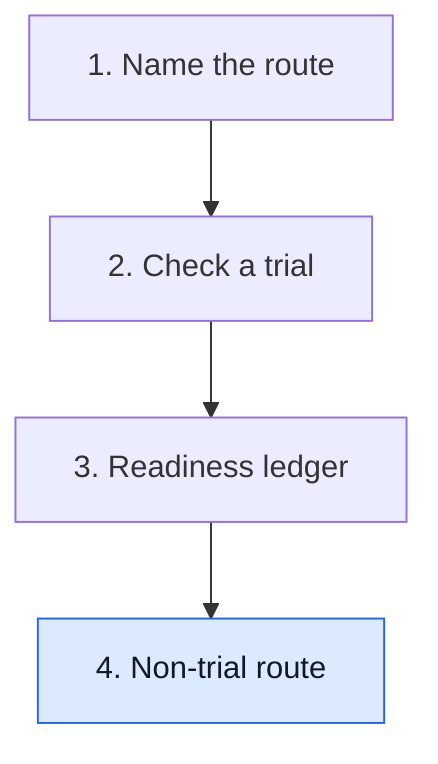

# Walk the non-trial route

**When no trial fits, a U.S. physician can ask for one patient's access to an investigational drug through a single-patient expanded-access request. The company must agree to supply it, the physician files a short FDA form, and an institutional review board (IRB) reviews it.**

**Before you start:** [Clinical trials versus expanded access](/wiki/education/concepts/access-and-regulation/trials-and-access/clinical-trial-vs-expanded-access) explains why expanded access exists and its timing rules. [IND versus marketing applications](/wiki/education/concepts/access-and-regulation/trials-and-access/ind-vs-bla) explains what an Investigational New Drug (IND) application is.

## Where this step sits

Lesson 1 named the routes and lesson 3 built the readiness ledger. This lesson walks the non-trial branch, step by step, so the "pathway and review" row of the ledger has concrete answers.

## The steps and their owners

For a non-emergency individual-patient request, FDA lists these steps [1]:

| Step | Owner | What happens |
|---|---|---|
| 1. Supplier agreement | The company | Agrees to provide the drug and usually sends a **letter of authorization** that lets FDA refer to the company's existing IND for manufacturing and safety data |
| 2. Submission | Treating physician | Files **Form FDA 3926**, the short individual-patient expanded-access form, or the longer general IND forms; FDA also accepts an online eRequest |
| 3. Review board | IRB | Reviews the request; a physician using Form 3926 may ask for review by the IRB chair or a designated member instead of a full meeting |
| 4. Consent | Physician and patient | Written informed consent on an IRB-approved form |
| 5. Start | Physician | Treatment may begin 30 days after FDA receives the request, or sooner if FDA says so |

FDA states that, on average, it determines that 99% of expanded-access requests may proceed [1]. The usual bottleneck is step 1: a company is not required to supply its drug and may decline. For cancer drugs, FDA's Oncology Center of Excellence runs **Project Facilitate**, a single point of contact that helps oncology clinicians prepare these requests [4].

Form FDA 3926 exists to make step 2 short. A physician may still use the general IND forms (FDA 1571 and 1572) instead, but FDA describes 3926 as built for these requests and easier to complete [1]. It is for individual patients only, in both non-emergency and emergency settings; a request covering a group of patients uses the general forms, and devices follow a different process entirely [2].

Emergency requests follow a faster path [1]. An FDA official may authorize the use by telephone or other rapid communication, and treatment may begin immediately on that authorization. The paperwork follows: Form FDA 3926 within 15 business days of the authorization, and notification of the IRB within 5 business days of starting treatment.

## Who pays

The default is that nobody charges. A company may charge for an investigational drug only with **prior written authorization from FDA**, and it must show its arithmetic: the calculation has to come with a statement that an independent certified public accountant has reviewed and approved it [3].

What may be recovered is narrow. For a single patient, a sponsor "may recover only the direct costs of making its investigational drug available" — the regulation defines direct costs as those that can be "specifically and exclusively attributed" to supplying the drug for that authorized use, such as per-unit manufacturing (raw materials, labor, non-reusable supplies) or acquisition, plus shipping and handling [3]. **Indirect costs may not be charged.** The regulation names these explicitly: facilities and equipment primarily intended to make commercial quantities, and research, development, administrative or labor costs that the company would incur anyway [3]. Larger programs — expanded access for intermediate-size populations, and treatment INDs — may recover monitoring, IND reporting and directly associated administrative costs in addition to direct costs [3].

An authorization to charge is not permanent: for expanded access it runs for one year unless FDA specifies a shorter period, and the sponsor may ask FDA to reauthorize it [3]. FDA will also withdraw the authorization if charging turns out to interfere with developing the drug for approval [3].

Insurance coverage of the surrounding care — visits, scans, infusion time, managing side effects — is a separate question for the insurer, and a company's decision not to charge for the drug says nothing about it.

## Worked example: Mara's request

Mara's oncologist wants a drug that is in phase 2 trials, but Mara does not meet any open trial's criteria.

1. The oncologist asks the company. It agrees and sends a letter of authorization.
2. The oncologist completes Form FDA 3926 with Mara's history and the treatment plan, and asks for IRB chair review.
3. The IRB chair approves; Mara signs the consent form.
4. Thirty days after FDA received the form, with no hold, treatment can start.
5. The company says it will not charge. If it had, the ledger would record the FDA charging authorization and what the amount covers.

Every step has a named owner, so the family's questions go to the right person.

## What can go wrong at this step

- Treating FDA as the gatekeeper misses the usual blocker, the company's decision to supply.
- Treating a letter of authorization as permission to treat skips FDA, the IRB and consent.
- Assuming the drug is free, or that a charge is unregulated, skips the charging rule.
- Calling a time-sensitive plan an emergency misuses the emergency path.

## Try it

A company agrees to supply a drug for one patient and quotes a price covering the drug plus a share of its research costs. Is that allowed?

**Answer:** No. With prior written FDA authorization it may recover the direct costs of making, acquiring, shipping and storing the drug for this use. Research and development are named in the regulation as indirect costs, which cannot be recovered — and for a single patient the monitoring and administrative costs that larger programs may add are not available either.

**A second check:** The company says its FDA authorization to charge is "on file from two years ago." What should the ledger ask?

**Answer:** Whether it is still current. An expanded-access charging authorization runs for one year unless FDA set a shorter period, so a two-year-old authorization needs to have been reauthorized.

## Explain it back

"For single-patient access, the company decides ___, the physician files ___, and the ___ reviews it."

**One possible answer:** "Whether to supply the drug; Form FDA 3926 with the letter of authorization; institutional review board, with FDA allowing treatment after 30 days unless it acts sooner."

## Takeaway

**Single-patient access runs through five owners: company, physician, FDA, IRB and patient. The company's yes usually comes first and matters most.**

**Next:** [Sequence the work and respect what cannot be undone](/wiki/education/guides/accessing-experimental-therapy/05-sequence-the-work), or return to [the guide map](/wiki/education/guides/accessing-experimental-therapy/index).

## Sources and scope

U.S. drugs and biologics only; devices differ. Source-checked November 8, 2026 for the emergency timing and the charging rule; November 7, 2026 otherwise; expert and learner review pending. Mara is fictional. Nothing here is an eligibility or availability determination for any individual.

1. [FDA: Expanded access, how to submit a request (forms)](https://www.fda.gov/news-events/expanded-access/expanded-access-how-submit-request-forms) — page content current October 16, 2024; checked for the steps, Form FDA 3926 and its relation to Forms 1571 and 1572, the letter of authorization, IRB chair concurrence, the 30-day non-emergency start, the emergency telephone authorization with its 15-business-day form and 5-business-day IRB notification, and the 99% figure.
2. [FDA guidance: individual patient expanded access applications, Form FDA 3926](https://www.fda.gov/regulatory-information/search-fda-guidance-documents/individual-patient-expanded-access-applications-form-fda-3926) — October 2017 guidance; checked for the form's scope, which covers non-emergency and emergency individual-patient requests for drugs and biologics and not devices.
3. [21 CFR 312.8: charging for investigational drugs under an IND](https://www.law.cornell.edu/cfr/text/21/312.8) — regulation text as amended August 13, 2009; checked for the prior-written-authorization requirement, the direct-cost limit and the regulation's own direct/indirect definitions, the additional recoverable costs for intermediate-size and treatment-IND expanded access, the independent certified public accountant statement, the one-year duration and FDA's withdrawal authority. Cornell's Legal Information Institute mirrors the Code of Federal Regulations; the official text is the eCFR.
4. [FDA Oncology Center of Excellence: Project Facilitate](https://www.fda.gov/about-fda/oncology-center-excellence/project-facilitate) — page content current February 15, 2024; checked for its role as a single point of contact for oncology expanded-access requests.
