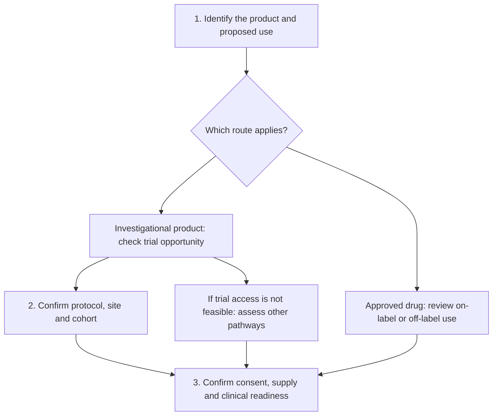

# Understand access to an experimental therapy

**Learn how to distinguish treatment routes, check a real trial opportunity, and understand the work needed before an investigational treatment can be given.** A promising therapy and a feasible plan are different stages of the same conversation.

When you read about a new treatment, it is natural to ask, “Could someone actually get this?” The answer can involve a study team, a manufacturer, a treating clinician and several review steps. This guide gives those pieces names and puts them in order.

You do not need to solve every regulatory detail yourself. The useful goal is to ask precise questions and recognize which answers are still missing. The lessons focus on U.S. drugs and biologics. Device access, other countries and individual institutional policies may differ.

## The big ideas

1. [Off-label use](/wiki/education/concepts/access-and-regulation/approval/drug-label-and-off-label-use) concerns an approved drug used outside its labeling. A never-approved product needs a different access route.
2. [Clinical trials and expanded access](/wiki/education/concepts/access-and-regulation/trials-and-access/clinical-trial-vs-expanded-access) serve different primary purposes. A single-patient Investigational New Drug (IND) application is one expanded-access mechanism.
3. A trial's [phase and assignment design](/wiki/education/concepts/evidence-and-statistics/study-design/trial-phases-and-randomization) describe its scientific plan. They do not establish an individual's eligibility or guarantee the experimental arm.
4. “Recruiting” is an invitation to check availability. A site and the relevant cohort must still be open, and screening must establish eligibility.
5. Supplier agreement, review, consent, product readiness and monitoring are separate gates. Authorization to proceed is not evidence that treatment will help.

## The map

*Follow the numbered lesson links below. A pathway becomes usable only when the relevant gates have been resolved.*

## Lessons

Minutes are suggested reading budgets. Each lesson includes a fictional case, a practice answer and an explain-it-back prompt.

| Step | Lesson | Question it answers | Minutes | Learning aid |
|---|---|---|---|---|
| 1 | [Name the access route](/wiki/education/guides/accessing-experimental-therapy/01-name-the-access-route) | Is this an approved drug, a study or another investigational pathway? | 12 | Route comparison and fictional choices |
| 2 | [Check a real trial opportunity](/wiki/education/guides/accessing-experimental-therapy/02-check-a-real-trial-opportunity) | Can the relevant site and cohort evaluate this patient now? | 12 | Screening record and randomization example |
| 3 | [Build the readiness picture](/wiki/education/guides/accessing-experimental-therapy/03-build-the-readiness-picture) | Who supplies, reviews, delivers and monitors treatment? | 12 | Readiness ledger and timing example |

## Concepts you will use

Start with [drug labeling and off-label use](/wiki/education/concepts/access-and-regulation/approval/drug-label-and-off-label-use) and [clinical trials versus expanded access](/wiki/education/concepts/access-and-regulation/trials-and-access/clinical-trial-vs-expanded-access). Then read [trial phases and randomization](/wiki/education/concepts/evidence-and-statistics/study-design/trial-phases-and-randomization) before interpreting a study invitation.

For a therapy suggested by a report, [actionability](/wiki/education/concepts/evidence-and-statistics/biomarkers/actionability) and [judging a test or company claim](/wiki/education/guides/judging-a-test-or-vendor-claim/index) help separate the access question from the evidence question.

## Applied to Diana

Current treatment decisions belong in [[wiki/care/treatment-plan|the care plan]], with trial evidence organized in [[wiki/treatment/clinical-trials|the clinical-trial review]]. Personalized-product preparation belongs in [[project-management/projects/vendors/personalized-vaccine|the vaccine readiness project]]. This guide explains route categories without copying eligibility, approvals or project status.

## What is still uncertain

Investigational therapies may help, do nothing useful, or cause serious harm. Early activity in one population cannot settle the benefit–risk question in another. Product changes can also limit how much earlier evidence carries forward.

Practical availability changes. A study may pause enrollment, a cohort may fill, or a supplier may be unable to provide treatment. Ask the responsible team for the current answer, and keep the date with that answer. A pathway's existence is a reason to investigate feasibility, rather than a treatment promise.

## Sources and scope

U.S. source check: October 9, 2026. General education; expert and learner review pending. No individual eligibility or access determination is made here.

- [FDA: expanded access and other treatment options](https://www.fda.gov/patients/learn-about-expanded-access-and-other-treatment-options) — route categories.
- [NCI: steps to find a clinical trial](https://www.cancer.gov/research/participate/clinical-trials-search/steps) — search and site confirmation.
- [FDA: expanded access information for review boards](https://www.fda.gov/news-events/expanded-access/expanded-access-information-institutional-review-boards-irbs) — supply, review, treatment and monitoring responsibilities.
