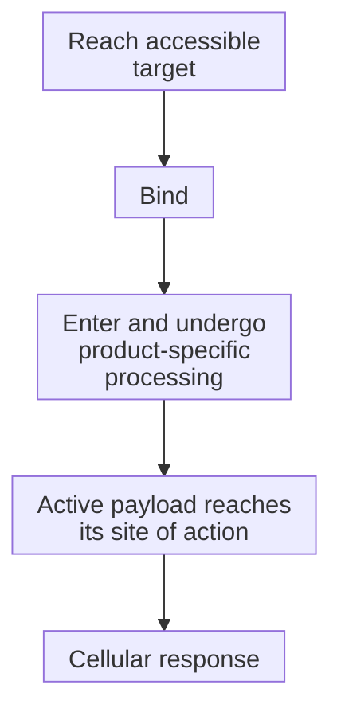

# Follow delivery, exposure, and the treatment clock

**A dose starts an exposure history. Binding, transport, payload processing, immune activation, and injury can happen on different clocks.**

It is tempting to picture an infusion as an on switch and the end of the infusion as an off switch. A more useful picture is a sequence of events. Some molecules leave the blood, some remain attached to cells, and some effects continue after the initiating exposure changes. Track the event that was measured before naming the effect.

**Before you start:** [Antibody-drug conjugates (ADCs)](/wiki/education/concepts/therapeutics/antibody-based/antibody-drug-conjugate) separate binding, processing, and payload action. [T-cell engagers](/wiki/education/concepts/therapeutics/antibody-based/t-cell-engager) require productive immune contact. [Chemotherapy](/wiki/education/concepts/therapeutics/chemotherapy/chemotherapy) explains why chemical exposure can affect susceptible cancer and normal cells.

## Where this step sits

This is step 2 of [Aiming a drug at a surface target](/wiki/education/guides/aiming-a-drug-at-a-surface-target/index): recognition and action → **delivery and exposure** → safety and clinical evidence → payload choice → new strategies → choosing the target.

## Follow the product through the cell

For a familiar ADC route, the product reaches a cell, binds its target, enters the cell, and is processed. An active payload or breakdown product must then reach a susceptible process, which depends on its [payload class](/wiki/education/concepts/therapeutics/antibody-based/adc-payload-classes). The route is product-specific; a diagram should never turn these stages into universal guarantees.

A useful experiment assigns a measurement to each part of the chain:

| Question | A possible measurement | What that result does not establish |
|---|---|---|
| Does it bind? | Product binding on viable target-positive and control cells | Delivery throughout a tumor |
| Does material enter the cell? | A validated trafficking assay that distinguishes internal from surface signal | Formation of active payload |
| Is active material formed and delivered? | Assay for the relevant payload or active breakdown product, with compartment information when needed | Sufficient damage or cell death |
| Is the intended process affected? | A mechanism-appropriate functional readout | A useful clinical outcome |
| Do cells survive? | Time-dependent survival measurements with controls | Safe exposure or benefit in a person |

The word **validated** matters. An assay must distinguish the quantities the claim depends on. A fluorescent antibody label follows antibody-associated signal; it cannot automatically reveal whether the active chemical is still attached, has been released, or has reached the cytoplasm.

Primary transport experiments give a concrete example: for trastuzumab emtansine, the lysosomal transporter SLC46A3 can carry an active breakdown product out of the lysosome into the cytoplasm [7]. Binding and uptake can therefore leave an important later step unanswered. That is one studied mechanism, not proof that every ADC needs the same transporter.

## Worked example: three real exposure curves

The clearest way to see that an ADC is several measurable species at once is to read the numbers in the labels. Each value below is a median elimination half-life from the product's US prescribing information: how long the measured blood level of that species takes to fall by half.

| Product | The conjugate | The payload, once free |
|---|---|---|
| Sacituzumab govitecan | 6.5 days | Free SN-38: about 22–24 hours [2] |
| Trastuzumab deruxtecan | 5.4 to 5.7 days | DXd: 5.4 to 6.1 days [3] |
| Datopotamab deruxtecan | 4.8 days | Released DXd: apparent half-life about 5.5 days [4] |

Three lessons follow. First, the conjugate's curve and the payload's curve are different measurements, so a long-lasting antibody signal cannot stand in for payload exposure. Second, the two curves need not even have the same shape: measured free SN-38 falls within about a day, while measured free DXd declines on roughly the same timescale as the conjugate. That long DXd value does not mean each free molecule lingers. It largely reflects DXd still being released from conjugate in the blood: the trastuzumab deruxtecan label puts free DXd's own clearance at about 18 liters per hour, against 0.4 liters per day for the conjugate [3]. Third, these are blood measurements. None of them says how much active payload reached a tumor cell, which is why the delivery chain above needs its own assays.

Notice how a conclusion grows with each measurement. "Binds the target," "enters cells," "produces active material" and "reduces survival" are increasingly informative claims. Keeping them separate makes a disagreement easier to investigate.

## Exposure is more than the amount infused

**Dose** is the amount administered. **Exposure** concerns concentration and time in a named place. [**Pharmacokinetics**](/wiki/education/concepts/therapeutics/how-drugs-work/pharmacokinetics-and-half-life) describes how the body handles the product; **pharmacodynamics** concerns its biological effects. These are related but distinct questions.

An ADC can generate several measurable species. The antibody carrying payload, the total antibody signal, and unconjugated payload need not follow identical time courses. A long-lasting antibody signal cannot, by itself, show sustained exposure to active payload at the tumor. The FDA's ADC guidance recommends product-appropriate measurements of the conjugate and its constituent parts to interpret benefit and harm [1].

Free payload has its own clock and its own harms. Payload that comes off in the blood, through an unstable linker or one designed to release gradually, acts like ordinary chemotherapy wherever it goes; sacituzumab govitecan's hydrolyzable linker, for example, releases SN-38 gradually outside as well as inside cells [5]. One design answer is a payload that does not last long once free: trastuzumab deruxtecan was built around a payload described as having a short systemic half-life in animals, so that what escapes the tumor is cleared quickly [6]. In patients the measured half-life of free DXd is similar to the conjugate's because DXd keeps being released from circulating conjugate, while free DXd itself is still cleared fast [3, 4]. Read a human number for what it measures, not only against the design intent. How linker design trades tumor release against blood release is covered in [ADC conjugation chemistry](/wiki/education/concepts/therapeutics/antibody-based/adc-conjugation-chemistry); the side effects that follow are in [ADC payload toxicities](/wiki/education/concepts/therapeutics/toxicities-and-supportive-care/adc-payload-toxicity).

An engager's format also shapes the exposure question. The [T-cell-engager explanation](/wiki/education/concepts/therapeutics/antibody-based/t-cell-engager) distinguishes compact constructs, antibody-like structures and half-life-extension strategies; these descriptions can overlap. A format name alone does not supply a concentration curve, dose schedule or safety advantage.

For an engager, declining protein exposure can reduce continued engagement, but inflammation or tissue injury may continue. For receptor-engineered cells, the relevant product is living cells that can expand, decline, or persist. A [chimeric antigen receptor (CAR)](/wiki/education/concepts/therapeutics/cell-therapies/car-anatomy) on a T cell is not cleared like a freely circulating protein. Cell persistence itself does not prove continued tumor control.

Radiopharmaceuticals add another clock: radioactive decay alongside biological distribution and clearance. **Dosimetry** estimates absorbed radiation dose in tissues. Seeing a tracer accumulate is not the same as establishing the therapeutic dose, its distribution, or its safety.

A separate set of clocks — how long a product takes to develop, how long a batch takes to make and release, and how long a dose acts — belongs to project planning rather than pharmacology. [The access guide](/wiki/education/guides/accessing-experimental-therapy/index) handles those, and keeping them apart from the exposure clocks above prevents a "six-month timeline" from being mistaken for a statement about a drug's duration of effect.

## What can go wrong at this step

**One signal can stand in for several quantities.** Check whether the assay detects total antibody, conjugated product, free payload, or an active breakdown product.

**An endpoint can hide the sequence.** A single late survival measurement cannot identify which earlier stage caused a difference. Use matched controls and time points that answer the proposed mechanism.

**Stopping dosing can be mistaken for reversing harm.** A phase 1 surface-target engager study documented serious toxicity that did not always resolve simply with discontinuation: in one patient, diarrhea progressed to a fatal event after the drug was stopped [8]. Safety controls require product-specific evidence.

**Manufacturing speed can be mistaken for availability.** Readiness, clinical authorization, eligibility, and an available treatment site remain distinct gates. [The access guide](/wiki/education/guides/accessing-experimental-therapy/index) develops those practical questions.

## Try it

A fictional report says: “Antibody is still detectable two weeks after infusion, so active payload must still be working in every tumor cell.” Which two measurements would most directly address the missing links?

**Possible answer:** measure the relevant active payload or breakdown product with a validated assay, and assess a mechanism-appropriate effect in the relevant tumor setting. Total antibody persistence answers neither by itself. Sampling and spatial coverage still limit what either measurement can establish.

## Explain it back

Complete: “The dose tells me ______; the exposure measurement tells me ______; the effect assay tells me ______.”

**One possible answer:** the dose tells me what was administered. Exposure tells me how much of a named species was present, where, and over time. The effect assay tells me what happened biologically under its conditions.

## Takeaway

**Follow a named product and a named effect through time; do not let binding, dose, or persistence stand in for the whole delivery chain.**

**Next:** [Compare formats with evidence and normal-tissue risk](/wiki/education/guides/aiming-a-drug-at-a-surface-target/03-comparisons).

## Sources and scope

Source check: November 8, 2026 for the half-life table and the free-payload paragraph; earlier content checked October 9–10, 2026. Delivery and timing concepts with label-sourced human exposure figures; the project clocks moved to the access guide. Expert and learner review remain pending. No treatment duration, dose or access promise is supplied here.

1. [FDA, 2024: ADC clinical pharmacology](https://www.fda.gov/media/155997/download) — measurement of conjugate, constituent parts, and exposure–response; with [FDA, 2019: therapeutic radiopharmaceutical development](https://www.fda.gov/media/129547/download) for biodistribution and absorbed dose.
2. [Sacituzumab govitecan prescribing information, section 12.3](https://dailymed.nlm.nih.gov/dailymed/drugInfo.cfm?setid=57a597d2-03f0-472e-b148-016d7169169d) — conjugate median half-life 6.5 days; free SN-38 median 22 hours, apparent 24 hours.
3. [Trastuzumab deruxtecan prescribing information, section 12.3](https://dailymed.nlm.nih.gov/dailymed/drugInfo.cfm?setid=7e67e73e-ddf4-4e4d-8b50-09d7514910b6) — conjugate median half-life 5.4 to 5.7 days and clearance 0.4 L/day; DXd 5.4 to 6.1 days and clearance 18 L/h.
4. [Datopotamab deruxtecan prescribing information, section 12.3](https://dailymed.nlm.nih.gov/dailymed/drugInfo.cfm?setid=2950227c-6230-4ca4-a135-46e44d9424a0) — conjugate median half-life 4.8 days; released DXd median apparent half-life about 5.5 days.
5. [Goldenberg and colleagues, 2015](https://pubmed.ncbi.nlm.nih.gov/26101915/) — gradual SN-38 release from sacituzumab govitecan's hydrolyzable linker (company authors).
6. [Nakada and colleagues, 2019](https://pubmed.ncbi.nlm.nih.gov/30827997/) — trastuzumab deruxtecan design, including a stable linker in circulation and a payload with a short systemic half-life in vivo (company authors).
7. [Tomabechi and colleagues, 2022](https://pubmed.ncbi.nlm.nih.gov/36741448/) — transport of an active payload breakdown product out of the lysosome, a specific intracellular delivery step.
8. [Primary phase 1 solitomab study, 2018](https://pubmed.ncbi.nlm.nih.gov/30221040/) — exposure and clinical toxicity limits for one engager; with [NCI: CAR T cells](https://www.cancer.gov/about-cancer/treatment/research/car-t-cells) for living-cell persistence.
