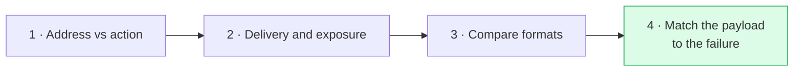

# Match the payload to the failure

**When an antibody-drug conjugate stops working, the next choice depends on why it failed. A new target is the logical next test for a delivery failure; a different payload, either a new class or one redesigned to evade the specific defense, is the logical next test for a payload failure. The evidence that switching payloads works comes mostly from laboratory models and small clinical series, so treat it as a hypothesis to test.**

**Before you start:**

- [Antibody-drug conjugate (ADC)](/wiki/education/concepts/therapeutics/antibody-based/antibody-drug-conjugate) — an antibody linked to a drug payload.
- [ADC payload classes](/wiki/education/concepts/therapeutics/antibody-based/adc-payload-classes) — payloads grouped by the cellular process they disrupt.
- [Topoisomerase I (TOP1) inhibitors](/wiki/education/concepts/therapeutics/chemotherapy/topoisomerase-i-inhibitors) — the payload class in today's breast cancer ADCs.
- [Drug efflux transporters](/wiki/education/concepts/therapeutics/how-drugs-work/drug-efflux-transporters) — membrane pumps that push drugs out of cells.

## Where this step sits

The earlier lessons separated the address from the action, followed delivery, and compared formats. This lesson asks the question that comes after a first targeted treatment stops working: **what should change next?**

## Three ways an ADC can stop working

An ADC must do three jobs in sequence. Each can fail on its own:

| Job | How it fails | What the failure points to |
|---|---|---|
| **Deliver**: bind, enter and release | Less target on the surface, slower uptake, payload stuck in the lysosome (release depends on [conjugation chemistry](/wiki/education/concepts/therapeutics/antibody-based/adc-conjugation-chemistry)) | A new target, or a format that enters better, such as a [bispecific ADC](/wiki/education/concepts/therapeutics/antibody-based/bispecific-adc) |
| **Act**: the payload reaches and harms its own target | The cell pumps the payload out, or the payload's target enzyme mutates | A different payload class, or a payload redesigned to evade the specific defense |
| **Kill**: the damage overwhelms the cell | The cell repairs the damage or tolerates it | A drug that blocks the repair, or a payload that kills another way |

The table explains [cross-resistance between ADCs](/wiki/education/concepts/therapeutics/antibody-based/adc-cross-resistance): two ADCs with different targets but the same payload class share the second and third jobs. If either was the problem, the new target may not help.

## The evidence behind this idea

In breast cancer, this was mostly inferred from shorter benefit on second ADCs. Two studies made it concrete for TOP1 payloads, one in the laboratory and one in a small patient cohort:

- Cell lines made resistant to trastuzumab deruxtecan or sacituzumab govitecan **kept their target proteins**. They resisted mainly by pumping the payload out. ADCs with a different payload class still worked in cells and mice [1].
- After progression on an ADC, 4 of 31 people with metastatic breast cancer had TOP1 mutations in plasma, three of them undetectable before treatment, compared with 3 of 420 never given an ADC [2].

Neither study tests a payload switch in patients, and neither tells a clinician what to give next. Together they show that **"the target is still there" does not mean the next ADC will work.** Prospective trials of switching payload class after a TOP1 ADC are still needed.

## Worked example: three fictional resistant tumors

A fictional TOP1 ADC aimed at protein M stopped working in three laboratory models. Researchers ran the same three tests on each.

| Test | Model A | Model B | Model C |
|---|---|---|---|
| Protein M on the cell surface | Lost | Present | Present |
| Free TOP1 payload kills the cells | Yes | No, even with a pump blocker | Yes, only with a pump blocker |
| Free microtubule payload kills the cells | Yes | Yes | Yes |

- **Model A** lost the address. The payload still works, so a TOP1 ADC aimed at a **different** target is reasonable to test.
- **Model B** kept the address but resists the payload itself. A new target carrying TOP1 would probably fail; a **different payload class** is the logical test.
- **Model C** resists through a pump. A TOP1 payload designed to evade that pump, or a payload the pump ignores, is the logical test. Check which pump first: MMAE, a common microtubule payload, is itself a substrate of P-glycoprotein.

Same failure on the surface, three different next steps.

## Sort the real breast-cancer ADCs the same way

The four ADCs on US labels for breast cancer target either trophoblast cell-surface antigen 2 (TROP2) or [human epidermal growth factor receptor 2 (HER2)](/wiki/education/concepts/breast-cancer/receptors-and-subtypes/her2). They fill three of the four boxes formed by target and payload class [4]:

| | TOP1 payload | Microtubule payload |
|---|---|---|
| **TROP2 target** | Sacituzumab govitecan (SN-38); datopotamab deruxtecan (DXd) | None approved |
| **HER2 target** | Trastuzumab deruxtecan (DXd) | Trastuzumab emtansine (DM1), HER2-positive disease only |

Read across a row to change the payload but keep the address; read down a column to change the address but keep the payload class. For triple-negative disease, every approved option sits in the TOP1 column. That is why a payload-level failure on one of them is the scenario this lesson is about, and why a different payload class for these patients is still a research question. Target level is a weak guide within a column; see [target expression versus ADC response](/wiki/education/concepts/therapeutics/antibody-based/target-expression-vs-adc-response).

## What can go wrong at this step

**The cause is usually unknown in patients.** Fresh tissue may not be available, and a blood test sees only some changes. Treat the framework as a way to ask better questions, not as a sorting rule.

**Different cells fail differently.** One tumor can contain cells that lost the target and cells that resist the payload; see [tumor heterogeneity](/wiki/education/concepts/cancer-biology/what-cancer-is/tumor-heterogeneity).

**Later treatments work for shorter periods anyway.** A shorter benefit on a second ADC does not by itself prove cross-resistance; see [line of therapy](/wiki/education/concepts/breast-cancer/treatment-setting/line-of-therapy).

**Switching payloads switches side effects.** A microtubule payload can bring nerve damage or eye toxicity; a TOP1 payload brings low blood counts and diarrhea and, for deruxtecan products, a lung-inflammation risk; see [ADC payload toxicities](/wiki/education/concepts/therapeutics/toxicities-and-supportive-care/adc-payload-toxicity).

**Laboratory restoration is not patient benefit.** A payload switch that works in resistant cell lines still needs clinical evidence in people previously treated with the same kind of ADC.

## Try it

A fictional trial reports that a new TOP1 ADC aimed at protein Q produced responses in 25% of patients "after prior ADC therapy." What do you need to know before deciding whether this helps someone whose cancer grew on a TOP1 ADC aimed at protein M?

**Possible answer:** which prior ADCs the patients received and their payload classes; how many had progressed on a TOP1 ADC specifically; how long those responses lasted compared with the same patients' prior benefit; whether protein Q was required for entry; and the side effects. A response rate among people who had a microtubule ADC first says little about TOP1 resistance.

## Explain it back

Complete: "Before choosing the next ADC, I would ask whether the last one failed at ______, because ______."

**One possible answer:** delivery, action or killing, because each failure points to a different change — a new target or format, a new payload class, or a repair-blocking partner — and changing the wrong part can repeat the failure.

## Takeaway

**Ask why the last ADC failed before choosing the next one: a new address may fix a delivery problem, but a payload problem calls for testing a payload the defense does not touch.**

**Next:** [Read a new payload strategy](/wiki/education/guides/aiming-a-drug-at-a-surface-target/05-read-a-new-payload-strategy), which applies this reasoning to the designs drug developers are testing now.

## Sources and scope

Source check: November 7, 2026. General reasoning with fictional laboratory models and two real breast cancer studies limited to their models and cohort; not a sequencing rule or treatment recommendation. Expert and learner review remain pending.

1. [Rampa et al., 2026](https://pubmed.ncbi.nlm.nih.gov/41591991/) — payload-specific, efflux-driven resistance to trastuzumab deruxtecan and sacituzumab govitecan, reversed by payload switching in breast cancer models.
2. [Abelman et al., 2025](https://pubmed.ncbi.nlm.nih.gov/39745368/) — TOP1 mutations and clinical cross-resistance after ADC progression in metastatic breast cancer.
3. [Drago, Modi and Chandarlapaty, 2021](https://pubmed.ncbi.nlm.nih.gov/33558752/) — ADC components, payload classes and resistance mechanisms.
4. US prescribing information (DailyMed), sections 1 and 11, checked November 7, 2026: [sacituzumab govitecan](https://dailymed.nlm.nih.gov/dailymed/drugInfo.cfm?setid=57a597d2-03f0-472e-b148-016d7169169d), [datopotamab deruxtecan](https://dailymed.nlm.nih.gov/dailymed/drugInfo.cfm?setid=2950227c-6230-4ca4-a135-46e44d9424a0), [trastuzumab deruxtecan](https://dailymed.nlm.nih.gov/dailymed/drugInfo.cfm?setid=7e67e73e-ddf4-4e4d-8b50-09d7514910b6), [trastuzumab emtansine](https://dailymed.nlm.nih.gov/dailymed/drugInfo.cfm?setid=23f3c1f4-0fc8-4804-a9e3-04cf25dd302e) — targets, payloads and breast-cancer indications.
