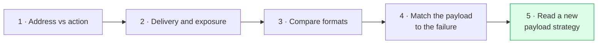
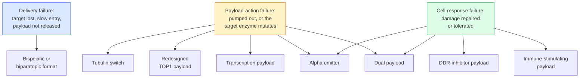

# Read a new payload strategy

**Every new antibody-drug conjugate design is a bet on one piece of cell biology. You can read any of them with four questions: what is the bet, which failure does it address, what could break it, and what evidence would settle it. Most of these strategies rest on laboratory and early human studies, so the honest reading is usually "plausible and untested," not "better."**

**Before you start:**

- [ADC payload classes](/wiki/education/concepts/therapeutics/antibody-based/adc-payload-classes) — payloads grouped by the cellular process they disrupt.
- [Cross-resistance between ADCs](/wiki/education/concepts/therapeutics/antibody-based/adc-cross-resistance) — the three-level frame this lesson uses.
- [Topoisomerase I (TOP1) inhibitors](/wiki/education/concepts/therapeutics/chemotherapy/topoisomerase-i-inhibitors) — the payload class in today's breast cancer ADCs.
- [Therapeutic index](/wiki/education/concepts/therapeutics/how-drugs-work/therapeutic-index) — the gap between an effective dose and a harmful one.

## Where this step sits

Lesson 4 asked which part of an [antibody-drug conjugate (ADC)](/wiki/education/concepts/therapeutics/antibody-based/antibody-drug-conjugate) failed. This lesson takes the next step: drug developers have proposed many answers at once, and you will meet them in press releases, conference abstracts and review articles. The skill here is not knowing which one wins. It is placing each one against a failure and saying what would prove it.

## The four questions

**1. What biological bet does it make?** Name the molecule or process the strategy exploits, and why putting the drug on an antibody helps more than giving the same drug by itself. If you cannot say what the drug does inside a cell, you are reading marketing.

**2. Which failure does it address?** Use the three levels from lesson 4: **delivery** (bind, enter, release), **payload action** (the freed drug reaches and harms its own target), **cell response** (the damage overwhelms the cell). A strategy that addresses delivery does nothing for a payload-action failure, and the reverse.

**3. What could break the bet?** Usually one of five things: the therapeutic window (the payload harms normal tissue at the dose that works), heterogeneity (only some cells in the tumor carry the vulnerability), the payload amount (an antibody can carry only a handful of molecules, so a weak drug may never reach a working concentration inside the cell), immune toxicity (for payloads that deliberately provoke inflammation), and misdiagnosis of the failure (the strategy fixes a problem this patient does not have).

**4. What evidence would settle it?** Write the single study. For most of these, it is a trial in people who have already progressed on a TOP1 ADC, reporting response and duration against a real comparator. Activity in a TOP1-naive population cannot test a post-TOP1 bet, however strong the result.

## Sort the strategies

Each row is one strategy, the failure it is aimed at, and the bet in a sentence. Read it as a map of claims, not a ranking.

| Strategy | Failure it addresses | The biological bet |
|---|---|---|
| [Tubulin payload switch](/wiki/education/concepts/therapeutics/antibody-based/adc-cross-resistance) | Payload action | A drug that blocks cell division is handled by different pumps and a different target enzyme, so TOP1-specific defenses do not apply |
| [Redesigned TOP1 payloads](/wiki/education/concepts/therapeutics/antibody-based/next-generation-top1-payloads) | Payload action | The mechanism still works; the molecule can be made more potent, a poorer pump substrate, and tuned for permeability |
| [Dual-payload ADCs](/wiki/education/concepts/therapeutics/antibody-based/dual-payload-adc) | Payload action and cell response | A cell that defends against one drug is unlikely to defend against both at once, if both can be delivered on one antibody |
| [DDR-inhibitor payloads](/wiki/education/concepts/therapeutics/antibody-based/ddr-inhibitor-payloads) | Cell response | The cell survives damage by repairing it; block the repair or the checkpoint and existing damage becomes lethal |
| [Transcription-inhibitor payloads](/wiki/education/concepts/therapeutics/antibody-based/transcription-inhibitor-payloads) | Payload action | Stopping the cell from reading its genes kills cells that are not dividing, which DNA-damage and tubulin payloads largely spare |
| [Immune-stimulating ADCs](/wiki/education/concepts/therapeutics/antibody-based/immune-stimulating-adc) | Cell response, plus the tumor environment | Delivering an innate-immune trigger into the tumor turns local killing into an immune response that outlives the drug |
| [Bispecific format, familiar payload](/wiki/education/concepts/therapeutics/antibody-based/bispecific-adc) | Delivery | Binding two targets, or two sites on one target, improves entry and release; the payload need not change at all |
| [Alpha-emitter radioconjugates](/wiki/education/concepts/therapeutics/antibody-based/radioligand-therapy) | Payload action and cell response | The radionuclide does not need to be taken into the cell or released inside it, is not pumped out, and its double-strand breaks are hard to repair |

Two things fall out of the table. First, the **bispecific row is the only one aimed at delivery**, and it is the only one that can keep an ordinary payload — which is why a design can look conservative and still be the furthest along. Second, **the rows aimed at the cell response are the only ones that escape payload chemistry altogether**, and they are also the ones whose safety is hardest to predict, because repair machinery and immune alarms exist in healthy tissue too.

*A strategy is only as useful as the match between the box on the left and the patient in front of you. In practice the left-hand box is rarely known.*

## Worked example: three fictional press releases

Three fictional companies describe an ADC aimed at protein M after failure of a TOP1 ADC. Apply the four questions.

| | Company A | Company B | Company C |
|---|---|---|---|
| Claim | "Novel payload with 100-fold greater potency than SN-38" | "First conjugate delivering a repair-blocking drug directly to tumor cells" | "Dual conjugate pairing a TOP1 inhibitor with a second mechanism" |
| Reported data | Cell-line panel; mouse xenograft regression | Cell-line panel; stronger effect in repair-deficient lines | Mouse models; activity in a line resistant to the TOP1 ADC alone |
| Patients treated | None | 6, dose escalation ongoing | None |

- **Company A.** Bet: more trapped damage per molecule delivered. Failure addressed: payload action, but only if the problem was insufficient payload — not if the cancer is pumping the drug out or carries an altered target enzyme. What could break it: the therapeutic window, since a 100-fold more potent molecule is also more potent in bone marrow. What would settle it: activity in models that are efflux-high or carry the resistance alleles, then human tolerability. The potency number alone answers nothing.
- **Company B.** Bet: the cell survives TOP1 damage by repairing it, so blocking repair converts survival into death. Failure addressed: cell response. What could break it: healthy dividing tissue also repairs damage, so the window may be narrow; and the effect may need a repair defect that must be measured in each patient. What would settle it: a dose that is tolerated, plus responses concentrated in the biomarker-defined group the bet predicts.
- **Company C.** Bet: two mechanisms on one antibody, so a single defense is not enough. Failure addressed: payload action and cell response together. What could break it: payload amount — an antibody carries a limited number of molecules, so splitting the load can leave both drugs below their working concentration; plus a combined toxicity. What would settle it: evidence that both payloads reach active levels inside the cell, and a comparison against each payload alone, not against no treatment.

Three different claims, three different missing studies. None of the three has shown benefit in a person previously treated with a TOP1 ADC.

## What can go wrong at this step

**Mistaking a format change for a mechanism change.** An ADC can be genuinely better engineered and still carry the same payload, which means the same payload-level resistance can apply.

**Accepting a response rate without the prior-treatment detail.** "After prior ADC" is not a population. Which ADC, which payload class, and how many progressed on a TOP1 payload specifically?

**Treating preclinical reversal as benefit.** Restoring activity in a resistant cell line is a hypothesis about patients; see [cross-resistance between ADCs](/wiki/education/concepts/therapeutics/antibody-based/adc-cross-resistance).

**Forgetting the toxicity swap.** Every strategy in the table trades one side-effect profile for another; see [ADC payload toxicities](/wiki/education/concepts/therapeutics/toxicities-and-supportive-care/adc-payload-toxicity).

**Assuming the whole tumor shares one weakness.** [Tumor heterogeneity](/wiki/education/concepts/cancer-biology/what-cancer-is/tumor-heterogeneity) means a strategy can work on most cells and still fail the patient.

## Try it

A fictional sponsor reports that its conjugate, which delivers a drug blocking the cell's damage checkpoint, produced tumor shrinkage in 4 of 18 patients. Which three things do you most want to know before calling this promising?

**Possible answer:** (1) whether the responders share a measurable repair or checkpoint defect, which is what the bet predicts — if responses are scattered, the mechanism is not doing the work claimed; (2) the dose-limiting toxicity and whether a tolerated dose delivers enough payload, since repair machinery is active in healthy dividing tissue; (3) the prior-treatment detail, specifically how many had progressed on a TOP1 ADC, because that is the failure this design is meant to address. A fourth: whether the free drug given on its own at a tolerated dose would have done the same, which is what the antibody is supposed to improve on.

## Explain it back

Complete: "This strategy bets that ______, which would address a failure of ______; it would fail if ______, and I would believe it after ______."

**One possible answer:** that blocking DNA repair makes existing damage lethal, which would address a cell-response failure; it would fail if healthy dividing tissue is harmed at the same dose, and I would believe it after a tolerated dose produced durable responses concentrated in patients with a measured repair defect.

## Takeaway

**Read every new payload strategy as a bet on one piece of cell biology, matched to one kind of failure, with one study that would settle it — and notice that almost none of them have run that study yet.**

**Next:** [the plain-language review of new ADC payloads](/wiki/research/reviews/2026-11-new-adc-payloads-short-version), which walks the same strategies program by program with their current evidence.

## Sources and scope

Source check: November 7, 2026. A reasoning framework with fictional examples, built on the three-level resistance frame and the concept pages linked above; the evidence for the individual strategies lives on those pages and in the review linked under "Next." Not a sequencing rule or treatment recommendation. Expert and learner review remain pending.

These three sources support the framework as a whole rather than single claims.

1. [Rampa et al., 2026](https://pubmed.ncbi.nlm.nih.gov/41591991/) — payload-specific, efflux-driven resistance in breast cancer models, with activity restored by switching payload class.
2. [Abelman et al., 2025](https://pubmed.ncbi.nlm.nih.gov/39745368/) — TOP1 mutations and clinical cross-resistance after ADC progression in metastatic breast cancer, with payload design named as an area needing optimization.
3. [Drago, Modi and Chandarlapaty, 2021](https://pubmed.ncbi.nlm.nih.gov/33558752/) — ADC components, payload classes and resistance mechanisms across delivery, processing and payload.
