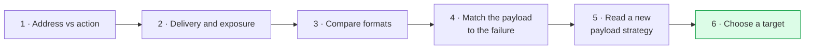

# Choose a target worth aiming at

**A surface protein becomes a usable address only if there is enough of it, it is scarce on the tissues you cannot afford to damage, it behaves the way the chosen format needs, and it is spread evenly enough through the tumor. No single number settles it, and a target that suits one format can be wrong for another.**

**Before you start:**

- [Immunohistochemistry](/wiki/education/concepts/measurement/pathology-readouts/immunohistochemistry) — the stain that reports how much of a protein a tissue sample carries.
- [Target expression versus ADC response](/wiki/education/concepts/therapeutics/antibody-based/target-expression-vs-adc-response) — why that number predicts benefit only weakly.
- [Tumor heterogeneity](/wiki/education/concepts/cancer-biology/what-cancer-is/tumor-heterogeneity) — why one biopsy may not describe the whole tumor.
- [On-target, off-tumor toxicity](/wiki/education/concepts/therapeutics/toxicities-and-supportive-care/on-target-off-tumor-toxicity) — correct recognition in the wrong tissue.

## Where this step sits

The first five lessons took the target as given and asked what a product does with it. This step goes back to the beginning: how is the address chosen in the first place, and why do the same reports keep naming the same handful of proteins?

## The four questions

**1. How much of it is there?** An antibody-drug conjugate (ADC) delivers only a handful of payload molecules per antibody, so the number of target copies per cell sets a ceiling on the dose a cell can receive. "Positive" on a stain is not a quantity: scoring systems such as the H-score combine intensity with the percentage of cells stained, and the fraction of tumors called "high" shifts with the antibody and the cutoff. In triple-negative breast cancer, almost every tumor carries some membrane TROP-2 — 225 of 228 in one nonmetastatic series — yet the proportion scoring above an H-score of 200 was 58.8% in that series and 16.5% of 589 tumors in another [1, 2]. Same protein, same disease, very different "prevalence."

**2. Where else does it appear?** This is usually the hard constraint. A survey of the targets of ADCs then in clinical development found a surprisingly broad range of normal-tissue expression and no set of parameters that defined an optimal target [3]. TROP-2 illustrates the problem: it is overexpressed on some carcinomas, but it is also highly expressed in several essential normal tissues at both the transcript and protein level, which is why its developers had to design around normal-tissue toxicity rather than assume it away [4]. Nectin-4 illustrates the opposite: in one series, membrane expression was found in 62% of 61 triple-negative tumors and was not detected in adult healthy tissues, including normal breast [5].

**3. Does the format's mechanism work on this protein?** Formats make different demands, which is why one target can suit one and not another:

| The format needs | Why | Consequence for target choice |
|---|---|---|
| **An ADC: internalization and release** | The payload has to get inside and be freed; sacituzumab govitecan binds TROP-2, is internalized, and releases SN-38 by hydrolysis of its linker [6] | A protein that sits on the surface without being taken in is a poor ADC target, however abundant |
| **A radioligand: binding and retention; internalization optional** | Radiation acts from where the decay happens, so the ligand need not get inside; see [radioligand therapy](/wiki/education/concepts/therapeutics/antibody-based/radioligand-therapy) | Non-internalizing and vascular targets stay usable |
| **A T-cell engager: density and geometry** | Two cells must be held close enough to form a killing contact; see [T-cell engagers](/wiki/education/concepts/therapeutics/antibody-based/t-cell-engager) | Very low density can be too little to trigger the T cell, while the same low density can suffice for a potent payload |

The same logic explains why the payload can decide whether a target is even reachable. In preclinical work on B7-H3, which appears on both tumor cells and tumor blood vessels, conjugates carrying a microtubule payload killed B7-H3-positive cancer cells but left the vasculature intact, whereas conjugates carrying a DNA-crosslinking payload killed both compartments and eradicated large established tumors [7]. The target had not changed; the cargo had.

**4. How evenly is it spread?** A tumor is a mosaic, and a target present on most cells is not present on all. Two design answers exist, and both have limits: a payload that crosses membranes can kill target-negative neighbors (the bystander effect), and a [bispecific ADC](/wiki/education/concepts/therapeutics/antibody-based/bispecific-adc) can bind two addresses at once. Neither removes the need to know what fraction of cells carries the target, or the fact that a single core from one site at one time may not represent the rest; see [tumor heterogeneity](/wiki/education/concepts/cancer-biology/what-cancer-is/tumor-heterogeneity).

## The real candidates in triple-negative breast cancer

| Target | How common | Normal-tissue note | Where it stands |
|---|---|---|---|
| **TROP-2** (TACSTD2) | Some membrane staining in nearly all tumors (225 of 228); "high" 16.5–58.8% depending on antibody and cutoff [1, 2] | Also expressed in several essential normal tissues [4] | Two approved ADCs; no target test required for those labels [6] |
| **HER2-low** | 34% of hormone-receptor-negative tumors (395 of 1,162) in four pooled neoadjuvant trials [8] | HER2 is also present on normal tissue, including the heart: the label requires measuring heart function before and during treatment [12] | An approved ADC indication; eligibility rests on an authorized HER2 test; see [HER2](/wiki/education/concepts/breast-cancer/receptors-and-subtypes/her2) |
| **Nectin-4** | Membrane staining in 62% of 61 tumors [5] | Not detected in adult healthy tissues in that series, including breast [5]; but the approved Nectin-4 ADC carries a boxed warning for severe skin reactions [13], and other surveys report weak staining in skin and other epithelium, so "absent" depends on the assay | The Nectin-4 ADC enfortumab vedotin is approved in urothelial cancer; in the EV-202 breast study, 42 people with triple-negative disease had a 19.0% confirmed response rate, below the study's threshold [9] |
| **B7-H3** (CD276) | Described as broadly overexpressed across tumor types, on cancer cells and on tumor-infiltrating blood vessels; no verified triple-negative prevalence figure is used here [7] | Reported as a dual-compartment tumor target in that work; a breast-specific normal-tissue survey is not cited here | ADCs and imaging agents in clinical trials, including phase 3 ADC trials in small-cell lung, prostate and esophageal cancer [14]; no breast-cancer approval |
| **LIV-1** (SLC39A6) | A zinc transporter known in estrogen-receptor-positive disease, retained after hormonal therapy and upregulated in triple-negative tumors [10] | Also expressed by melanoma, prostate, ovarian and uterine cancer; no normal-tissue figure is cited here [10] | The LIV-1 ADC ladiratuzumab vedotin went into breast-cancer trials that have since completed; no approval [10, 11] |

Read the table as four separate columns, not one ranking. TROP-2 wins on how many tumors carry it; Nectin-4 looks better on normal tissue but lost on clinical activity in breast cancer; B7-H3 offers a second compartment that only some payloads can exploit.

## What can go wrong at this step

**"Expressed in 90%" can be a scoring choice.** Ask which antibody, which cutoff and which population produced the number.

**A clean normal-tissue stain is not a safety claim.** Expression surveys use fixed tissue and a research antibody. The product's own distribution and exposure decide where harm lands.

**Abundance can be mistaken for dependence.** A delivery address need not be a protein the tumor needs; see lesson 1.

**One target can carry several drugs that fail for the same reason.** If two ADCs against different targets share a payload class, a payload-level problem follows the patient; see [cross-resistance between ADCs](/wiki/education/concepts/therapeutics/antibody-based/adc-cross-resistance).

## Try it

A report proposes a new ADC against a protein found on 85% of triple-negative tumors by a research stain, with "minimal expression in normal tissue." What four things do you want to know before treating that as a promising address?

**Possible answer:** (1) what "85%" means — which antibody, cutoff and cohort, and how many cells per tumor; (2) which normal tissues were tested and by what method, since a research stain on fixed tissue is not a distribution study of the finished product; (3) whether the protein is internalized, because an ADC needs that and a radioligand does not; (4) which payload is attached, because the payload decides what the target's distribution is worth and which side effects to expect.

## Explain it back

Complete: "A good target needs enough ______, little ______, behavior that matches the ______, and an even enough ______."

**One possible answer:** copies per cell; expression on tissues you cannot afford to damage; format's mechanism, such as internalization for an ADC; distribution across the tumor.

## Takeaway

**Choose a target by quantity, normal-tissue expression, format fit and evenness together; a single prevalence figure describes a stain, not an opportunity.**

**Next:** return to [the guide map](/wiki/education/guides/aiming-a-drug-at-a-surface-target/index), or continue to [judge a test or company claim](/wiki/education/guides/judging-a-test-or-vendor-claim/index) for the evidence behind a proposed assay.

## Sources and scope

Source check: November 8, 2026. Target-selection principles, prevalence figures with their populations, and preclinical mechanism work; trial results are limited to the populations studied. No target below is recommended for any person, and current eligibility belongs to [the ADC therapies page](/wiki/treatment/therapeutics/adc-therapies). Expert and learner review remain pending.

1. [Jacot and colleagues, 2025](https://pubmed.ncbi.nlm.nih.gov/40059728/) — TROP-2 by H-score in 228 nonmetastatic triple-negative tumors: low, moderate and strong in 12.3%, 28.9% and 58.8%; only 3 tumors with no staining.
2. [Izci and colleagues, 2022](https://pubmed.ncbi.nlm.nih.gov/36577919/) — TROP-2 high, medium and low in 16.5%, 25.3% and 58.2% of 589 scored triple-negative tumors.
3. [Damelin and colleagues, 2015](https://pubmed.ncbi.nlm.nih.gov/25585957/) — survey of tumor and normal-tissue expression for ADC targets in clinical development; no optimal parameters identified.
4. [Stepan and colleagues, 2011](https://pubmed.ncbi.nlm.nih.gov/21551320/) — TROP-2 expression across normal and tumor tissues, including high expression in several essential normal tissues.
5. [M-Rabet and colleagues, 2017](https://pubmed.ncbi.nlm.nih.gov/27998973/) — Nectin-4 membrane expression in 62% of 61 triple-negative tumors, not detected in adult healthy tissues; an MMAE conjugate active in patient-derived models.
6. [Sacituzumab govitecan prescribing information, sections 1 and 12.1](https://dailymed.nlm.nih.gov/dailymed/drugInfo.cfm?setid=57a597d2-03f0-472e-b148-016d7169169d) — TROP-2 binding, internalization and SN-38 release; indications without a target test.
7. [Seaman and colleagues, 2017](https://pubmed.ncbi.nlm.nih.gov/28399408/) — B7-H3 on cancer cells and tumor-infiltrating vessels; MMAE conjugates spared the vasculature while pyrrolobenzodiazepine conjugates killed both compartments in mouse models.
8. [Denkert and colleagues, 2021](https://pubmed.ncbi.nlm.nih.gov/34252375/) — pooled analysis of 2,310 HER2-non-amplified tumors from four neoadjuvant trials; 395 of 1,162 hormone-receptor-negative tumors were HER2-low.
9. [EV-202 breast cancer study, 2025](https://doi.org/10.1200/OA-25-00053) — enfortumab vedotin in 42 people with locally advanced or metastatic triple-negative breast cancer: confirmed response rate 19.0%, disease control 57.1%.
10. [Sussman and colleagues, 2014](https://pubmed.ncbi.nlm.nih.gov/25253783/) — LIV-1 as an ADC target: upregulation in triple-negative breast cancer, internalization and lysosomal trafficking of the MMAE conjugate.
11. ClinicalTrials.gov records for ladiratuzumab vedotin, read November 8, 2026: [the first-in-human breast cancer study](https://clinicaltrials.gov/study/NCT01969643) (completed) and [the triple-negative combination with pembrolizumab](https://clinicaltrials.gov/study/NCT03310957) (completed).
12. [Trastuzumab deruxtecan prescribing information, sections 2.3 and 5.3](https://dailymed.nlm.nih.gov/dailymed/drugInfo.cfm?setid=7e67e73e-ddf4-4e4d-8b50-09d7514910b6) — left ventricular ejection fraction measured before and during treatment, with dose rules by the size of the fall.
13. [Enfortumab vedotin prescribing information, boxed warning](https://dailymed.nlm.nih.gov/dailymed/drugInfo.cfm?setid=b5631d3e-4604-4363-8f20-11dfc5a4a8ed) — severe and fatal cutaneous adverse reactions, read November 8, 2026.
14. ClinicalTrials.gov phase 3 records for the B7-H3 ADC ifinatamab deruxtecan, read November 7, 2026: [small-cell lung cancer](https://clinicaltrials.gov/study/NCT06203210), [prostate cancer](https://clinicaltrials.gov/study/NCT06925737) and [esophageal squamous cell cancer](https://clinicaltrials.gov/study/NCT06644781), all recruiting.
