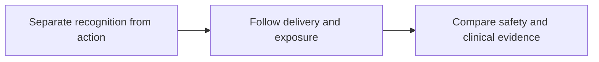

# Aiming a drug at a surface target

**Explain how a targeted product connects recognition to action, and assess the delivery, safety, and clinical evidence that the claim still needs.**

When a report names a protein on a tumor cell, the next question is often, “Can we aim a treatment at it?” This guide helps you follow that question carefully. You will compare recognition systems, chemical cargo, recruited T cells, radiation, and living engineered cells without needing to memorize a drug catalog.

The core path takes about 44 minutes. Start with [antibody structure](/wiki/education/concepts/immunology/antibodies-and-b-cells/antibody-structure) if the distinction between binding and other antibody functions is new. [Chemotherapy](/wiki/education/concepts/therapeutics/chemotherapy/chemotherapy) introduces chemical damage before you meet antibody-linked payloads.

## The big ideas

1. A surface protein can be an address without being a process the tumor depends on.
2. Binding, delivery, processing, activation, and killing are separate measurements.
3. The recognition route determines whether a particular peptide displayed by [human leukocyte antigen (HLA)](/wiki/education/concepts/immunology/antigen-presentation/hla) is required.
4. The same target can create different risks when paired with different therapeutic actions and exposures.
5. Clinical benefit belongs to a defined product, population, setting, and comparison.

## The map

## Lessons

| Step | Lesson | The question it answers | Minutes | Learning aid |
|---|---|---|---|---|
| 1 | [Separate the address from the killing mechanism](/wiki/education/targeted-therapy-modalities/01-mechanism) | What is recognized, and what can happen next? | 14 | A format map and fictional target M |
| 2 | [Follow delivery, exposure, and the treatment clock](/wiki/education/targeted-therapy-modalities/02-timing) | Which forms of the product reaches which place over time? | 14 | A delivery chain and two contrasting models |
| 3 | [Compare formats with evidence and normal-tissue risk](/wiki/education/targeted-therapy-modalities/06-comparisons) | What bottleneck, safety question, and evidence fit the proposed use? | 16 | Three fictional evidence cards |

## Concepts you will use

For recognition, use [antibody structure](/wiki/education/concepts/immunology/antibodies-and-b-cells/antibody-structure), [the T-cell receptor (TCR)](/wiki/education/concepts/immunology/t-cells/t-cell-receptor), and [human leukocyte antigen (HLA)](/wiki/education/concepts/immunology/antigen-presentation/hla). An exposed part of an intact surface protein and a peptide–HLA complex are different targets, even though both can be encountered at the surface.

For action, use [chemotherapy](/wiki/education/concepts/therapeutics/chemotherapy/chemotherapy), [antibody-drug conjugates (ADCs)](/wiki/education/concepts/therapeutics/antibody-based/antibody-drug-conjugate), and [T-cell engagers](/wiki/education/concepts/therapeutics/antibody-based/t-cell-engager). [CAR (chimeric antigen receptor) anatomy](/wiki/education/concepts/therapeutics/cell-therapies/car-anatomy) introduces the living-cell comparison.

For evidence and risk, use [immunohistochemistry](/wiki/education/concepts/measurement/pathology-readouts/immunohistochemistry), [tumor heterogeneity](/wiki/education/concepts/cancer-biology/what-cancer-is/tumor-heterogeneity), [on-target, off-tumor toxicity](/wiki/education/concepts/therapeutics/toxicities-and-supportive-care/on-target-off-tumor-toxicity), and [clinical actionability](/wiki/education/concepts/evidence-and-statistics/biomarkers/actionability).

## Build an evidence ledger

Carry one fictional target through all three lessons. For every proposed product, write the observation, the conclusion it supports, the next unresolved question, and the measurement that could answer it.

For example, a tissue stain can support a protein signal. Live-cell testing can add target-associated binding. A delivery assay can add processing information. A functional assay can add activity in its model. A clinical comparison asks about outcomes in people. The ledger helps you preserve useful evidence while keeping each inference within its limits.

If your starting point is a gene alteration rather than a surface measurement, begin with [From a variant to a drug claim](/wiki/education/guides/from-variant-to-drug/index). For deeper cell behavior, continue to [engineered cell therapy](/wiki/education/guides/engineered-cell-therapy/index). [Experimental therapy access](/wiki/education/guides/accessing-experimental-therapy/index) covers practical access gates after the evidence question is clear.

## Applied to Diana

[The molecular profile](/wiki/care/molecular-profile) owns qualified findings. [The treatment plan](/wiki/care/treatment-plan) and [the postoperative treatment question](/wiki/questions/adjuvant-treatment) own care application and unresolved decisions. Use those pages for application; the fictional teaching examples here do not describe Diana's tumor or treatment status.

## What is still uncertain

A target can be unevenly distributed or inaccessible in a living tumor. A model can omit immune cells, normal tissues, or realistic exposure. A product can produce measurable activity while its clinical benefit remains unknown in the intended setting. Each uncertainty belongs beside the claim it limits.

Source check: October 9, 2026. General education; expert and learner review remain pending. The lessons cite primary experiments and authoritative mechanism sources. Dated clinical examples illustrate evidence scope and need a fresh check for a real decision.
