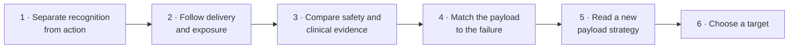

# Aiming a drug at a surface target

**Explain how antibodies, antibody-drug conjugates, engagers and radioligands find and kill tumor cells, which breast-cancer targets and payloads matter, and what evidence a claim still needs.**

When a report names a protein on a tumor cell, the next question is often, “Can we aim a treatment at it?” A promising address is a useful beginning, but it can support several product ideas, and an antibody, a chemical payload, a recruited T cell, a radionuclide or an engineered receptor each brings a different action and a different set of requirements. This guide follows that question through recognition, delivery, evidence, payload choice and target choice. The anchor examples are the antibody-drug conjugates (ADCs) used in breast cancer: sacituzumab govitecan, trastuzumab deruxtecan and datopotamab deruxtecan.

The core path takes about 86 minutes. Start with [antibody structure](/wiki/education/concepts/immunology/antibodies-and-b-cells/antibody-structure) if the distinction between binding and other antibody functions is new. [Chemotherapy](/wiki/education/concepts/therapeutics/chemotherapy/chemotherapy) introduces chemical damage before you meet antibody-linked payloads.

## The big ideas

1. A surface protein can be an address without being a process the tumor depends on.
2. Binding, delivery, processing, activation, and killing are separate measurements.
3. The recognition route determines whether a particular peptide displayed by [human leukocyte antigen (HLA)](/wiki/education/concepts/immunology/antigen-presentation/hla) is required.
4. The same target can create different risks when paired with different therapeutic actions and exposures.
5. Clinical benefit belongs to a defined product, population, setting, and comparison.
6. When a targeted drug stops working, find which part failed before changing the target; a new address does not fix a payload problem.
7. Every new payload strategy is a biological bet about how tumor cells survive; judge it by the failure it addresses and the evidence that would settle it.
8. A target earns its place on four separate counts: how much of it there is, where else it appears, whether the chosen format's mechanism works on it, and how evenly it is spread.

## The map

*Each numbered box is the lesson of the same number in the table below.*

## Lessons

| Step | Lesson | The question it answers | Minutes | Learning aid |
|---|---|---|---|---|
| 1 | [Separate the address from the killing mechanism](/wiki/education/guides/aiming-a-drug-at-a-surface-target/01-mechanism) | What is recognized, and how does each format actually kill? | 14 | A table of five formats with a real drug for each |
| 2 | [Follow delivery, exposure, and the treatment clock](/wiki/education/guides/aiming-a-drug-at-a-surface-target/02-timing) | Which forms of the product reach which place over time? | 14 | A delivery chain and the labeled half-lives of three ADCs |
| 3 | [Compare formats with evidence and normal-tissue risk](/wiki/education/guides/aiming-a-drug-at-a-surface-target/03-comparisons) | What bottleneck, safety question, and evidence fit the proposed use? | 16 | Three randomized breast-cancer trials read for scope |
| 4 | [Match the payload to the failure](/wiki/education/guides/aiming-a-drug-at-a-surface-target/04-match-the-payload-to-the-failure) | After one ADC stops working, what should change next? | 14 | Three resistant tumor models and a grid of the approved breast-cancer ADCs |
| 5 | [Read a new payload strategy](/wiki/education/guides/aiming-a-drug-at-a-surface-target/05-read-a-new-payload-strategy) | What biological bet does a new payload make, and what would show it works? | 14 | A strategy map and three invented press releases |
| 6 | [Choose a target worth aiming at](/wiki/education/guides/aiming-a-drug-at-a-surface-target/06-choose-a-target) | What makes a surface protein a usable address in the first place? | 14 | Four selection questions and the real TNBC candidates compared |

## Supporting topics

For a proposal with several workstreams, continue to [sequence the work](/wiki/education/guides/accessing-experimental-therapy/05-sequence-the-work), [ask the questions a therapy format demands](/wiki/education/guides/judging-a-test-or-vendor-claim/04-ask-product-specific-questions), and [tissue and sample requirements](/wiki/education/guides/local-therapy-and-the-immune-system/05-tissue-and-sample-budget). Their worksheets address research planning, evidence and specimen use rather than treatment choice, and they are additional to the core path.

## Concepts you will use

For recognition, use [antibody structure](/wiki/education/concepts/immunology/antibodies-and-b-cells/antibody-structure), [the T-cell receptor (TCR)](/wiki/education/concepts/immunology/t-cells/t-cell-receptor), [human leukocyte antigen (HLA)](/wiki/education/concepts/immunology/antigen-presentation/hla) and [the epitope](/wiki/education/concepts/immunology/antigen-presentation/antigen-and-epitope). An exposed part of an intact surface protein and a peptide–HLA complex are different targets, even though both can be encountered at the surface.

For the distinction, use [target versus therapeutic format](/wiki/education/concepts/therapeutics/antibody-based/target-vs-chassis). For action, use [chemotherapy](/wiki/education/concepts/therapeutics/chemotherapy/chemotherapy), [monoclonal antibodies](/wiki/education/concepts/therapeutics/antibody-based/monoclonal-antibodies) with the [effector mechanisms](/wiki/education/concepts/immunology/antibodies-and-b-cells/adcc-adcp-cdc) they recruit, [antibody-drug conjugates (ADCs)](/wiki/education/concepts/therapeutics/antibody-based/antibody-drug-conjugate), and [T-cell engagers](/wiki/education/concepts/therapeutics/antibody-based/t-cell-engager). For what an ADC carries and why it fails, use [ADC payload classes](/wiki/education/concepts/therapeutics/antibody-based/adc-payload-classes), [topoisomerase I inhibitors](/wiki/education/concepts/therapeutics/chemotherapy/topoisomerase-i-inhibitors), [drug efflux transporters](/wiki/education/concepts/therapeutics/how-drugs-work/drug-efflux-transporters), [cross-resistance between ADCs](/wiki/education/concepts/therapeutics/antibody-based/adc-cross-resistance) and [bispecific ADCs](/wiki/education/concepts/therapeutics/antibody-based/bispecific-adc). For how the payload is attached and what it costs, use [ADC conjugation chemistry](/wiki/education/concepts/therapeutics/antibody-based/adc-conjugation-chemistry) and [ADC payload toxicities](/wiki/education/concepts/therapeutics/toxicities-and-supportive-care/adc-payload-toxicity). For radiation, use [radioligand therapy](/wiki/education/concepts/therapeutics/antibody-based/radioligand-therapy) and [ADC versus radioligand therapy](/wiki/education/concepts/therapeutics/antibody-based/adc-vs-radioligand-therapy). [CAR (chimeric antigen receptor) anatomy](/wiki/education/concepts/therapeutics/cell-therapies/car-anatomy) introduces the living-cell comparison.

For the newer payload strategies in lesson 5, use [next-generation TOP1 payloads](/wiki/education/concepts/therapeutics/antibody-based/next-generation-top1-payloads), [dual-payload ADCs](/wiki/education/concepts/therapeutics/antibody-based/dual-payload-adc), [DNA-damage-response inhibitor payloads](/wiki/education/concepts/therapeutics/antibody-based/ddr-inhibitor-payloads), [transcription-inhibitor payloads](/wiki/education/concepts/therapeutics/antibody-based/transcription-inhibitor-payloads) and [immune-stimulating ADCs](/wiki/education/concepts/therapeutics/antibody-based/immune-stimulating-adc).

For choosing and judging a target in lesson 6, use [human epidermal growth factor receptor 2 (HER2)](/wiki/education/concepts/breast-cancer/receptors-and-subtypes/her2), [target expression versus ADC response](/wiki/education/concepts/therapeutics/antibody-based/target-expression-vs-adc-response), [immunohistochemistry](/wiki/education/concepts/measurement/pathology-readouts/immunohistochemistry), [tumor heterogeneity](/wiki/education/concepts/cancer-biology/what-cancer-is/tumor-heterogeneity), [on-target, off-tumor toxicity](/wiki/education/concepts/therapeutics/toxicities-and-supportive-care/on-target-off-tumor-toxicity) and [companion diagnostics](/wiki/education/concepts/access-and-regulation/approval/companion-diagnostics).

For evidence and risk overall, use [therapeutic index](/wiki/education/concepts/therapeutics/how-drugs-work/therapeutic-index), [pharmacokinetics and half-life](/wiki/education/concepts/therapeutics/how-drugs-work/pharmacokinetics-and-half-life), [cytokine release syndrome](/wiki/education/concepts/therapeutics/toxicities-and-supportive-care/cytokine-release-syndrome) and [clinical actionability](/wiki/education/concepts/evidence-and-statistics/biomarkers/actionability).

## Build an evidence ledger

Carry one target through the whole path. For every proposed product, write the observation, the conclusion it supports, the next unresolved question, and the measurement that could answer it.

For example, a tissue stain can support a protein signal. Live-cell testing can add target-associated binding. A delivery assay can add processing information. A functional assay can add activity in its model. A clinical comparison asks about outcomes in people. The ledger helps you preserve useful evidence while keeping each inference within its limits.

If your starting point is a gene alteration rather than a surface measurement, begin with [From a variant to a drug claim](/wiki/education/guides/from-variant-to-drug/index). For deeper cell behavior, continue to [engineered cell therapy](/wiki/education/guides/engineered-cell-therapy/index). [Experimental therapy access](/wiki/education/guides/accessing-experimental-therapy/index) covers practical access gates after the evidence question is clear.

## Applied to Diana

[The molecular profile](/wiki/care/molecular-profile) owns qualified findings. [The treatment plan](/wiki/care/treatment-plan) and [the postoperative treatment question](/wiki/questions/adjuvant-treatment) own care application and unresolved decisions. Use those pages for application; the fictional teaching examples here do not describe Diana's tumor or treatment status.

## What is still uncertain

A target can be unevenly distributed or inaccessible in a living tumor. A model can omit immune cells, normal tissues, or realistic exposure. A product can produce measurable activity while its clinical benefit remains unknown in the intended setting. Each uncertainty belongs beside the claim it limits.

Source check: November 8, 2026. General education; expert and learner review remain pending. The lessons cite primary experiments, product labels and authoritative mechanism sources. Dated clinical examples illustrate evidence scope and need a fresh check for a real decision.

This landing page replaces the former "targeted therapy mechanisms and comparisons" index, which pointed at the same lessons.
