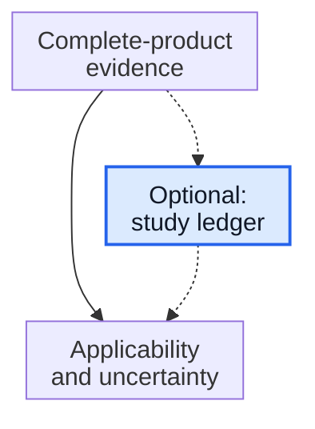

# Read a research-product study without losing the denominator

**A research result belongs to an exact product, study population and assessment rule. Recover those details before turning a percentage into a claim.**

**Before you start:** [Trial phases and randomization](/wiki/education/concepts/evidence-and-statistics/study-design/trial-phases-and-randomization) separates a study's purpose from its comparison. [Response rates](/wiki/education/concepts/evidence-and-statistics/endpoints/response-rates) explains what counts in the numerator. [Ex vivo versus in vivo engineering](/wiki/education/concepts/engineering-and-manufacturing/cell-manufacturing/ex-vivo-vs-in-vivo-engineering) identifies where instructions enter cells.

## Where this step sits

This is optional practice after the [complete-product evidence packet](/wiki/education/cellular-therapies/09-reading-cell-therapy-evidence), within the [engineered-cell guide](/wiki/education/guides/engineered-cell-therapy/index). Its published example adds source-reading practice to the fictional laboratory exercises. The task is to explain a report, rather than select a treatment.

*The solid path continues to applicability; the dashed branch visits the highlighted optional study ledger. Use the lesson links below the diagram to navigate. This is a learning route, not a treatment sequence or an added requirement in the nine-step reading budget.*

**Lesson links:**

- [Complete-product evidence lesson](/wiki/education/cellular-therapies/09-reading-cell-therapy-evidence)
- [Optional study-ledger lesson (this page)](/wiki/education/guides/engineered-cell-therapy/10-read-a-research-product-study)
- [Applicability and uncertainty lesson](/wiki/education/guides/reading-cancer-evidence/03-check-applicability-and-uncertainty)

## The intuition: recover the missing labels

A headline often keeps the result and drops its labels. Build a small ledger before judging it. What entered the body? Which participants entered each analysis? What counted as a response? Which reviewer applied the rule? What date ends the observations? Finally, what comparison can the study support?

Those questions travel well across products. Their answers do not. Two studies can use the same percentage while studying different diseases, follow-up periods and interventions. Preserve the ledger when you paraphrase the report; a technically correct number can become misleading after its definition disappears.

## Mechanism: follow the product, then follow the participants

Keep administered cells, the engineered receptor and its recognition feature separate. A family name cannot identify every design. Then follow participants from the study's entry definition through treatment and assessment. Write down exclusions before calculating any fraction. A participant missing an assessment is still part of the study's history.

Confirmation is another column, not a synonym for a first qualifying result. Keep the paper's rules attached. A response measurement also differs from a duration, survival or quality-of-life measurement. Changing the endpoint changes the question, even when the same participants supply the observations.

## Worked example: a dated research report

The 2023 gavo-cel report describes single-arm phase 1 dose escalation within a phase 1/2 study (cutoff: September 9, 2022). Safety and dose selection were primary. Gavo-cel comprises autologous T cells engineered ex vivo with an antibody–cluster of differentiation 3 epsilon (CD3ε) fusion recognizing surface mesothelin independently of [human leukocyte antigen (HLA)](/wiki/education/concepts/immunology/antigen-presentation/hla). The treated cancers were mesothelioma, ovarian cancer and cholangiocarcinoma. [Primary report](https://www.nature.com/articles/s41591-023-02452-y).

| Ledger field | Paper-defined observation |
|---|---|
| Intent-to-treat population | 48 consented and apheresed intending phase 1 treatment |
| Treated / response-evaluable | 32 / 30 |
| Blinded independent central review | 6 responses; 4 confirmed partial responses |
| Missing response assessments | Two grade 5 (fatal) adverse events before post-infusion imaging |

These paper-defined rows describe a historical analysis with no randomized concurrent clinical comparison. [Primary report](https://www.nature.com/articles/s41591-023-02452-y).

## What can go wrong at this step

Silently replacing an entry population with an evaluable subgroup loses information about what happened before assessment. Silently changing “response” to “confirmed response” changes the numerator. Treat both as explicit editorial decisions requiring a label.

Likewise, a toxicity grade and causal attribution answer different questions. Missing assessments should prompt reading the safety record, not an assumption that absent scans imply absent harm. This exercise does not reconstruct individual events or determine their causes.

## Try it

**1. Rebuild the rates from the ledger. Which population does each use?**

**One answer:** 6/30 = 20% among response-evaluable participants; 6/48 = 12.5% using the paper's intent-to-treat definition. Confirmed partial responses give 4/30 ≈ 13.3%, rounded to 13% in the report. Keep all three labels attached.

**2. A summary mentions only people with evaluable scans. What question should you restore?**

**One answer:** What happened to the treated participants without those scans, and how were they represented in safety reporting? Response-evaluable and treated populations answer different questions. Missing response data cannot settle safety or causality.

**3. Does “T-cell receptor fusion” automatically imply a conventional peptide–HLA recognition requirement?**

**One answer:** No. Read the actual fusion and its recognition route. Architecture vocabulary cannot substitute for the product description.

**4. A reader calls the percentage proof of superior benefit in another cancer. What evidence is missing?**

**One answer:** A suitable comparison and evidence in that disease and setting. Early activity supports further investigation; it cannot supply a comparative benefit estimate by itself. Mechanistic plausibility is a separate question.

## Explain it back

“This fraction counts ___ out of ___ under ___; its study design leaves ___ unresolved.”

One answer: “participants meeting the stated response rule; the stated analysis population; the paper's assessment and confirmation rules; benefit compared with an alternative.”

## Takeaway

**Carry product identity, population, endpoint and comparison with every research-result summary.**

**Next:** [Check applicability and uncertainty](/wiki/education/guides/reading-cancer-evidence/03-check-applicability-and-uncertainty).

## Sources and scope

Source check: October 12, 2026. This is a historical research-reading exercise. Current approval, recruitment, access, individual eligibility and treatment choice are outside its source review. Expert and learner review remain pending.

- [Hassan et al., Nature Medicine, 2023](https://www.nature.com/articles/s41591-023-02452-y) — primary report; construct description, clinical design, response Results and statistical Methods read in the [primary full-text XML mirror](https://www.ebi.ac.uk/europepmc/webservices/rest/PMC10427427/fullTextXML). Figure captions were available; figure pixels and supplementary/raw data were not inspected.
- [Trial phases and randomization](/wiki/education/concepts/evidence-and-statistics/study-design/trial-phases-and-randomization) — existing curriculum explanation and its scoped sources.
- [Response rates](/wiki/education/concepts/evidence-and-statistics/endpoints/response-rates) — existing curriculum definitions and endpoint limits.
- [Ex vivo versus in vivo engineering](/wiki/education/concepts/engineering-and-manufacturing/cell-manufacturing/ex-vivo-vs-in-vivo-engineering) — existing curriculum distinction between administered product and downstream cells.
