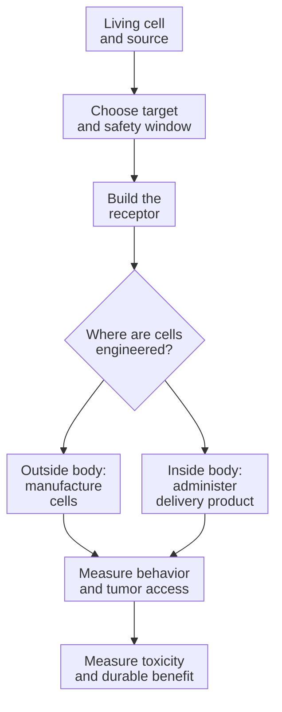

# How engineered immune cells can attack a solid tumor

**Follow a living therapy from target choice and receptor design to delivery, tumor access, safety and evidence.** This path includes engineering cells outside the body and engineering them inside it.

## The big ideas

1. A [cell therapy as a living drug](/wiki/education/concepts/therapeutics/cell-therapies/cell-therapy-as-a-living-drug) can change number, location and state. The cell, its genetic instructions and its receptor protein are different objects.
2. A [chimeric antigen receptor (CAR)](/wiki/education/concepts/therapeutics/cell-therapies/car-anatomy) usually reads an accessible surface target. A conventional [T-cell receptor (TCR)](/wiki/education/concepts/immunology/t-cells/t-cell-receptor) reads peptide plus [human leukocyte antigen (HLA)](/wiki/education/concepts/immunology/antigen-presentation/hla).
3. [Delivery targeting](/wiki/education/concepts/engineering-and-manufacturing/delivery-vehicles/delivery-targeting-vs-cancer-targeting) selects which cells receive instructions. Cancer targeting selects what the resulting receptor recognizes.
4. More cells cannot restore a missing target or guarantee access and function.
5. Safety and benefit need measurements for the complete product, not just a promising component.

## The map

*The numbered lessons supply the links through this map. The engineering route changes the manufactured product, while recognition and safety remain separate questions.*

## Lessons

**Start at step 1 and read in order.** Suggested reading budgets help pace the course; they are not measured completion times. If the therapy names themselves are unfamiliar, read step 9's [family comparison](/wiki/education/guides/engineered-cell-therapy/09-car-tcr-til-comparison) first for vocabulary, then come back here.

| Step | Lesson | Question | Minutes | Learning aid |
|---|---|---|---|---|
| 1 | [Living drugs](/wiki/education/guides/engineered-cell-therapy/01-cell-therapy-primer) | What is administered, and whose cells are used? | 8 | Source-versus-engineering example |
| 2 | [Specify recognition and a safety window](/wiki/education/guides/engineered-cell-therapy/02-choosing-a-target) | How do tumor coverage and normal-tissue expression interact? | 10 | Eight-label recognition/measurement board |
| 3 | [Build the receptor](/wiki/education/guides/engineered-cell-therapy/03-engineered-t-cell-building-blocks) | How do instructions become a functional receptor? | 10 | Component map and labeled architecture |
| 4 | [Deliver the instructions](/wiki/education/guides/engineered-cell-therapy/04-in-vivo-delivery) | What differs between ex vivo and in vivo engineering? | 12 | Two targeting jobs |
| 5 | [Tune behavior](/wiki/education/guides/engineered-cell-therapy/05-cytokines-and-programmable-receptors) | How do added signals, armoring and recognition rules change behavior? | 10 | Coverage-versus-selectivity exercise |
| 6 | [Enter a solid tumor](/wiki/education/guides/engineered-cell-therapy/06-solid-tumor-barriers) | Which independent barriers remain? | 10 | Target-negative survivors |
| 7 | [Read the safety plan](/wiki/education/guides/engineered-cell-therapy/07-reading-the-safety-plan) | Which harms and control mechanisms were actually tested? | 10 | Risk-to-measurement table |
| 8 | [Read a complete-product packet](/wiki/education/guides/engineered-cell-therapy/08-reading-cell-therapy-evidence) | What does each experiment establish? | 12 | Seven cards and nine answered questions |
| 9 | [Compare therapy families](/wiki/education/guides/engineered-cell-therapy/09-car-tcr-til-comparison) | How do recognition system and cell source differ? | 8 | Recognition comparison |

**If you have time for only one thread,** follow a single recognition specification through the course: pick a row of [the recognition board](/wiki/education/guides/engineered-cell-therapy/02-choosing-a-target#tnbc-recognition-and-measurement-board) in step 2, carry it through [the tissue barriers](/wiki/education/guides/engineered-cell-therapy/06-solid-tumor-barriers#carry-a-recognition-specification-through-the-tissue) in step 6 and [the safety plan](/wiki/education/guides/engineered-cell-therapy/07-reading-the-safety-plan) in step 7, then test your reading against [the cumulative evidence packet](/wiki/education/guides/engineered-cell-therapy/08-reading-cell-therapy-evidence#try-it-one-complete-product-packet) in step 8.

**Optional practice and extras.** [Read a research-product study without losing the denominator](/wiki/education/guides/engineered-cell-therapy/10-read-a-research-product-study) is a seven-minute extension that uses a dated clinical research report; take it after step 8, outside the nine-step budget. The [CAR T-cell learning lab](/wiki/education/tools/in-vivo-car-t-learning-lab) adds interactive component, graph and quiz exercises in the browser. [Gamma-delta T cells](/wiki/education/concepts/immunology/innate-and-unconventional-cells/gamma-delta-t-cells) extend the recognition comparison in step 9 for readers who want a cell family with its own native recognition system.

## Concepts you will use

Read these three first. Each lesson links the rest at the point where you need it.

| Foundation | What it settles |
|---|---|
| [DNA, RNA and protein](/wiki/education/concepts/biology-basics/genetics/central-dogma) | Why instructions, message and receptor are three different objects |
| [The immune-cell roster](/wiki/education/concepts/immunology/the-immune-system/immune-cell-roster) | Which cell families exist before any engineering |
| [T-cell activation](/wiki/education/concepts/immunology/t-cells/t-cell-priming-three-signals) | What a T cell needs besides seeing a target |

Then the specialist concepts, grouped by the question they answer.

| What recognizes the cancer | What it settles |
|---|---|
| [CAR anatomy](/wiki/education/concepts/therapeutics/cell-therapies/car-anatomy) | The receptor's parts and what each part changes |
| [Engineered T-cell receptor (TCR) therapy](/wiki/education/concepts/therapeutics/cell-therapies/tcr-t) | Reading a peptide with its HLA holder, not a surface protein |
| [Tumor-infiltrating lymphocyte (TIL) therapy](/wiki/education/concepts/therapeutics/cell-therapies/til-therapy) | Selecting existing tumor lymphocytes rather than adding a receptor |
| [CAR natural killer (NK) cells](/wiki/education/concepts/therapeutics/cell-therapies/car-nk) | A different starting cell with its own native signals |
| [Single-chain variable fragments (scFvs) and nanobodies](/wiki/education/concepts/engineering-and-manufacturing/binders/scfv-and-vhh-nanobodies) | The binder formats, their sizes and their limits |
| [Affinity, epitope and developability](/wiki/education/concepts/engineering-and-manufacturing/binders/affinity-epitope-and-developability) | How a candidate binder is actually measured |

| What the cell does next | What it settles |
|---|---|
| [Armoring](/wiki/education/concepts/therapeutics/cell-therapies/armoring) | Added functions, each addressing a named obstacle |
| [Logic-gated CARs](/wiki/education/concepts/therapeutics/cell-therapies/logic-gated-cars) | Why coverage and selectivity pull in opposite directions |
| [Safety switches](/wiki/education/concepts/therapeutics/cell-therapies/safety-switches) | Turning activity down versus removing the cells |
| [Cytokine therapy](/wiki/education/concepts/therapeutics/immunotherapy/cytokine-therapy) | Why more signaling is not automatically more benefit |
| [T-cell states and exhaustion](/wiki/education/concepts/immunology/t-cells/t-cell-states) | Why the same signal gives different responses |

| Why it may not work | What it settles |
|---|---|
| [The tumor microenvironment](/wiki/education/concepts/cancer-biology/tumor-microenvironment/tumor-microenvironment) | The tissue the cells must enter and function inside |
| [Immune escape](/wiki/education/concepts/immunology/tumor-immunology/immune-escape) | The routes by which a tumor stops being recognized |
| [Beta-2 microglobulin (B2M)](/wiki/education/concepts/immunology/antigen-presentation/b2m) | One shared failure point for every HLA-dependent design |
| [On-target, off-tumor toxicity](/wiki/education/concepts/therapeutics/toxicities-and-supportive-care/on-target-off-tumor-toxicity) | Why a perfectly specific binder can still cause harm |

| How the product is made and given | What it settles |
|---|---|
| [Ex vivo versus in vivo engineering](/wiki/education/concepts/engineering-and-manufacturing/cell-manufacturing/ex-vivo-vs-in-vivo-engineering) | Where the genetic change happens |
| [Autologous versus allogeneic](/wiki/education/concepts/engineering-and-manufacturing/cell-manufacturing/autologous-vs-allogeneic-cell-therapy) | Whose cells they are, and the two rejection directions |
| [Delivery versus cancer targeting](/wiki/education/concepts/engineering-and-manufacturing/delivery-vehicles/delivery-targeting-vs-cancer-targeting) | Two separate addresses in one design |
| [Lentiviral vectors](/wiki/education/concepts/engineering-and-manufacturing/delivery-vehicles/lentiviral-vector), [AAV vectors](/wiki/education/concepts/engineering-and-manufacturing/delivery-vehicles/aav-vector) and [transposons](/wiki/education/concepts/engineering-and-manufacturing/delivery-vehicles/transposon) | Whether the instructions integrate, and for how long |
| [Vein-to-vein time](/wiki/education/concepts/engineering-and-manufacturing/cell-manufacturing/vein-to-vein-time) | The wait, and who never reaches infusion |
| [Cell-product release testing](/wiki/education/concepts/engineering-and-manufacturing/cell-manufacturing/release-testing-for-cell-products) | Which quality results exist before infusion, and which arrive later |
| [Lymphodepletion](/wiki/education/concepts/therapeutics/toxicities-and-supportive-care/lymphodepletion) | The treatment given before the cells, and its own risks |
| [Cytokine release syndrome (CRS)](/wiki/education/concepts/therapeutics/toxicities-and-supportive-care/cytokine-release-syndrome) and [immune effector cell-associated neurotoxicity syndrome (ICANS)](/wiki/education/concepts/therapeutics/toxicities-and-supportive-care/icans) | The two graded acute syndromes, and what is not one of them |
| [Insertional mutagenesis](/wiki/education/concepts/therapeutics/toxicities-and-supportive-care/insertional-mutagenesis) | The delayed risk that drives long-term follow-up |

The delivery and manufacturing lessons link the remaining quality concepts — [good manufacturing practice](/wiki/education/concepts/engineering-and-manufacturing/cmc-and-quality/gmp-and-batch-release), [batch release](/wiki/education/concepts/engineering-and-manufacturing/cmc-and-quality/batch-release), [potency assays](/wiki/education/concepts/engineering-and-manufacturing/cmc-and-quality/potency-assays) and [manufacturing comparability](/wiki/education/concepts/engineering-and-manufacturing/cmc-and-quality/manufacturing-comparability) — where their worked route needs them. A mechanism explains a dependency; the trial or clinical owner establishes an option.

## Applied to Diana

[The cell-therapy decision framework](/wiki/treatment/therapeutics/cell-therapy-decision-framework), [the HLA/B2M question](/wiki/questions/hla-b2m-loss) and [the care plan](/wiki/care/treatment-plan) own case suitability and current choices. [The therapeutic landscape](/wiki/treatment/therapeutics/car-t) owns dated programs and access evidence.

## What is still uncertain

Delivery, receptor design and target selection interact. Findings in blood cancers or animal models do not establish benefit for a particular solid tumor. Early human activity needs adequate follow-up, toxicity reporting and an appropriate comparison. The label “in vivo” alone does not establish less toxicity or easier reversibility.

## Sources and scope

Source check: October 10, 2026 for the added mechanism routes; expert and learner review pending. The concept list was regrouped and the reading order clarified on November 8, 2026, when the retired cell-therapy lesson library's gamma-delta and learning-lab pointers were folded in; no claim changed. Earlier lesson examples retain their stated source scopes. The lessons cite their primary examples. [FDA product-development guidance](https://www.fda.gov/regulatory-information/search-fda-guidance-documents/considerations-development-chimeric-antigen-receptor-car-t-cell-products) separates product characterization and clinical development questions.
