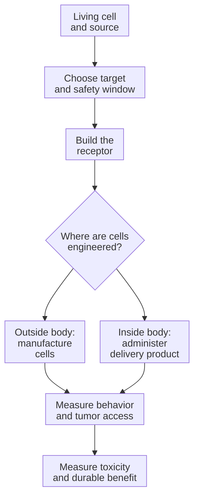

# How engineered immune cells can attack a solid tumor

**Follow a living therapy from target choice and receptor design to delivery, tumor access, safety and evidence.** This path includes engineering cells outside the body and engineering them inside it.

## The big ideas

1. A [cell therapy as a living drug](/wiki/education/concepts/therapeutics/cell-therapies/cell-therapy-as-a-living-drug) can change number, location and state. The cell, its genetic instructions and its receptor protein are different objects.
2. A [chimeric antigen receptor (CAR)](/wiki/education/concepts/therapeutics/cell-therapies/car-anatomy) usually reads an accessible surface target. A conventional [T-cell receptor (TCR)](/wiki/education/concepts/immunology/t-cells/t-cell-receptor) reads peptide plus [human leukocyte antigen (HLA)](/wiki/education/concepts/immunology/antigen-presentation/hla).
3. [Delivery targeting](/wiki/education/concepts/engineering-and-manufacturing/delivery-vehicles/delivery-targeting-vs-cancer-targeting) selects which cells receive instructions. Cancer targeting selects what the resulting receptor recognizes.
4. More cells cannot restore a missing target or guarantee access and function.
5. Safety and benefit need measurements for the complete product, not just a promising component.

## The map

*The numbered lessons supply the links through this map. The engineering route changes the manufactured product, while recognition and safety remain separate questions.*

## Lessons

Suggested reading budgets help pace the course; they are not measured completion times. Read the family comparison early if the therapy names are unfamiliar, then return to it at the end.

| Step | Lesson | Question | Minutes | Learning aid |
|---|---|---|---|---|
| 1 | [Living drugs](/wiki/education/cellular-therapies/01-cell-therapy-primer) | What is administered, and whose cells are used? | 8 | Source-versus-engineering example |
| 2 | [Specify recognition and a safety window](/wiki/education/guides/engineered-cell-therapy/02-choosing-a-target) | How do tumor coverage and normal-tissue expression interact? | 10 | Eight-label recognition/measurement board |
| 3 | [Build the receptor](/wiki/education/cellular-therapies/05-engineered-t-cell-building-blocks) | How do instructions become a functional receptor? | 10 | Component map and labeled architecture |
| 4 | [Deliver the instructions](/wiki/education/cellular-therapies/06-in-vivo-delivery) | What differs between ex vivo and in vivo engineering? | 12 | Two targeting jobs |
| 5 | [Tune behavior](/wiki/education/cellular-therapies/07-cytokines-and-programmable-receptors) | How do added signals, armoring and recognition rules change behavior? | 10 | Coverage-versus-selectivity exercise |
| 6 | [Enter a solid tumor](/wiki/education/cellular-therapies/08-solid-tumor-barriers) | Which independent barriers remain? | 10 | Target-negative survivors |
| 7 | [Read the safety plan](/wiki/education/guides/engineered-cell-therapy/07-reading-the-safety-plan) | Which harms and control mechanisms were actually tested? | 10 | Risk-to-measurement table |
| 8 | [Read a complete-product packet](/wiki/education/cellular-therapies/09-reading-cell-therapy-evidence) | What does each experiment establish? | 12 | Seven cards and nine answered questions |
| 9 | [Compare therapy families](/wiki/education/cellular-therapies/02-car-tcr-til-comparison) | How do recognition system and cell source differ? | 8 | Recognition comparison |

Start with [the recognition board](/wiki/education/guides/engineered-cell-therapy/02-choosing-a-target#tnbc-recognition-and-measurement-board), carry the specification through [the tissue barriers](/wiki/education/cellular-therapies/08-solid-tumor-barriers#carry-a-recognition-specification-through-the-tissue) and [safety plan](/wiki/education/guides/engineered-cell-therapy/07-reading-the-safety-plan), then test your reading with [the cumulative evidence packet](/wiki/education/cellular-therapies/09-reading-cell-therapy-evidence#try-it-one-complete-product-packet).

Optional practice: [read a research-product study without losing the denominator](/wiki/education/guides/engineered-cell-therapy/10-read-a-research-product-study). This seven-minute extension uses a dated clinical research report after lesson eight; it is outside the nine-step reading budget.

## Concepts you will use

**Foundations:** [DNA, RNA and protein](/wiki/education/concepts/biology-basics/genetics/central-dogma), [immune-cell roster](/wiki/education/concepts/immunology/the-immune-system/immune-cell-roster) and [T-cell activation](/wiki/education/concepts/immunology/t-cells/t-cell-priming-three-signals).

**Recognition families:** [engineered T-cell receptor therapy (TCR-T)](/wiki/education/concepts/therapeutics/cell-therapies/tcr-t), [tumor-infiltrating lymphocyte (TIL) therapy](/wiki/education/concepts/therapeutics/cell-therapies/til-therapy) and [CAR natural killer (NK) cells](/wiki/education/concepts/therapeutics/cell-therapies/car-nk). [Gamma-delta T cells](/wiki/education/concepts/immunology/innate-and-unconventional-cells/gamma-delta-t-cells) have native recognition systems; adding a CAR supplies another defined recognition system. Each name identifies a strategy, not a clinical ranking.

**Design choices:** [single-chain variable fragments (scFvs) and single-domain nanobodies](/wiki/education/concepts/engineering-and-manufacturing/binders/scfv-and-vhh-nanobodies), [armoring](/wiki/education/concepts/therapeutics/cell-therapies/armoring), [logic gates](/wiki/education/concepts/therapeutics/cell-therapies/logic-gated-cars) and [safety switches](/wiki/education/concepts/therapeutics/cell-therapies/safety-switches). Their contribution depends on the finished product and intended setting.

**Inspect the binding module:** [binder discovery](/wiki/education/concepts/engineering-and-manufacturing/binders/binder-discovery) generates and tests candidates. [A binder as a targeting module](/wiki/education/concepts/engineering-and-manufacturing/binders/binder-as-a-targeting-module) separates recognition from action. [Affinity, epitope and developability](/wiki/education/concepts/engineering-and-manufacturing/binders/affinity-epitope-and-developability) describe a candidate's profile; [format constraints](/wiki/education/concepts/engineering-and-manufacturing/binders/format-constraints-on-binders) explain why a promising module needs new tests in its finished product.

**Added signals:** [cytokine therapy](/wiki/education/concepts/therapeutics/immunotherapy/cytokine-therapy) explains administered signaling proteins. A cytokine drug, a cytokine measured in an assay and an engineered cell that produces a cytokine are distinct interventions or observations.

**Product and context:** [lipid nanoparticles (LNPs)](/wiki/education/concepts/engineering-and-manufacturing/delivery-vehicles/lipid-nanoparticle), [T-cell states and exhaustion](/wiki/education/concepts/immunology/t-cells/t-cell-states), [the tumor microenvironment](/wiki/education/concepts/cancer-biology/tumor-microenvironment/tumor-microenvironment), [immune escape](/wiki/education/concepts/immunology/tumor-immunology/immune-escape), [beta-2 microglobulin (B2M)](/wiki/education/concepts/immunology/antigen-presentation/b2m) and the receptor concepts above. A mechanism explains a dependency; the trial or clinical owner establishes an option.

**Manufacturing and safety:** [lymphodepletion](/wiki/education/concepts/therapeutics/toxicities-and-supportive-care/lymphodepletion), [insertional mutagenesis](/wiki/education/concepts/therapeutics/toxicities-and-supportive-care/insertional-mutagenesis), [ex vivo versus in vivo engineering](/wiki/education/concepts/engineering-and-manufacturing/cell-manufacturing/ex-vivo-vs-in-vivo-engineering), [lentiviral vectors](/wiki/education/concepts/engineering-and-manufacturing/delivery-vehicles/lentiviral-vector), [adeno-associated virus (AAV) vectors](/wiki/education/concepts/engineering-and-manufacturing/delivery-vehicles/aav-vector), [transposons](/wiki/education/concepts/engineering-and-manufacturing/delivery-vehicles/transposon), [good manufacturing practice (GMP) and batch release](/wiki/education/concepts/engineering-and-manufacturing/cmc-and-quality/gmp-and-batch-release), [cytokine release syndrome (CRS)](/wiki/education/concepts/therapeutics/toxicities-and-supportive-care/cytokine-release-syndrome), [immune effector cell-associated neurotoxicity syndrome (ICANS)](/wiki/education/concepts/therapeutics/toxicities-and-supportive-care/icans) and [on-target, off-tumor toxicity](/wiki/education/concepts/therapeutics/toxicities-and-supportive-care/on-target-off-tumor-toxicity).

**Follow the cell product:** [autologous versus allogeneic sources](/wiki/education/concepts/engineering-and-manufacturing/cell-manufacturing/autologous-vs-allogeneic-cell-therapy), [leukapheresis](/wiki/education/concepts/engineering-and-manufacturing/cell-manufacturing/leukapheresis), [ex vivo expansion](/wiki/education/concepts/engineering-and-manufacturing/cell-manufacturing/ex-vivo-cell-expansion), [identity and custody](/wiki/education/concepts/engineering-and-manufacturing/cell-manufacturing/chain-of-identity-and-custody), [cryopreservation](/wiki/education/concepts/engineering-and-manufacturing/cell-manufacturing/cryopreservation) and [vein-to-vein time](/wiki/education/concepts/engineering-and-manufacturing/cell-manufacturing/vein-to-vein-time). [Potency assays](/wiki/education/concepts/engineering-and-manufacturing/cmc-and-quality/potency-assays) and [manufacturing comparability](/wiki/education/concepts/engineering-and-manufacturing/cmc-and-quality/manufacturing-comparability) explain the quality questions at release and after a process change. These links support the delivery lesson's worked route.

## Applied to Diana

[The cell-therapy decision framework](/wiki/treatment/therapeutics/cell-therapy-decision-framework), [the HLA/B2M question](/wiki/questions/hla-b2m-loss) and [the care plan](/wiki/care/treatment-plan) own case suitability and current choices. [The therapeutic landscape](/wiki/treatment/therapeutics/car-t) owns dated programs and access evidence.

## What is still uncertain

Delivery, receptor design and target selection interact. Findings in blood cancers or animal models do not establish benefit for a particular solid tumor. Early human activity needs adequate follow-up, toxicity reporting and an appropriate comparison. The label “in vivo” alone does not establish less toxicity or easier reversibility.

## Sources and scope

Source check: October 10, 2026 for the added mechanism routes; expert and learner review pending. Earlier lesson examples retain their stated source scopes. The lessons cite their primary examples. [FDA product-development guidance](https://www.fda.gov/regulatory-information/search-fda-guidance-documents/considerations-development-chimeric-antigen-receptor-car-t-cell-products) separates product characterization and clinical development questions.
