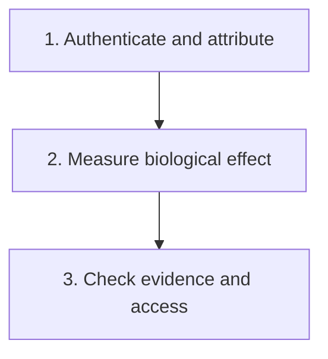

# Authenticate and attribute the finding

**Before asking which drug fits, establish what was measured, whether the finding is credible, and which cells it belongs to.**

**Before you start:** [Mutation types](/wiki/education/concepts/biology-basics/genetics/mutation-types) describes sequence changes and their possible consequences. [Germline versus somatic](/wiki/education/concepts/biology-basics/genetics/germline-vs-somatic) separates variant origins. [Variant allele fraction and cancer-cell fraction](/wiki/education/concepts/measurement/sequencing-basics/variant-allele-fraction-and-cancer-cell-fraction) explains why a fraction of sequencing reads is not a fraction of cancer cells.

## Where this step sits

This is step 1 of [From a variant to a drug claim](/wiki/education/guides/from-variant-to-drug/index). A credible finding comes before a measured biological consequence and clinical translation.

## Begin with a sentence you can check

“An important cancer gene is altered” is too vague to evaluate. Write a finding with enough detail that another reader can trace it:

“In specimen T, assay A reported sequence change V at a named genomic location, with a specified transcript and supporting read evidence.”

A **transcript** is one RNA message produced from a gene. Different transcripts can change how a DNA coordinate maps to a protein consequence. A **reference genome** is the comparison sequence used by an analysis. Its version matters when coordinates are compared.

The report should distinguish a measured sequence from [variant-effect prediction](/wiki/education/concepts/measurement/computational-analysis/variant-effect-prediction). A predicted splice consequence is a hypothesis about RNA processing. It is not the same evidence as measuring the relevant junctions in RNA. Keep the model version, transcript and score interpretation attached to that hypothesis.

## Authenticate the observation

Ask about specimen identity, tissue type, assay design, local coverage, and quality control. **Coverage** describes how much sequencing evidence exists at a location. A high overall sequencing average does not guarantee usable evidence at the one site that matters.

Technical errors can arise before sequencing, during preparation, or during analysis. A call supported mainly by poor-quality or unusually aligned reads needs investigation. Repeating the same data through another report template is not independent confirmation.

A meaningful confirmation should address the suspected weakness. Depending on the claim, this might use a separate preparation, an orthogonal method, or a technically different assay. **Orthogonal** means the method has sufficiently different strengths and failure modes. Different brand names alone do not establish that independence.

Disagreement also needs a fair comparison. Check whether both assays cover the exact site, detect that alteration class, and examine comparable tissue and time points. A negative test with inadequate local evidence is uninformative. [Absence of evidence](/wiki/education/concepts/evidence-and-statistics/biomarkers/absence-of-evidence) separates a test that failed to answer the question from informative evidence against the finding. Two adequate tests on different tumor samples can disagree because the biology changed or different cell populations were sampled.

## Attribute the finding

A tumor specimen is a mixture. The finding may belong to malignant cells, other cells, or a variant shared with nonmalignant tissues. Paired tumor and matched-normal analysis can help separate somatic from germline findings. A normal comparator must have adequate coverage and an appropriate source. Tumor-only analysis cannot always determine origin reliably. [Jones 2015](https://pubmed.ncbi.nlm.nih.gov/25877891/).

Next, distinguish origin from **clonality**, the distribution of a finding among cancer-cell lineages. Variant allele fraction, or VAF, is the fraction of informative sequencing reads carrying the variant. Cancer-cell fraction estimates how many cancer cells carry it. Purity, copy number, and the number of altered copies affect the relationship.

A driver helps promote cancer behavior. A passenger travels with the cancer without an established driving role. Authenticity does not establish which category a particular finding belongs to.

## A worked example: one number, several explanations

A fictional sample reports a splice-site change in repair gene R. It has 32 alternate reads among 160 usable reads: VAF is 20%. The matched-normal sample has adequate local evidence and does not show that change.

| Observation | Supported interpretation | Additional question |
|---|---|---|
| 32 of 160 usable reads carry the change | The observed VAF is 20%. | Are preparation and alignment artifacts adequately excluded? |
| Adequate matched-normal evidence lacks the change | Somatic origin is supported for the sampled tissues. | Was the normal comparator appropriate? |
| Tumor and nonmalignant cells are mixed | Read fraction cannot directly specify cancer-cell fraction. | What are purity and local copy number? |
| The site is associated with splicing | An RNA-processing consequence is plausible. | Is the altered junction actually measured? |

Under a simplified diploid model with one altered copy per affected cell and no normal-cell admixture, 20% VAF could fit about 40% affected cells. Those assumptions do not hold automatically in a tumor. The exercise illustrates the conversion problem; it is not a cancer-cell-fraction estimate for this sample.

A second adequate assay supports the same change. The finding becomes more credible. Researchers still need RNA and functional evidence before claiming repair failure. This is progress: one uncertainty has been reduced without pretending the whole [variant-to-benefit evidence chain](/wiki/education/concepts/evidence-and-statistics/reasoning-tools/evidence-chain-variant-to-benefit) is complete.

## What can go wrong at this step

A famous gene can make an uncertain call feel convincing. A pathogenic classification in one context can also be mistaken for treatment sensitivity in another. Write separate conclusions about sequence credibility, origin, biological effect, and [clinical actionability](/wiki/education/concepts/evidence-and-statistics/biomarkers/actionability).

Another mistake is interpreting every negative result as a contradiction. A test that cannot detect the alteration class cannot settle it. Conversely, an adequate contradiction should lead to reconciliation, rather than accumulating interpretations of a disputed call.

## Try it

Assay A reports a low-fraction variant. Assay B reports no variant, but its report gives no coverage at that site. Has B disproved A? What should be requested next?

Show the answer

No. Request the exact site, local usable coverage, detection limits for that alteration, and a comparison of specimen and time point. If B was adequate, reconcile the discrepancy. If it was not, choose a confirmation that directly tests the unresolved technical question.

## Explain it back

“Confirmation tells us ___; origin tells us ___; biological consequence still needs ___.”

One possible answer: “whether the finding is credible; which lineage or tissue carries it; appropriate RNA, protein, or functional measurements.”

## Takeaway

**An authentic and well-attributed variant is a starting fact, not a completed drug prediction.**

**Next:** [Connect repair biology to PARP sensitivity](/wiki/education/guides/from-variant-to-drug/02-connect-repair-biology-to-parp-sensitivity).

## Sources and scope

Source check: 2026-10-09. General education; worked scenarios are fictional. Named studies and labels illustrate their specified populations and evidence boundaries. Expert and learner review pending.

- [Jones 2015: paired tumor–normal sequencing and variant interpretation](https://pubmed.ncbi.nlm.nih.gov/25877891/).
- [Carter 2012: absolute copy number, purity, and mutation interpretation](https://pmc.ncbi.nlm.nih.gov/articles/PMC4383288/).
- [HGVS stable nomenclature: specifying sequence variants](https://hgvs-nomenclature.org/stable/).
- [NCI: biomarker testing for cancer treatment](https://www.cancer.gov/about-cancer/treatment/types/biomarker-testing-cancer-treatment).
