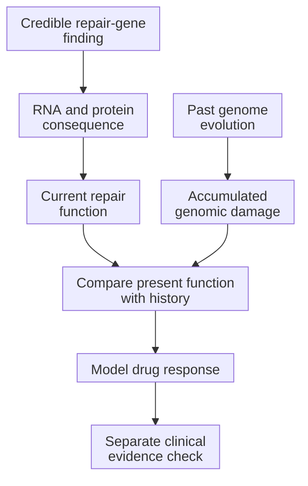

# Connect repair biology to PARP sensitivity

**Repair-gene evidence, a genomic scar, present repair function, and drug response answer different questions. A stronger hypothesis connects them without substituting one for another.**

**Before you start:** [Homologous recombination and HRD](/wiki/education/concepts/cancer-biology/genome-instability-and-repair/homologous-recombination-and-hrd) explains template-based DNA repair. [Synthetic lethality](/wiki/education/concepts/therapeutics/how-drugs-work/synthetic-lethality) describes two impairments that become lethal together. [Germline and somatic](/wiki/education/concepts/biology-basics/genetics/germline-vs-somatic) describes variant origin rather than the degree of repair failure.

## Where this step sits

This is step 2 of [From a variant to a drug claim](/wiki/education/guides/from-variant-to-drug/index). [Step 1](/wiki/education/guides/from-variant-to-drug/01-authenticate-and-attribute-the-finding) established finding credibility and attribution. Here we connect a measured consequence before step 3 checks clinical evidence and access.

## Follow the repair team, not just one name

**Homologous recombination (HR)** uses a matching DNA template to repair certain lesions. [BRCA1 and BRCA2](/wiki/education/concepts/cancer-biology/genome-instability-and-repair/brca1-and-brca2), PALB2, RAD51, and other proteins cooperate in this process. **Homologous recombination deficiency (HRD)** means the process is impaired. It is a biological state, not the name of one mutation.

Other repair routes have different jobs. [Non-homologous end joining (NHEJ) and microhomology-mediated end joining (MMEJ)](/wiki/education/concepts/cancer-biology/genome-instability-and-repair/nhej-and-mmej) join broken ends without the same long matching template. Their existence does not guarantee that an HR-deficient cell tolerates every lesion.

Many cells carry two copies of a repair gene. [Alleles](/wiki/education/concepts/biology-basics/genetics/allele-and-zygosity) are sequence versions, rather than a physical copy count. **Biallelic inactivation** means neither parental allele supplies working gene function in the relevant cells. Evidence may combine a damaging variant and loss of the other parental contribution. Gains and losses can change the number of physical copies. [Purity and local copy state](/wiki/education/concepts/measurement/sequencing-basics/variant-allele-fraction-and-cancer-cell-fraction), together with cell-lineage mixture, affect that interpretation. A high variant allele fraction (VAF) or two events somewhere in a tissue does not automatically show both parental contributions are disabled in the same malignant population.

Pan-cancer studies have connected particular biallelic repair-gene changes with characteristic damage patterns. These associations are useful, but they do not make every repair-gene variant equivalent. [Nguyen 2020](https://pubmed.ncbi.nlm.nih.gov/33149131/).

## Measure the consequence at the right layer

Return to fictional repair gene R from step 1. The sequence change is now credible. RNA testing shows an abnormal junction. That supports altered processing of captured RNA. It does not yet establish the amount or function of the usable protein.

A protein stain shows reduced R staining in malignant cells. That supports a cell-specific protein signal. Whether intact R protein remains is an assay-specific question: antibody binding can detect some fragments or miss particular forms. A method validated for the intended protein form is needed before declaring that the intact product is absent.

Finally, researchers measure a repair response under adequate assay conditions. This can add functional evidence beyond the sequence and protein observations. Each additional layer narrows the hypothesis; none should silently replace the others.

## A scar records a history

A [**genomic scar**](/wiki/education/concepts/cancer-biology/genome-instability-and-repair/genomic-scars) summarizes patterns of accumulated chromosome damage. Different assays use different features and cutoffs. A scar compatible with past repair deficiency is not a clock that reports today's repair capacity.

Repair can partly return while old scars remain. A **BRCA reversion** is a later change that restores function to a previously disrupted repair protein. Selected resistant metastatic breast cancers have demonstrated repair-restoring changes. That finding explains a mechanism; it is not a prevalence estimate for every cancer. [Waks 2020](https://pubmed.ncbi.nlm.nih.gov/32245699/).

One present-function readout is **RAD51 foci**, visible assemblies of a repair protein. Interpretation requires adequate damaged and cycling cells, suitable scoring, and controls. Few foci in a sample with too few informative cells can be an uninformative result rather than proof of HRD. [Cruz 2018](https://pubmed.ncbi.nlm.nih.gov/29635390/).

## PARP inhibition creates another challenge

**Poly(ADP-ribose) polymerase (PARP)** proteins help coordinate responses to DNA damage. [PARP inhibitors](/wiki/education/concepts/therapeutics/targeted-small-molecules/parp-inhibitors-and-trapping) can reduce enzyme activity and can trap PARP–DNA complexes. Trapping can create an obstacle for DNA-copying machinery. Cells then need ways to tolerate or resolve the resulting stress.

Some HR-deficient cells are especially vulnerable to that challenge, illustrating synthetic lethality. Experiments also show that catalytic inhibition and trapping strength can differ between compounds. Laboratory trapping measurements do not rank the best medicine for a person. Exposure, normal-tissue effects, resistance, and clinical setting remain important. [Murai 2012](https://pmc.ncbi.nlm.nih.gov/articles/PMC3528345/).

## Keep five claims separate

A repair story becomes easier to read when each claim gets its own evidence. These are questions to investigate, not a validated scoring system.

| Claim | Evidence that can support it | The tempting overread |
|---|---|---|
| A repair-gene change is real | Technically credible DNA calls with sample identity and attribution. | A real variant must damage repair. |
| Neither parental gene contribution supplies useful function | Allele-specific copy number, phasing, and a damaging consequence in the relevant cells. | A large read fraction proves biallelic loss. |
| The genome carries a compatible damage history | Method-specific scars and [mutational signatures](/wiki/education/concepts/cancer-biology/genome-instability-and-repair/mutational-signatures). | Past damage proves present HRD. |
| Repair is impaired now | Fit-for-purpose protein or functional assays with adequate informative cells and controls. | One weak stain or uninformative foci result proves complete loss. |
| A drug improves an outcome in the intended setting | Applicable clinical evidence and the actual indication or protocol. | A mechanism or culture response establishes clinical benefit. |

## Four different kinds of confidence

Agreement is useful, but its meaning depends on how the evidence was produced. These four checks answer different questions; they are not numerical confidence tiers.

| Check | What it adds | What still needs a separate check |
|---|---|---|
| Internal coherence | The findings make a compatible biological story. | They may share one pipeline's assumptions or errors. |
| Cross-report agreement | Another report supports a specified part of the story. | Reused specimens or calls may not provide independent replication. |
| Independent reproduction | A separate workflow can reproduce the result from auditable data with suitable quality controls. | Reproducibility alone does not show clinical utility. |
| Clinical validation | Measurement and evidence fit the proposed clinical use and population. | Neither a validated assay nor an indication guarantees one person's response. |

Keep the observation, method, source, and remaining question together. A signature, scar, protein signal, and functional result should strengthen a specific claim rather than vote for a single label.

## A worked example: the same scar, different present function

Two fictional tumor models have similar historical scar patterns. Both have technically adequate current assays.

| Evidence | Model A | Model B |
|---|---|---|
| Current repair measurement | Supports impaired HR | Supports partial restoration |
| PARP target engagement | Demonstrated | Demonstrated |
| Survival after the tested exposure | Falls substantially | Changes little |
| Careful conclusion | Repair-related sensitivity is supported in this model. | The historical scar overstates this model's current vulnerability. |

A matched repair restoration in model A could further test causality. Neither model result determines a treatment indication. Clinical evidence must match the disease, biomarker, treatment line, and intended outcome.

## What can go wrong at this step

A scar score can be treated as a universal threshold even when the pipeline differs from the validated assay. A protein stain can be overread as complete protein loss. A functional assay can be overread despite inadequate informative cells.

Drug-associated death can also be attributed entirely to HRD without controls. Use target engagement, appropriate exposure, matched comparators, and causal experiments where feasible. [The functional-experiment lesson](/wiki/education/guides/from-variant-to-drug/07-reading-a-functional-experiment) explains the next checks.

## Try it

A culture has an HRD-associated scar and few RAD51 foci, but almost no cycling cells. It survives the tested PARP exposure. Which conclusion is most defensible?

Show the answer

The scar supports a compatible damage history. The low-foci result may be uninformative because the assay lacks enough relevant cells. The culture did not show sensitivity at that tested exposure. Current repair deficiency and the reason for survival remain unresolved.

## Explain it back

“A scar tells us ___; a valid repair assay tells us ___; a drug-response assay tells us ___.”

One possible answer: “what damage accumulated; how a repair function behaves under the assay conditions; what the tested model does at a specified exposure.”

## Takeaway

**Connect the genetic cause, current function, and drug response, then evaluate clinical applicability as a separate step.**

**Next:** [Check clinical evidence and access](/wiki/education/guides/from-variant-to-drug/03-check-clinical-evidence-and-access).

## Sources and scope

Source check: 2026-10-09. General education; worked scenarios are fictional. Named studies and labels illustrate their specified populations and evidence boundaries. Expert and learner review pending.

- [Nguyen 2020: pan-cancer genetic causes and HRD scars](https://pubmed.ncbi.nlm.nih.gov/33149131/).
- [Cruz 2018: RAD51 foci as a functional repair biomarker](https://pubmed.ncbi.nlm.nih.gov/29635390/).
- [Waks 2020: repair restoration in selected resistant metastatic breast cancers](https://pubmed.ncbi.nlm.nih.gov/32245699/).
- [Murai 2012: catalytic inhibition and differential PARP trapping](https://pmc.ncbi.nlm.nih.gov/articles/PMC3528345/).
