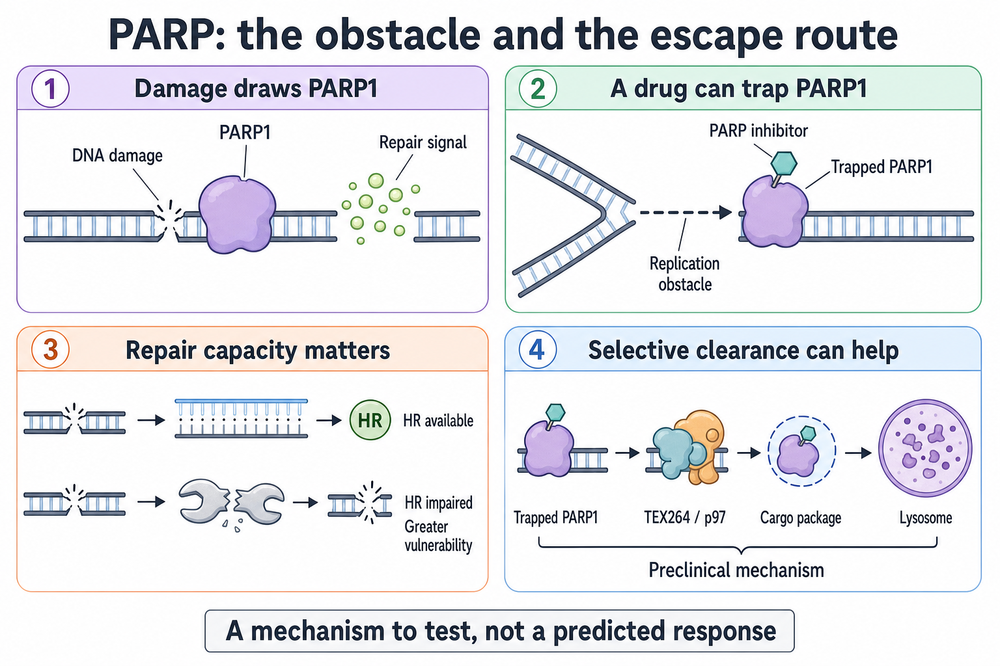

# PARP trapping and recycling

**A poly(ADP-ribose) polymerase (PARP) inhibitor can both block an enzyme and leave a protein stuck to DNA. The cell's repair and clearance systems help determine what happens next.**

**Before you start:** [Homologous recombination (HR)](/wiki/education/concepts/cancer-biology/genome-instability-and-repair/homologous-recombination-and-hrd) is template-based repair of deoxyribonucleic acid (DNA); [synthetic lethality](/wiki/education/concepts/therapeutics/how-drugs-work/synthetic-lethality) describes two impairments that become lethal together. ADP-ribose is a chemical unit that PARP enzymes use to build signals at DNA damage.

## Where this step sits

This is optional step 4 of [From a variant to a drug claim](/wiki/education/guides/from-variant-to-drug/index), the first of the supporting lessons shown on [the guide's map](/wiki/education/guides/from-variant-to-drug/index#the-map). [Step 2](/wiki/education/guides/from-variant-to-drug/02-connect-repair-biology-to-parp-sensitivity) covered repair capacity, scars and RAD51; this lesson adds the other side of the story: what happens to the obstacle itself.

## The repair worker can become an obstacle

Imagine a repair worker who normally spots damage, calls for help, and moves on. A drug may silence the call and also leave the worker stuck in the doorway. Those are related effects, but they are not the same effect.

PARP1 is a protein that responds to DNA damage. It adds chains of ADP-ribose that help organize the response. **Catalytic inhibition** means blocking this chemical activity. [**PARP trapping**](/wiki/education/concepts/therapeutics/targeted-small-molecules/parp-inhibitors-and-trapping) means stabilizing a PARP–DNA complex so the protein stays bound longer. A [replication fork](/wiki/education/concepts/cancer-biology/genome-instability-and-repair/replication-stress), the moving machinery that copies DNA, can run into that obstacle. The collision can generate stress and damage the cell must resolve.

Trapping strength differs between compounds in a defined assay. Murai and colleagues found stronger trapping with niraparib and olaparib than with veliparib, despite all inhibiting PARP activity ([Murai 2012](https://pmc.ncbi.nlm.nih.gov/articles/PMC3528345/)). In cell-based assays, talazoparib trapped PARP–DNA complexes about 100 times more potently than olaparib or rucaparib, although all three inhibited the enzyme comparably ([Murai 2014](https://pubmed.ncbi.nlm.nih.gov/24356813/)). Talazoparib is approved for HER2-negative locally advanced or metastatic breast cancer with a germline BRCA1 or BRCA2 variant ([talazoparib label](https://dailymed.nlm.nih.gov/dailymed/drugInfo.cfm?setid=f2423edd-6d24-495c-aec1-c2f457f08d9a)); in the EMBRACA trial of 431 such patients it lengthened median progression-free survival from 5.6 to 8.6 months compared with standard chemotherapy (hazard ratio 0.54) ([Litton 2018](https://pubmed.ncbi.nlm.nih.gov/30110579/)). Potency in a trapping assay is still a laboratory distinction. It does not rank the best drug for a person: exposure, toxicity, dose, resistance, and the clinical setting also matter.

*Creating an obstacle, repairing its damage, and removing it are separate parts of the response.*

## Why the obstacle matters more in some cells

A cell with impaired homologous recombination has fewer ways to repair the breaks that form when replication forks hit trapped PARP. [Step 2](/wiki/education/guides/from-variant-to-drug/02-connect-repair-biology-to-parp-sensitivity) explains why present repair function, not an old scar, decides that vulnerability. Here, the question is different: can the cell remove the obstacle before it does harm?

## A clearance route is a specific hypothesis

[Autophagy](/wiki/education/concepts/cancer-biology/cell-death-and-survival/autophagy) is cellular recycling that delivers material to a lysosome, a compartment where it is broken down. **Nucleophagy** is autophagic handling of nuclear material. A preclinical study identified a route involving TEX264, a cargo-recognition protein, and p97, a protein-remodeling enzyme, that helps remove trapped PARP1. Disrupting this machinery increased trapping and drug sensitivity in the studied models. [Hoslett 2026](https://www.nature.com/articles/s41556-026-01961-5).

That finding does not show that a high recycling-related gene-expression score predicts resistance. Nor does it show that chloroquine or hydroxychloroquine selectively blocks this route. These drugs alter lysosomal functions more broadly. To attribute a response to trapped-PARP clearance, an experiment needs measurements of that cargo and pathway, alongside cell survival.

## A worked example: three readings of one result

A fictional lab adds a lysosomal drug to a PARP inhibitor and sees more cell death. Three explanations fit:

| Explanation | What would support it | What would argue against it |
|---|---|---|
| The lysosomal drug blocked clearance of trapped PARP | More PARP1 stays bound to chromatin; disrupting TEX264 or p97 reproduces the effect | Trapped PARP is unchanged, yet death still rises |
| The lysosomal drug is toxic on its own | Similar death with the lysosomal drug alone at that dose | Little death with that drug alone |
| A different stress response changed | Markers of another pathway shift with the death | The effect follows the clearance machinery specifically |

Only the first row is the clearance hypothesis, and it needs a measurement of the cargo, not only survival.

## What can go wrong at this step

A mechanism can be mistaken for a treatment indication. A clearance route discovered in models says nothing about who should receive a PARP inhibitor; [step 3](/wiki/education/guides/from-variant-to-drug/03-check-clinical-evidence-and-access) covers the label and trial evidence.

A second error is treating broad lysosomal disruption as proof of selective PARP clearance. The same drug can change several processes. Measuring only survival cannot identify which one caused the effect.

## Try it

A fictional study reports that hydroxychloroquine plus a PARP inhibitor kills more tumor cells than the PARP inhibitor alone, and concludes that the combination "blocks removal of trapped PARP." What two measurements would you ask for first?

Show the answer

First, chromatin-bound PARP1 with and without hydroxychloroquine, to show the obstacle actually lasts longer. Second, a selective perturbation of the clearance machinery (for example TEX264 or p97) that reproduces the effect, because hydroxychloroquine changes lysosomes broadly. Without both, the result is a combination observation, not evidence for the clearance mechanism.

## Explain it back

“A PARP inhibitor can create ___; a clearance route can ___; to credit clearance for a response, an experiment must measure ___.”

One possible answer: “a protein obstacle on DNA; remove that obstacle before it causes lethal damage; the trapped PARP itself, not only cell survival.”

## Takeaway

**Creating the obstacle and clearing it are separate steps, and each needs its own measurement.**

**Next:** [Separate recycling amount, flow, and dependence](/wiki/education/guides/from-variant-to-drug/05-autophagy-flux-and-dependence).

## Sources and scope

Source check: 2026-11-08. General mechanism education; expert and learner review pending. Clearance experiments are preclinical; the worked models are fictional. This lesson does not select a drug or infer individual benefit.

- [Murai 2012: differential PARP trapping](https://pmc.ncbi.nlm.nih.gov/articles/PMC3528345/).
- [Hoslett 2026: nucleophagy of trapped PARP1](https://www.nature.com/articles/s41556-026-01961-5).
- [Murai 2014: talazoparib's PARP trapping compared with olaparib and rucaparib](https://pubmed.ncbi.nlm.nih.gov/24356813/).
- [Litton 2018: EMBRACA, talazoparib in germline BRCA-mutated advanced breast cancer](https://pubmed.ncbi.nlm.nih.gov/30110579/).
