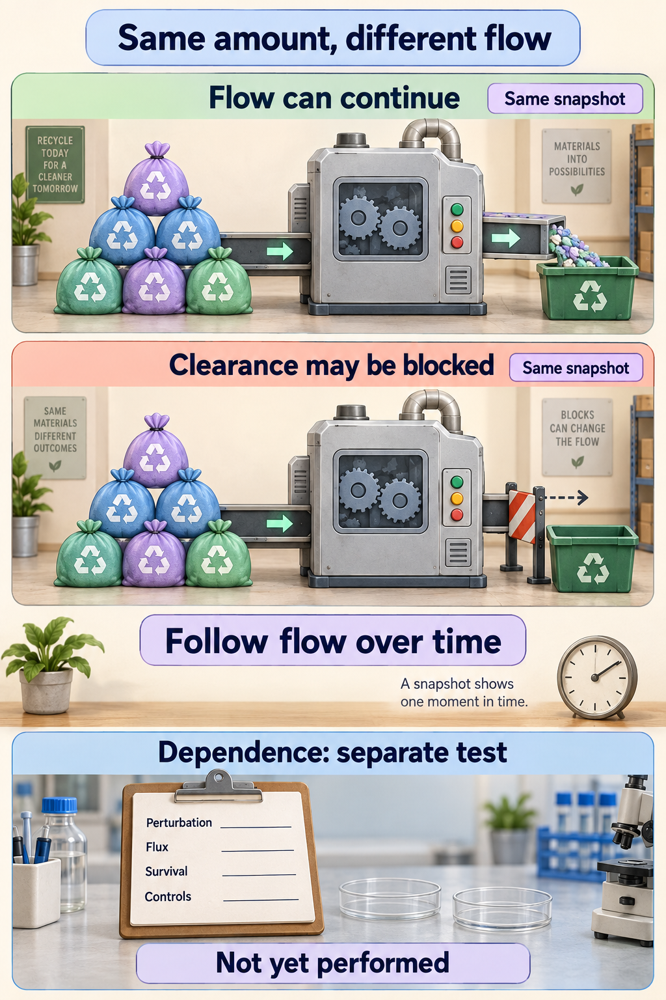

# Autophagy: traffic, flow, and dependence

**A busy-looking recycling system may be working quickly, waiting at a blockage, or doing something that does not determine survival. Amount, completed flow, and dependence are separate questions.**

**Before you start:** [Autophagy](/wiki/education/concepts/cancer-biology/cell-death-and-survival/autophagy) delivers cell material to lysosomes for breakdown. [Ubiquitin and the proteasome](/wiki/education/concepts/cancer-biology/cell-death-and-survival/ubiquitin-and-proteasome) is the cell's other disposal route. [Homologous recombination (HR)](/wiki/education/concepts/cancer-biology/genome-instability-and-repair/homologous-recombination-and-hrd) is a DNA repair process that can change drug vulnerability.

## Where this step sits

This is optional step 5 of [From a variant to a drug claim](/wiki/education/guides/from-variant-to-drug/index). After identifying the [PARP obstacle](/wiki/education/guides/from-variant-to-drug/04-parp-trapping-and-recycling), we ask what recycling is doing. PARP stands for poly(ADP-ribose) polymerase, an enzyme that builds chemical signals at DNA damage. The next lesson follows growth signals that can affect repair and recycling together.

## Count bags, then watch the trucks

In macroautophagy, the form used in this lesson, an **autophagosome** carries cell material to a **lysosome** for breakdown and reuse. The concept page explains the machinery; here we ask which measurement can distinguish a moving queue from a blocked one.

Think of a recycling station. A photograph showing many bags could mean many deliveries are arriving. It could also mean the trucks stopped leaving. The photograph alone does not tell you how much material completes its trip.

*Equal piles show equal amount, not equal flow; survival dependence needs its own experiment.*

**Autophagic flux** means material progressing through the process over time, including breakdown at the end. More autophagosomes at one moment do not establish greater flux. Likewise, [bulk RNA sequencing](/wiki/education/concepts/measurement/transcriptomics/bulk-rna-seq) measures instructions in a sampled mixture. It does not watch cargo move or show that a tumor depends on recycling.

## What the markers can and cannot tell you

- **LC3-II** is a lipid-attached form of microtubule-associated protein 1 light chain 3. It sits on autophagic membranes. More LC3-II can reflect more formation or less clearance.
- **p62**, also called sequestosome 1, is a cargo adaptor that is broken down through autophagy. Its amount also depends on production. An increase alone does not establish a blockage.

The standard flux test compares parallel cultures with and without a short, verified block of lysosomal breakdown, for example with bafilomycin A1. If LC3-II rises substantially when the block is added, material was flowing through. If it barely changes, either formation is low or clearance was already stuck. A two-color reporter that changes as cargo reaches an acidic compartment adds a second view [1]. Expert guidelines recommend combining complementary measurements rather than relying on one static marker [2].

## A worked example: the same queue, different flow

These are invented counts over one hour. They are an analogy, not assay values.

| Observation | Station A | Station B |
|---|---:|---:|
| Bags initially waiting | 20 | 20 |
| New bags arriving | 30 | 5 |
| Bags processed | 30 | 0 |
| Bags left waiting | 20 | 25 |

Both start with the same queue. Station A processes many bags while keeping its queue stable. Station B accumulates bags because nothing leaves. A single starting snapshot misses that difference; the lysosomal-block test above is how a laboratory tells A from B.

## Two disposal routes, two kinds of cargo

Cells have a second disposal system. The **ubiquitin–proteasome** route tags individual proteins, often short-lived regulators, with ubiquitin chains and shreds them in a barrel-shaped protease. Autophagy handles bulk material: protein clumps, damaged organelles and portions of the cytoplasm, which it delivers to lysosomes. The routes interact; p62, for example, links ubiquitin-tagged cargo to autophagic membranes. But they have different machinery and different drugs:

| | Proteasome | Autophagy–lysosome |
|---|---|---|
| Typical cargo | Single tagged proteins | Bulk material, aggregates, organelles |
| Approved drug example | Bortezomib, in multiple myeloma | None approved as a cancer drug; hydroxychloroquine blocks late lysosomal steps broadly |
| Clinical anchor | Longer time to progression than high-dose dexamethasone in relapsed myeloma (median 6.2 versus 3.5 months) [3] | Adding hydroxychloroquine to chemotherapy in 112 people with metastatic pancreatic cancer did not improve 12-month survival (41% versus 49%) [4] |

A finding in one route does not predict the other, and blocking both does not prove a selective harm to cancer cells.

## Flow still does not establish dependence

Suppose recycling completes efficiently during drug treatment. Does it help the cell survive? To ask that question, change the process and measure survival under controlled conditions.

| Result after disrupting the process | Possible interpretation | Important remaining check |
|---|---|---|
| More tumor-cell death | Recycling may have been protective. | Did the perturbation act through the intended process? |
| Less drug-induced death | Recycling may have contributed to the death response. | Does an independent perturbation reproduce the result? |
| Changed flux, similar survival | Recycling may not limit survival in these conditions. | Could timing or compensation conceal an effect? |

Published breast cancer experiments show why both directions deserve attention. Bellare and colleagues found that blocking autophagy, genetically or with chloroquine, increased sensitivity to the PARP inhibitor talazoparib in HR-proficient breast cancer cells and mouse models [5]. Arun and colleagues found that reducing ATG5, an autophagy machinery protein, partly reduced olaparib-induced apoptosis, a regulated cell-death process, in the BRCA2-mutant HCC-1428 cell line [6], which is estrogen-receptor-positive rather than triple-negative [7]. These studies used different models, drugs and perturbations. Read Bellare's report with its [2025 correction](https://pubmed.ncbi.nlm.nih.gov/40527957/), which replaced an incorrectly assembled liver-histology image in Figure 6f.

## What can go wrong at this step

- **A gene name for a process.** ATG13 and FIP200 help start autophagy [8], but an alteration in one does not show whether completed recycling rose or fell.
- **A snapshot for a rate.** A static marker can be mistaken for completed recycling.
- **A broad drug for a selective one.** Chloroquine and hydroxychloroquine change lysosomes broadly. Show [target engagement](/wiki/education/concepts/therapeutics/how-drugs-work/chemical-probe-vs-drug-and-target-engagement) and add a matching genetic perturbation to strengthen the claim.
- **One outcome for a whole tumor.** Dependence is conditional on the cells, drug, timing and environment. Restoring the disrupted function and reversing the result strengthens a causal explanation.
- **Measuring too late.** Death itself changes markers, so measure the proposed change before the outcome.

## Try it

A fictional experiment shows more LC3-II after a drug and lower metabolic signal after adding a lysosomal blocker. A report calls this "high protective autophagy." What is still missing?

Show the answer

The LC3-II snapshot cannot distinguish increased formation from blocked clearance, so a controlled flux comparison is needed. Lower metabolic signal does not prove cell death or autophagy dependence. The researcher needs survival or death measurements and a specific perturbation showing that the intended pathway caused the effect.

## Explain it back

"Amount asks ___; flux asks ___; dependence asks ___."

One possible answer: "how much machinery or cargo is present; how much material completes the process over time; whether changing the process changes survival."

## Takeaway

**Measure amount, flow, and survival dependence as three different claims.**

**Next:** [Follow growth signals and their competing effects](/wiki/education/guides/from-variant-to-drug/06-pi3k-akt-mtor-and-repair).

## Sources and scope

Source check: November 8, 2026. General measurement education; expert and learner review pending. Station counts are fictional. Published drug interactions in breast cancer cells are preclinical.

1. [Kimura and colleagues 2007: tracking autophagosome maturation with a tandem fluorescent reporter](https://pubmed.ncbi.nlm.nih.gov/17534139/).
2. [Klionsky and colleagues 2021: guidelines for interpreting autophagy assays, fourth edition](https://pubmed.ncbi.nlm.nih.gov/33634751/).
3. [Richardson and colleagues, *NEJM* 2005: bortezomib versus dexamethasone in relapsed myeloma](https://pubmed.ncbi.nlm.nih.gov/15958804/).
4. [Karasic and colleagues, *JAMA Oncology* 2019: hydroxychloroquine with gemcitabine and nab-paclitaxel in pancreatic cancer](https://pubmed.ncbi.nlm.nih.gov/31120501/).
5. [Pai Bellare and colleagues, *British Journal of Cancer* 2021: autophagy and talazoparib resistance in HR-proficient breast cancer](https://pubmed.ncbi.nlm.nih.gov/33473172/); [2025 correction](https://pubmed.ncbi.nlm.nih.gov/40527957/).
6. [Arun and colleagues, *International Journal of Oncology* 2015: olaparib, autophagy and apoptosis in BRCA-mutant breast cancer cells](https://pubmed.ncbi.nlm.nih.gov/25975349/).
7. [Dai and colleagues, *Journal of Cancer* 2017: receptor status of breast cancer cell lines, including HCC1428](https://pubmed.ncbi.nlm.nih.gov/29158785/).
8. [Ganley and colleagues 2009: the ULK1–ATG13–FIP200 initiation complex](https://pubmed.ncbi.nlm.nih.gov/19258318/).
