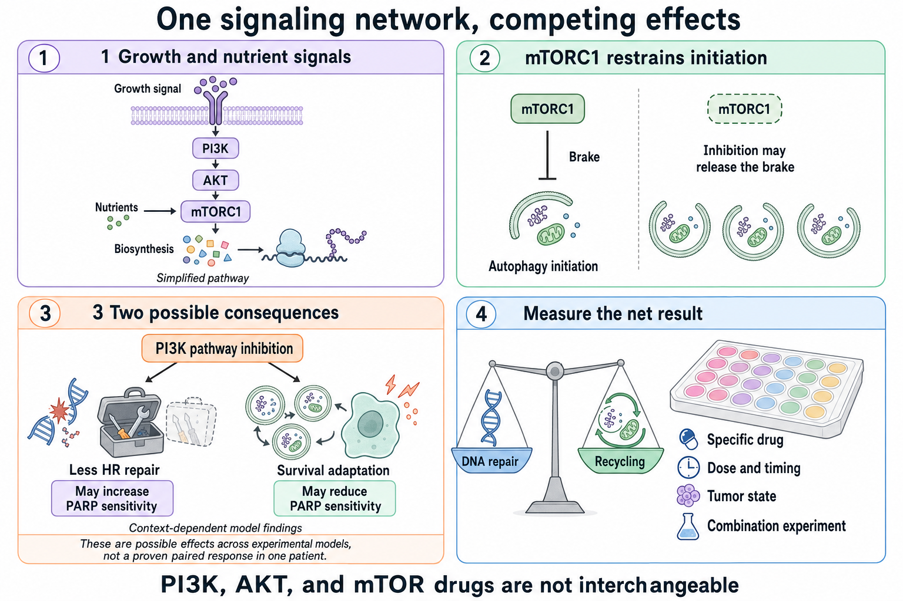

# PI3K, AKT, and mTOR: competing effects on repair and recycling

**Changing one growth signal can weaken repair, alter recycling, and trigger feedback at the same time. A pathway arrow cannot tell us which effect will dominate survival.**

**Before you start:** [Ligands and receptors](/wiki/education/concepts/biology-basics/signaling/ligand-and-receptor) explain how cells receive signals; [DNA, RNA, and protein](/wiki/education/concepts/biology-basics/genetics/central-dogma) separates instructions from machinery; [homologous recombination (HR)](/wiki/education/concepts/cancer-biology/genome-instability-and-repair/homologous-recombination-and-hrd) is template-based DNA repair. DNA means deoxyribonucleic acid, and RNA means ribonucleic acid.

## Where this step sits

This is optional step 6 of [From a variant to a drug claim](/wiki/education/guides/from-variant-to-drug/index). The previous lesson separates [recycling amount, flow, and dependence](./05-autophagy-flux-and-dependence). This step adds growth signals to that picture. The final lesson tests the complete combination rather than predicting its outcome from one arrow.

## Follow the signal, then look for the brakes

Imagine a control panel with several linked switches. Turning one down may slow an output. It may also release a safety brake that turns another switch back up. Cells use feedback like this, although their switches are chemical reactions rather than knobs.

The familiar [PI3K → AKT → mTORC1 pathway](/wiki/education/concepts/cancer-biology/signaling-pathways/pi3k-akt-mtor) is a simplified growth-signaling route:

| Component | Full name or meaning | A role in this simplified route |
|---|---|---|
| PI3K | Phosphoinositide 3-kinase | Produces lipid signals at membranes that help recruit and activate downstream machinery. |
| AKT | Also called protein kinase B | Relays signals that can affect survival, metabolism, and growth. |
| mTORC1 | Mechanistic target of rapamycin complex 1 | Integrates growth and nutrient inputs, promotes biosynthesis, and restrains autophagy initiation. |
| PTEN | Phosphatase and tensin homolog | Removes a phosphate from a lipid signal made by PI3K, acting as a brake on this route. |

A **kinase** adds phosphate groups to a target; a **phosphatase** removes them. These modifications can change activity without changing how much protein is present. PTEN's lipid-phosphatase activity was demonstrated experimentally; loss of its relevant function can remove a restraint on PI3K signaling. RNA abundance alone cannot establish whether that restraint is working. [Maehama and Dixon 1998](https://pubmed.ncbi.nlm.nih.gov/9593664/).

*Follow both repair and stress responses, then measure their combined effect.*

## One intervention can affect two branches

The first branch concerns repair. In some BRCA-proficient triple-negative breast cancer models, PI3K inhibition lowered BRCA1 and BRCA2 expression and increased sensitivity to a **poly(ADP-ribose) polymerase (PARP)** inhibitor. PARP enzymes build chemical signals at DNA damage. This provides a mechanism worth testing. It does not show that every PI3K drug creates the same repair defect in every tumor. [Ibrahim 2012](https://pmc.ncbi.nlm.nih.gov/articles/PMC5125254/).

The second branch concerns [autophagy](/wiki/education/concepts/cancer-biology/cell-death-and-survival/autophagy), the recycling process from [supporting lesson 5](./05-autophagy-flux-and-dependence). mTORC1 restrains machinery that starts this process. Reducing that restraint can make initiation easier. It does not show that cargo completes degradation or that the increased recycling helps the cell survive. Those are separate measurements. Experiments connecting mTORC1 to the initiation protein ULK1 support this control mechanism. ULK1 is a kinase involved in starting autophagy. [Kim 2011](https://pmc.ncbi.nlm.nih.gov/articles/PMC3987946/).

A different preclinical experiment found that mTOR inhibition increased talazoparib resistance in HeLa cervical cancer cells; reducing ATG7, an autophagy machinery protein, partly reversed that effect. This was a particular model and intervention, rather than a demonstrated effect of every growth-pathway drug in breast cancer. [Hoslett 2026](https://www.nature.com/articles/s41556-026-01961-5).

An intervention can therefore make repair less effective while also changing a stress response. Whether those changes cooperate or compete depends on the actual cell state, compound, dose, and timing. A cell already lacking a repair function cannot be assumed to gain the same added vulnerability as a cell in which the intervention first reduces that function.

## Feedback can make neighboring signals disagree

**Rapalogs** are drugs related to rapamycin that inhibit signaling through mTORC1. In some studied systems, mTORC1 inhibition relieved feedback that had been suppressing upstream growth signals. AKT activity then rose while the targeted mTORC1 output fell. This is a measured feedback response, rather than a contradiction of the pathway diagram. It is conditional, not an inevitable result in every tumor. [O'Reilly 2006](https://pmc.ncbi.nlm.nih.gov/articles/PMC3193604/).

[PI3K and AKT inhibitors](/wiki/education/concepts/therapeutics/targeted-small-molecules/pi3k-akt-inhibitors), a rapalog, and a drug that inhibits mTOR's kinase activity act differently. The last can affect a broader set of mTOR functions than a rapalog. They cannot stand in for one another merely because their targets appear on the same diagram.

## A worked example: expression is not the activity switch

A fictional lab studies a combination. It sees fewer repair-protein instructions, reduced phosphorylation of an mTORC1 downstream target, and increased AKT phosphorylation after a rapalog. Phosphorylation means attachment of phosphate groups to a protein.

The tempting conclusion is “the pathway measurements disagree.” A better reading is more precise:

1. The RNA result concerns instructions; a protein measurement is needed to check the proposed repair change.
2. The downstream phosphorylation result suggests one targeted signaling output changed, provided the assay and controls are adequate.
3. Increased AKT phosphorylation may fit feedback, but one marker does not establish every AKT output.
4. None of these observations determines whether the cells die, stop growing, or recover after treatment.

The lab should connect the pathway measurements with adequate repair, recycling, and survival readouts. The experiment can then test the net effect instead of voting among arrows.

## What can go wrong at this step

A high expression signal can be mistaken for kinase activity. Kinase activity can be mistaken for dependence. A result from one inhibitor can be generalized to an entire pathway. Each overread ignores a different part of the causal chain.

Another error is declaring the combination helpful because repair fell, or harmful because recycling initiation rose. Both effects may be real while the survival outcome remains uncertain. The [synthetic-lethality concept](/wiki/education/concepts/therapeutics/how-drugs-work/synthetic-lethality) requires evidence about paired losses; it cannot be inferred from a pathway drawing.

## Try it

In a fictional experiment, mTORC1 output falls, AKT activity rises, and more autophagosomes are visible. What can you conclude about the combination's survival effect?

Show the answer

The measurements may fit target inhibition with feedback and changed recycling. More autophagosomes still do not establish completed flux. There is no survival conclusion yet: measure cell death or regrowth, alongside controls that connect the proposed mechanism to the result.

## Explain it back

“An RNA signal asks ___; a phosphorylation assay asks ___; a survival experiment asks ___.”

One possible answer: “which instructions are present; whether a specified protein modification changed; what happened to cells under the tested conditions.”

## Takeaway

**A combination's net effect must be measured across its competing mechanisms.**

**Next:** [Read the experiment and bound its claim](./07-reading-a-functional-experiment).

## Sources and scope

Source check: 2026-10-09. General signaling education; expert and learner review pending. The worked lab case is fictional. Research examples establish mechanisms in their studied systems, not a safe or effective personal combination.

- [Maehama and Dixon 1998: PTEN lipid-phosphatase activity](https://pubmed.ncbi.nlm.nih.gov/9593664/).
- [Ibrahim 2012: PI3K inhibition, BRCA expression, and PARP response in breast cancer models](https://pmc.ncbi.nlm.nih.gov/articles/PMC5125254/).
- [Kim 2011: mTOR regulation of autophagy initiation](https://pmc.ncbi.nlm.nih.gov/articles/PMC3987946/).
- [O'Reilly 2006: feedback activation of AKT after mTOR inhibition](https://pmc.ncbi.nlm.nih.gov/articles/PMC3193604/).
- [Hoslett 2026: mTOR inhibition, autophagy, and PARP response in a preclinical model](https://www.nature.com/articles/s41556-026-01961-5).
- [Rodrik-Outmezguine 2011: feedback after mTOR kinase inhibition](https://aacrjournals.org/cancerdiscovery/article/1/3/248/676/mTOR-Kinase-Inhibition-Causes-Feedback-Dependent).
