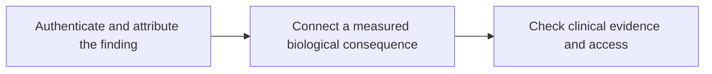

# From a variant to a drug claim

**Evaluate a molecular drug claim from credible finding through measured biology to clinical evidence and access.**

A sequencing report can offer a useful clue. The next step is to find out what the clue actually supports. This guide helps you ask a sequence of concrete questions without needing to become a specialist in every pathway.

The core path takes about 46 minutes. Start with [DNA, RNA, and protein](/wiki/education/multi-omics-foundations/00-genes-rna-and-protein) if those layers are unfamiliar. [The multi-omics guide](/wiki/education/reading-a-tumor/omics-and-multi-omics) offers a fuller introduction to connecting measurements.

## The big ideas

1. A finding needs a clear specimen, assay, and attribution before it can support a biological claim.
2. A gene name does not establish the direction of a protein or pathway change.
3. A measured state and a selective survival dependence are different conclusions.
4. Clinical evidence must fit the disease, biomarker, treatment setting, and intended outcome.
5. Eligibility and access are additional gates; neither substitutes for evidence of benefit.

## The map

## Lessons

| Step | Lesson | The question it answers | Minutes | Learning aid |
|---|---|---|---|---|
| 1 | [Authenticate and attribute the finding](/wiki/education/guides/from-variant-to-drug/01-authenticate-and-attribute-the-finding) | Is the finding credible, and which cells carry it? | 14 | A read-fraction and specimen exercise |
| 2 | [Connect repair biology to PARP sensitivity](/wiki/education/molecular-profiling/hrd-parp-and-dianas-biology) | What consequence was measured, and what remains predicted? | 16 | Two models with similar scars and different current repair |
| 3 | [Check clinical evidence and access](/wiki/education/guides/from-variant-to-drug/03-check-clinical-evidence-and-access) | Does the evidence fit the intended use? | 16 | Disease, biomarker, and setting comparisons |

The repair example teaches a general method. It does not make every drug claim a homologous recombination deficiency (HRD) question. Use [the pathway mechanisms library](/wiki/education/molecular-profiling/evee-proposed-pathways) when your proposed consequence involves recycling, growth signals, lipid supply, developmental signals, or stress defenses.

## Concepts you will use

For the finding, use [mutation types](/wiki/education/concepts/biology-basics/genetics/mutation-types), [germline versus somatic](/wiki/education/concepts/biology-basics/genetics/germline-vs-somatic), and [variant allele fraction versus cancer-cell fraction](/wiki/education/concepts/measurement/sequencing-basics/variant-allele-fraction-and-cancer-cell-fraction).

For the consequence, use [homologous recombination and HRD](/wiki/education/concepts/cancer-biology/genome-instability-and-repair/homologous-recombination-and-hrd) and [synthetic lethality](/wiki/education/concepts/therapeutics/how-drugs-work/synthetic-lethality). The supporting library links to its specialist concepts at the start of each lesson.

For translation, use [clinical actionability](/wiki/education/concepts/evidence-and-statistics/biomarkers/actionability), [prognostic versus predictive biomarkers](/wiki/education/concepts/evidence-and-statistics/biomarkers/prognostic-vs-predictive), and [analytical validity, clinical validity, and utility](/wiki/education/concepts/measurement/computational-analysis/analytical-validity-clinical-validity-and-utility). A clear mechanism and a valid measurement still leave a clinical comparison to answer.

## Keep an evidence ledger

At each step, record the observation, its source, the conclusion it supports, and the next unresolved question. A fictional repair-gene variant may be confirmed in DNA, alter an RNA junction, and accompany a protein signal. A functional assay then asks whether repair is impaired. A clinical study asks a different question about benefit in a defined population.

[From data to a care plan](/wiki/education/molecular-profiling/07-from-data-to-care-plan) is the shared supporting lesson for this ledger. [Judging a test or vendor claim](/wiki/education/guides/judging-a-test-or-vendor-claim/index) helps assess the claim's wording and validation. [Accessing experimental therapy](/wiki/education/guides/accessing-experimental-therapy/index) develops the practical final gate.

## Applied to Diana

[The molecular profile](/wiki/care/molecular-profile) owns qualified findings. [The postoperative treatment question](/wiki/questions/adjuvant-treatment) owns the care decision. Use these owners for application; this guide teaches the reasoning rather than maintaining case results.

## What is still uncertain

A model can differ from the tumor in cell mixture, exposure, and environment. A pathway can be active without being a selective bottleneck. A clinical signal can be real while leaving an unstudied setting unresolved. Each uncertainty should stay attached to the claim it limits.

Source check: 2026-10-09. General education; expert and learner review pending. Study and indication examples are dated in the lessons and need a fresh check for a real clinical decision.
