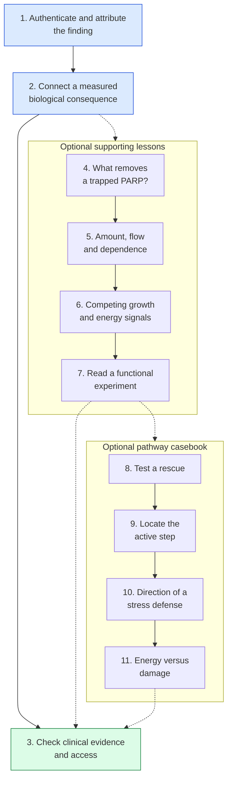

# From a variant to a drug claim

**Evaluate a molecular drug claim from credible finding through measured biology to clinical evidence and access.**

A sequencing report can offer a useful clue. The next step is to find out what the clue actually supports. This guide helps you ask a sequence of concrete questions without needing to become a specialist in every pathway.

The core path takes about 46 minutes. Start with [DNA, RNA, and protein](/wiki/education/guides/what-multi-omics-tells-us/01-genes-rna-and-protein) if those layers are unfamiliar. [The multi-omics guide](/wiki/education/guides/what-multi-omics-tells-us/index) offers a fuller introduction to connecting measurements.

## The big ideas

1. A finding needs a clear specimen, assay, and attribution before it can support a biological claim.
2. A gene name does not establish the direction of a protein or pathway change.
3. A measured state and a selective survival dependence are different conclusions.
4. Clinical evidence must fit the disease, biomarker, treatment setting, and intended outcome.
5. Eligibility and access are additional gates; neither substitutes for evidence of benefit.

## The map

Solid arrows are the 46-minute core. Dotted arrows show two optional shelves: four supporting lessons that deepen the repair example, then a four-lesson pathway casebook. Both feed back into step 3.

## Lessons

| Step | Lesson | The question it answers | Minutes | Learning aid |
|---|---|---|---|---|
| 1 | [Authenticate and attribute the finding](/wiki/education/guides/from-variant-to-drug/01-authenticate-and-attribute-the-finding) | Is the finding credible, and which cells carry it? | 14 | A read-fraction and specimen exercise |
| 2 | [Connect repair biology to PARP sensitivity](/wiki/education/guides/from-variant-to-drug/02-connect-repair-biology-to-parp-sensitivity) | What consequence was measured, and what remains predicted? | 16 | Two models with similar scars and different current repair |
| 3 | [Check clinical evidence and access](/wiki/education/guides/from-variant-to-drug/03-check-clinical-evidence-and-access) | Does the evidence fit the intended use? | 16 | Disease, biomarker, and setting comparisons |

The repair example teaches a general method. It does not make every drug claim a homologous recombination deficiency (HRD) question.

## Optional supporting lessons

These four lessons deepen the repair example. The core takes about 46 minutes; these add about 47. Each teaches one general question you can ask of any drug claim: what does the drug physically do, is a busy-looking pathway actually completing its work, can one intervention push survival two ways, and what would a convincing experiment show?

| Step | Lesson | The question it answers | Minutes | Learning aid |
|---|---|---|---|---|
| 4 | [PARP trapping and recycling](/wiki/education/guides/from-variant-to-drug/04-parp-trapping-and-recycling) | What obstacle does the drug create, and what might remove it? | 9 | An obstacle cartoon and a three-explanation table |
| 5 | [Autophagy: traffic, flow, and dependence](/wiki/education/guides/from-variant-to-drug/05-autophagy-flux-and-dependence) | Does a busy-looking recycling system help a cell survive? | 13 | A recycling-station figure and a proteasome contrast |
| 6 | [Growth signals, repair, and recycling](/wiki/education/guides/from-variant-to-drug/06-pi3k-akt-mtor-and-repair) | How can one intervention push survival in different directions? | 13 | A pathway cartoon and feedback example |
| 7 | [Read a functional experiment](/wiki/education/guides/from-variant-to-drug/07-reading-a-functional-experiment) | What would a convincing combination result establish? | 12 | Controls and interaction arithmetic |

## Optional pathway casebook

The casebook applies the same reasoning to other pathways, each through published experiments. First ask what was measured: a sequence change, an RNA program, a protein state or a functional response. Then ask which direction the finding implies and whether that direction was tested. Finally, separate an active process from one the cancer cells need to survive. Read the four in order, or choose the one that fits your question; together they take about 47 minutes.

| Step | Lesson | The question it answers | Minutes | Worked case |
|---|---|---|---|---|
| 8 | [Test a supply dependence with a rescue experiment](/wiki/education/guides/from-variant-to-drug/08-test-a-supply-dependence-with-rescue) | Which missing product explains the effect? | 11 | Mutant p53, statins and the mevalonate pathway |
| 9 | [Locate the active signaling step](/wiki/education/guides/from-variant-to-drug/09-locate-the-active-signaling-step) | Does the cancer's signal still pass the step the drug blocks? | 12 | Notch rearrangements in triple-negative breast cancer; Wnt ligand dependence |
| 10 | [Test the direction of a stress defense](/wiki/education/guides/from-variant-to-drug/10-test-the-direction-of-a-stress-defense) | Does a defense protect the tumor or make it dependent? | 12 | KEAP1 loss in lung cancer; GPX4 in drug-tolerant cells |
| 11 | [Measure energy and damage separately](/wiki/education/guides/from-variant-to-drug/11-measure-energy-and-damage-separately) | Which energy or damage process was actually measured? | 12 | Oxygen use in residual triple-negative tumors |

## Concepts you will use

For the finding, use [the genetic code](/wiki/education/concepts/biology-basics/genetics/genetic-code), [mutation types](/wiki/education/concepts/biology-basics/genetics/mutation-types), [germline versus somatic](/wiki/education/concepts/biology-basics/genetics/germline-vs-somatic), and [variant allele fraction versus cancer-cell fraction](/wiki/education/concepts/measurement/sequencing-basics/variant-allele-fraction-and-cancer-cell-fraction).

For the consequence, use [DNA damage and repair](/wiki/education/concepts/cancer-biology/genome-instability-and-repair/dna-damage-and-repair-overview), [PARP inhibitors and trapping](/wiki/education/concepts/therapeutics/targeted-small-molecules/parp-inhibitors-and-trapping), [homologous recombination and HRD](/wiki/education/concepts/cancer-biology/genome-instability-and-repair/homologous-recombination-and-hrd), [composite HRD scores](/wiki/education/concepts/cancer-biology/genome-instability-and-repair/composite-hrd-scores), [BRCA reversion mutations](/wiki/education/concepts/cancer-biology/genome-instability-and-repair/brca-reversion-mutations), [synthetic lethality](/wiki/education/concepts/therapeutics/how-drugs-work/synthetic-lethality) and [oncogene addiction versus synthetic lethality](/wiki/education/concepts/cancer-biology/what-cancer-is/oncogene-addiction-vs-synthetic-lethality).

For the casebook, by lesson: recycling uses [autophagy](/wiki/education/concepts/cancer-biology/cell-death-and-survival/autophagy) and [ubiquitin and the proteasome](/wiki/education/concepts/cancer-biology/cell-death-and-survival/ubiquitin-and-proteasome); growth and supply use [PI3K–AKT–mTOR](/wiki/education/concepts/cancer-biology/signaling-pathways/pi3k-akt-mtor), [AMPK](/wiki/education/concepts/cancer-biology/metabolism-and-stress/nutrient-sensing-ampk) and [SCAP–SREBP](/wiki/education/concepts/cancer-biology/metabolism-and-stress/cholesterol-and-srebp); cell messages use [Notch](/wiki/education/concepts/cancer-biology/signaling-pathways/notch-signaling), [Wnt–β-catenin](/wiki/education/concepts/cancer-biology/signaling-pathways/wnt-beta-catenin) and [receptor tyrosine kinases](/wiki/education/concepts/cancer-biology/signaling-pathways/receptor-tyrosine-kinases); stress and energy use [NRF2–KEAP1](/wiki/education/concepts/cancer-biology/signaling-pathways/nrf2-keap1), [ferroptosis](/wiki/education/concepts/cancer-biology/cell-death-and-survival/ferroptosis) and [oxidative phosphorylation](/wiki/education/concepts/cancer-biology/metabolism-and-stress/oxidative-phosphorylation).

For translation, use [clinical actionability](/wiki/education/concepts/evidence-and-statistics/biomarkers/actionability), [prognostic versus predictive biomarkers](/wiki/education/concepts/evidence-and-statistics/biomarkers/prognostic-vs-predictive), and [analytical validity, clinical validity, and utility](/wiki/education/concepts/measurement/computational-analysis/analytical-validity-clinical-validity-and-utility). A clear mechanism and a valid measurement still leave a clinical comparison to answer.

## Keep an evidence ledger

Use the [variant-to-benefit evidence chain](/wiki/education/concepts/evidence-and-statistics/reasoning-tools/evidence-chain-variant-to-benefit) to keep the bridges visible. At each step, record the observation, its source, the conclusion it supports, and the next unresolved question. A fictional repair-gene variant may be confirmed in DNA, alter an RNA junction, and accompany a protein signal. A functional assay then asks whether repair is impaired. A clinical study asks a different question about benefit in a defined population.

[Integrating the evidence](/wiki/education/guides/what-multi-omics-tells-us/10-integrate-the-evidence) is the shared supporting lesson for this ledger. [Judging a test or vendor claim](/wiki/education/guides/judging-a-test-or-vendor-claim/index) helps assess the claim's wording and validation. [Accessing experimental therapy](/wiki/education/guides/accessing-experimental-therapy/index) develops the practical final gate.

## Applied to Diana

[The molecular profile](/wiki/care/molecular-profile) owns qualified findings. [The postoperative treatment question](/wiki/questions/adjuvant-treatment) owns the care decision. [The diagnostic workplan](/project-management/projects/research/diagnostics) owns practical specimen arrangements. This guide teaches the reasoning rather than maintaining case results.

## What is still uncertain

Selective removal of trapped PARP remains a research question. One preclinical study does not establish that broad lysosomal drugs reproduce the mechanism in patients. Exact drugs, exposure, schedule, safety, and disease setting matter.

A model can differ from the tumor in cell mixture, exposure, and environment. A pathway can be active without being a selective bottleneck. A clinical signal can be real while leaving an unstudied setting unresolved. Each uncertainty should stay attached to the claim it limits.

Source check: 2026-11-08. General education; expert and learner review pending. Study and indication examples are dated in the lessons and need a fresh check for a real clinical decision.
