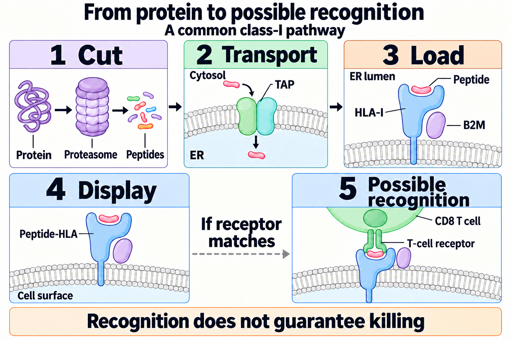

# How a T cell sees a cancer cell

**A T cell never sees a whole cancer cell. It reads short protein fragments that the cell displays on [human leukocyte antigen (HLA)](/wiki/education/concepts/immunology/antigen-presentation/hla) molecules, and it responds only when its receptor fits one fragment held by one HLA molecule.**

**Before you start:**

- [Proteins and peptides](/wiki/education/concepts/biology-basics/molecules/protein-and-peptide): a peptide is a short chain cut from a protein.
- [HLA](/wiki/education/concepts/immunology/antigen-presentation/hla): the cell-surface molecules that display peptides.
- [T-cell receptor (TCR)](/wiki/education/concepts/immunology/t-cells/t-cell-receptor): the receptor that reads a peptide together with its HLA molecule.
- [Neoantigen](/wiki/education/concepts/immunology/antigen-presentation/neoantigen): a target created by a tumor-specific mutation.

## Where this step sits

This is lesson 1 of [the immune-system guide](/wiki/education/guides/how-the-immune-system-fights-cancer/index). Everything later in the guide depends on it: priming, travel to the tumor, cell states, escape and checkpoint drugs all assume a T cell has something to recognize.

**Protein → fragment → HLA display → receptor contact →** (lesson 2) **a primed response.**

## Every cell posts samples of its proteins

Think of a shop that tapes a few torn scraps of everything it makes to the front window. Passers-by never go inside; they judge the shop by the scraps. A cell does something similar. The window is HLA, and the passers-by are T cells. The analogy breaks in one important way: each window frame holds only scraps of a particular shape, so two shops making the same product may post different scraps.

Most nucleated cells use the **class I** route ([Neefjes et al., 2011](https://pubmed.ncbi.nlm.nih.gov/22076556/)):

1. **Cut.** The proteasome, a protein-shredding complex, cuts proteins from inside the cell into peptides. Mutated, misfolded and normal proteins all get cut.
2. **Transport.** A pump called TAP (transporter associated with antigen processing) moves peptides into the endoplasmic reticulum, where proteins for the surface are assembled.
3. **Load.** A class I HLA molecule (HLA-A, HLA-B or HLA-C), held together with [beta-2 microglobulin (B2M)](/wiki/education/concepts/immunology/antigen-presentation/b2m), binds a peptide that fits its groove. Class I peptides are usually 8 to 10 amino acids long.
4. **Display.** The peptide–HLA complex moves to the cell surface, where a CD8 T cell can inspect it.

*Cut, transport, load, display: recognition is possible only at the last step, and it still does not guarantee killing.*

**Class II** HLA works differently. Mainly on dendritic cells, macrophages and B cells, it displays longer peptides from material the cell has swallowed, for CD4 T cells. [CD4 versus CD8](/wiki/education/concepts/immunology/t-cells/cd4-vs-cd8) compares the two partners. The [antigen-processing machinery](/wiki/education/concepts/immunology/antigen-presentation/antigen-processing-machinery) page covers each class I step in detail.

Each person inherits two copies each of HLA-A, HLA-B and HLA-C, so a cell can display up to six different classical class I molecules. Each one has a differently shaped groove, so each displays a different set of peptides. This is why the same mutation can produce a displayed target in one person and none in another.

## The receptor reads peptide and holder together

A conventional T-cell receptor is made of an alpha and a beta chain. Its tips contact the peptide and the surrounding HLA surface at the same time. So a T cell recognizes "this peptide, in this HLA molecule", not the peptide alone. Immunologists call this **HLA restriction**.

Each T cell carries one receptor type, and the body holds a huge, varied [repertoire](/wiki/education/concepts/immunology/t-cells/t-cell-repertoire) of them. The contact itself is weak: receptor–peptide–HLA binding is typically in the micromolar range, far weaker than most antibodies ([Stone et al., 2009](https://pubmed.ncbi.nlm.nih.gov/19125887/)). The CD8 or CD4 co-receptor and many contacts at once make it work. Weak, flexible binding also means one receptor can sometimes recognize more than one peptide.

During development in the thymus, most T cells that react strongly to normal self-peptides are removed. That protects healthy tissue. It also means the T cells left over react poorly to tumor fragments that look like self ([self-similarity and tolerance](/wiki/education/concepts/immunology/antigen-presentation/self-similarity-and-tolerance)).

## What makes a fragment look foreign

| Target class | Example | Also found in healthy tissue? | What it means for treatment |
|---|---|---|---|
| [Neoantigen](/wiki/education/concepts/immunology/antigen-presentation/neoantigen) | A peptide spanning a tumor-specific mutation | No | Looks most foreign and carries the least risk of attacking healthy tissue, but is usually unique to one person |
| Cancer-testis antigen, a kind of [tumor-associated antigen](/wiki/education/concepts/immunology/antigen-presentation/tumor-associated-antigen) | NY-ESO-1, found in 16% of 168 triple-negative breast cancers in one study ([Ademuyiwa et al., 2012](https://pubmed.ncbi.nlm.nih.gov/22761704/)) | Normally only in testis germ cells, which display little HLA | Shared across patients, so one receptor or vaccine can serve many people with the right HLA type |
| Overexpressed or tissue antigen | A normal protein made in excess, or one specific to breast tissue | Yes, at lower levels | Tolerance blunts responses, and attacking it risks harming normal tissue |
| Viral antigen | Human papillomavirus proteins in cervical and some throat cancers | Only in infected cells | Highly foreign, but not a usual feature of breast cancer |

Most mutations never become targets. In 75 people with gastrointestinal cancers, tumor-infiltrating lymphocytes from 62 (83%) recognized at least one neoantigen. Yet only 1.6% of the protein-changing mutations tested were recognized, and 99% of the recognized neoantigens were unique to one patient ([Parkhurst et al., 2019](https://pubmed.ncbi.nlm.nih.gov/31164343/)). The mutation must be in an expressed protein, be cut into a fragment that fits one of the person's HLA grooves, be displayed and meet a matching receptor ([Schumacher and Schreiber, 2015](https://pubmed.ncbi.nlm.nih.gov/25838375/)).

## A worked example: one mutation, two people

Two fictional people have tumors with the same mutation in an expressed gene.

- **Person A** carries HLA-A*02:01. A 9-amino-acid peptide spanning the mutation fits that groove, is displayed, and a CD8 T cell with a matching receptor exists. The mutation is a target.
- **Person B** carries six different class I types. None binds any peptide spanning the mutation well. The same mutation offers no class I target, though a class II fragment might still engage CD4 T cells.

Now suppose person A's tumor later loses the chromosome region carrying HLA-A*02:01. The mutation is still there, but its display is gone. That is one of the escape routes in [lesson 6](/wiki/education/guides/how-the-immune-system-fights-cancer/06-find-the-failed-step).

## What can go wrong at this step

- **The protein is not made.** A mutation in an unexpressed gene cannot be displayed.
- **The fragment is not produced or transported.** Defects in the [processing machinery](/wiki/education/concepts/immunology/antigen-presentation/antigen-processing-machinery) block display.
- **No HLA molecule holds it, or the holder is lost.** [HLA loss of heterozygosity](/wiki/education/concepts/measurement/sequencing-basics/hla-loh) removes one inherited set; B2M loss removes all class I display.
- **No matching T cell survives tolerance**, or matching cells are too rare.
- **Prediction is mistaken for display.** A computer can predict that a peptide binds; only measurement shows it is displayed and recognized. See [binding, presentation and recognition](/wiki/education/concepts/immunology/antigen-presentation/binding-presentation-and-recognition).

## Try it

A tumor has 60 mutations that change a protein. Using the 1.6% recognition rate from the gastrointestinal-cancer study, about how many would you expect T cells to recognize, and why is that only a rough guide?

**Answer:** About one (60 × 0.016 ≈ 1). The rate came from one study of gastrointestinal cancers, and the real number depends on which genes are expressed, the person's six class I types and the T cells they carry.

## Explain it back

"A T cell recognizes ___ held by ___; a neoantigen differs from a shared tumor antigen because ___."

**One possible answer:** "a short peptide; one particular HLA molecule; it comes from a tumor-only mutation and is usually unique to that person, while a shared antigen is a normal or germ-cell protein found in many patients' tumors."

## Takeaway

**T cells read peptide–HLA pairs, so a target exists only when a tumor protein is made, cut, displayed on the person's own HLA and met by a matching receptor.**

**Next:** [How dendritic cells help start a T-cell response](/wiki/education/guides/how-the-immune-system-fights-cancer/02-start-a-response).

## Sources and scope

Source-checked November 8, 2026, against PubMed abstracts. General recognition biology; the two-person example is fictional. Expert and learner review pending.

- [Neefjes et al., 2011: class I and class II antigen presentation](https://pubmed.ncbi.nlm.nih.gov/22076556/) — review.
- [Stone et al., 2009: T-cell receptor binding affinities](https://pubmed.ncbi.nlm.nih.gov/19125887/) — review.
- [Schumacher and Schreiber, 2015: neoantigens in cancer immunotherapy](https://pubmed.ncbi.nlm.nih.gov/25838375/) — review.
- [Parkhurst et al., 2019: neoantigen recognition in 75 people with gastrointestinal cancers](https://pubmed.ncbi.nlm.nih.gov/31164343/) — laboratory screening of tumor-infiltrating lymphocytes, not a breast-cancer rate.
- [Ademuyiwa et al., 2012: NY-ESO-1 in triple-negative breast cancer](https://pubmed.ncbi.nlm.nih.gov/22761704/) — 168 triple-negative breast cancer specimens from one institution.
