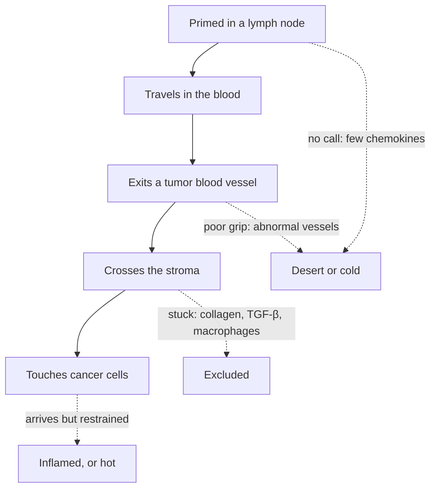

# How T cells reach a tumor, and what keeps them out

**A primed T cell must leave the lymph node, travel in the blood, exit through a tumor blood vessel and cross the surrounding tissue to touch cancer cells. A tumor can block any leg of that trip, and where the trip stops decides whether the tumor looks cold, excluded or hot.**

**Before you start:**

- [Lymph nodes and lymphatics](/wiki/education/concepts/immunology/the-immune-system/lymph-nodes-and-lymphatics): where T cells are primed.
- [Cytokines and chemokines](/wiki/education/concepts/immunology/immune-regulation/cytokine-and-chemokine): chemokines are the signals that direct cell movement.
- [The tumor microenvironment](/wiki/education/concepts/cancer-biology/tumor-microenvironment/tumor-microenvironment): the vessels, support cells and matrix around cancer cells.
- [Hot, excluded and cold tumors](/wiki/education/concepts/immunology/tumor-immunology/hot-excluded-cold-tumor): the names for where immune cells sit.

## Where this step sits

This is lesson 3 of [the immune-system guide](/wiki/education/guides/how-the-immune-system-fights-cancer/index). Lesson 1 showed what a T cell recognizes; lesson 2 showed how it gets primed in a lymph node. Recognition can only happen once the cell arrives. Lesson 4 then reads the tissue map the trip leaves behind.

*The four legs of the trip, and the pattern left behind when each fails.*

## The trip has four legs

Imagine a rescue crew. It needs a call for help, a road with an exit, a way across the yard and a door into the building. Each can fail separately. The analogy breaks because the "road" and "yard" are living tissue that the tumor keeps reshaping.

**1. Leave the node and hear the call.** After priming, effector T cells change the receptors on their surface. They leave the lymph node, enter the blood and now carry chemokine receptors such as CXCR3. Tissues that are inflamed release chemokines such as CXCL9 and CXCL10, which bind CXCR3. In human melanoma metastases, six chemokines including CCL5, CXCL9 and CXCL10 were expressed mainly in tumors that contained T cells ([Harlin et al., 2009](https://pubmed.ncbi.nlm.nih.gov/19293190/)).

**2. Grip the vessel wall and exit.** A T cell in a fast-flowing vessel first rolls along the wall, then sticks firmly using adhesion molecules, then squeezes between the lining cells ([Slaney et al., 2014](https://pubmed.ncbi.nlm.nih.gov/25477332/)). Tumor vessels are often leaky and disorganized, and their lining may show little of the adhesion molecules intercellular adhesion molecule 1 (ICAM-1) and vascular cell adhesion molecule 1 (VCAM-1). In mouse and human melanoma models, CXCR3 signaling was needed for transferred CD8 T cells to stick inside tumor vessels and leave them ([Mikucki et al., 2015](https://pubmed.ncbi.nlm.nih.gov/26109379/)).

**3. Cross the stroma.** Outside the vessel lies the stroma: [fibroblasts](/wiki/education/concepts/cancer-biology/tumor-microenvironment/cancer-associated-fibroblasts-and-stroma), collagen and other [extracellular matrix](/wiki/education/concepts/cancer-biology/tumor-microenvironment/extracellular-matrix). In live slices of human lung tumors, T cells moved freely in loose matrix, stalled in dense matrix and tracked along aligned fibers that steered them around cancer-cell islands. Digesting collagen let more T cells reach cancer cells ([Salmon et al., 2012](https://pubmed.ncbi.nlm.nih.gov/22293174/)).

**4. Reach the cancer cells.** Inside cancer-cell nests, the T cell can finally test the peptide–[human leukocyte antigen (HLA)](/wiki/education/concepts/immunology/antigen-presentation/hla) pairs from lesson 1. What happens next, killing or restraint, belongs to lessons 5 to 7.

## Where the trip stops sets the pattern

| Where T cells stop | Common causes | Pattern a pathologist sees |
|---|---|---|
| Never called in, or never primed | Few recruitment chemokines; tumor WNT/β-catenin signaling that keeps away the dendritic cells needed to start a response | **Desert**: few T cells anywhere, often called cold |
| At the vessel wall | Abnormal vessels with little adhesion-molecule display | Few T cells in the tissue, sometimes patchy |
| In the stroma | Dense collagen, fibroblast transforming growth factor beta (TGF-β) signaling, macrophages that hold T cells in long contacts | **Excluded**: T cells crowd the stroma or edge, few inside nests |
| Inside the nests | The trip succeeded; restraint by programmed death-ligand 1 (PD-L1), exhaustion or regulatory cells comes next | **Inflamed**, often called hot |

The [T-cell exclusion mechanisms](/wiki/education/concepts/immunology/tumor-immunology/t-cell-exclusion-mechanisms) concept gives the evidence for each barrier. Most of the causal proof comes from mice and tissue slices. For example, in metastatic urothelial cancer treated with atezolizumab, a stromal TGF-β signature went with exclusion and non-response, and in mice blocking TGF-β together with PD-L1 let T cells in ([Mariathasan et al., 2018](https://pubmed.ncbi.nlm.nih.gov/29443960/)).

## What this looks like in triple-negative breast cancer

Triple-negative breast cancer (TNBC) shows all three patterns. In 681 TNBCs, Hammerl and colleagues found that excluded tumors carried collagen deposits and TGF-β and blood-vessel growth signaling. "Ignored" tumors, with few T cells, showed either many CD163-positive myeloid cells (a macrophage type) or WNT pathway activity. Inflamed tumors had more CLEC9A-positive dendritic cells, the subtype that specializes in priming CD8 T cells. In a phase II trial of an anti-PD-1 drug in metastatic TNBC, the inflamed pattern went with response and the other two with resistance ([Hammerl et al., 2021](https://pubmed.ncbi.nlm.nih.gov/34580291/)).

Another TNBC study found a subgroup whose CD8 T cells stayed in the stroma, with poor outcomes ([Gruosso et al., 2019](https://pubmed.ncbi.nlm.nih.gov/30753167/)). These are associations. They show the patterns are real in TNBC; they do not prove that a given barrier caused a given outcome.

## A worked example: two different stops

Two fictional TNBC biopsies are both described as "not very hot".

- **Biopsy A** has many CD8 T cells packed in collagen-dense stroma, few inside cancer-cell nests and a high TGF-β gene signature. The trip most likely stopped in the stroma.
- **Biopsy B** has few T cells anywhere and low CXCL9 and CXCL10. The trip may never have started: T cells were not called in, or were never primed.

The same word hides two different failures. A proposed fix for A, such as loosening the stroma, would not help B, which needs a call or a primed response. Each idea still needs its own evidence.

## What can go wrong at this step

- **Calling an excluded tumor cold.** The T cells are close by; the barrier is the problem, not their absence.
- **Reading the cause from the picture.** An image shows where cells are. It does not show whether collagen, TGF-β, vessels or macrophages put them there.
- **Treating a mouse rescue as a treatment.** Several barriers can be opened in mice. No drug that targets an exclusion mechanism is an approved part of TNBC treatment.
- **Forgetting sampling.** One biopsy shows one region at one time. Another region, or the same region after treatment, can look different.

## Try it

A report gives a high stromal tumor-infiltrating lymphocyte (sTIL) score of 40%, but multiplex imaging shows few CD8 T cells inside cancer-cell nests. Is the tumor hot? What would you ask next?

**Answer:** Not necessarily. The [sTIL score](/wiki/education/concepts/measurement/pathology-readouts/stil-scoring) counts lymphocytes in the stroma, so a high score is compatible with an excluded pattern. Ask what holds the cells in the stroma: collagen density, a TGF-β signature or stromal macrophages.

## Explain it back

"Desert means T cells ___; excluded means they ___; inflamed means they ___."

**One possible answer:** "were never called in or primed; arrived but stopped in the stroma; reached the cancer cells, where restraint may begin."

## Takeaway

**Where T cells stop on their way into a tumor tells you which step failed, and each failed step needs a different fix.**

**Next:** [Read an immune map without overreading it](/wiki/education/guides/how-the-immune-system-fights-cancer/04-read-an-immune-map).

## Sources and scope

Source-checked November 8, 2026, against PubMed abstracts. Mechanisms shown in mice or tissue slices are labeled; the biopsies are fictional. No treatment recommendation. Expert and learner review pending.

- [Slaney et al., 2014: trafficking of T cells into tumors](https://pubmed.ncbi.nlm.nih.gov/25477332/) — review.
- [Mikucki et al., 2015: CXCR3 at the tumor vessel wall](https://pubmed.ncbi.nlm.nih.gov/26109379/) — mouse and human melanoma models.
- [Salmon et al., 2012: matrix architecture and T-cell movement](https://pubmed.ncbi.nlm.nih.gov/22293174/) — live human lung tumor slices.
- [Mariathasan et al., 2018: TGF-β and T-cell exclusion](https://pubmed.ncbi.nlm.nih.gov/29443960/) — urothelial cancer cohort and mouse models.
- [Hammerl et al., 2021: spatial immune phenotypes in 681 TNBCs](https://pubmed.ncbi.nlm.nih.gov/34580291/) — tissue associations and a phase II trial analysis.
- [Gruosso et al., 2019: spatially distinct TNBC immune microenvironments](https://pubmed.ncbi.nlm.nih.gov/30753167/) — tissue associations.
