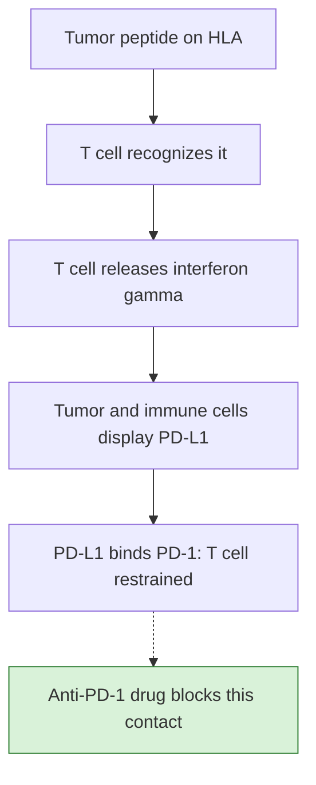

# What checkpoint inhibitors change

**A checkpoint inhibitor removes one brake from T cells that already recognize the cancer. In early triple-negative breast cancer (TNBC), adding pembrolizumab to chemotherapy raised the complete-response rate and improved survival, whether or not the tumor stained for PD-L1.**

**Before you start:**

- [Immune checkpoint](/wiki/education/concepts/immunology/immune-regulation/immune-checkpoint): a normal inhibitory signal that limits T-cell activity.
- [Immune checkpoint inhibitor](/wiki/education/concepts/therapeutics/immunotherapy/immune-checkpoint-inhibitor): a drug that blocks one such signal.
- [T-cell exhaustion](/wiki/education/concepts/immunology/t-cells/t-cell-exhaustion): the restrained program T cells enter under persistent antigen.
- [Prognostic vs predictive](/wiki/education/concepts/evidence-and-statistics/biomarkers/prognostic-vs-predictive): tracking outcome versus tracking benefit from one treatment.

## Where this step sits

This is lesson 7 of [the immune-system guide](/wiki/education/guides/how-the-immune-system-fights-cancer/index). Lessons 1 to 6 followed a response from display through priming, travel into the tumor, the tissue map, cell states and escape. This step asks what happens when a drug changes one of those steps.

*The drug acts at the last contact. It cannot create the earlier steps: a displayed target, a matching T cell and access to the tumor.*

## The brake that the tumor borrows

Programmed cell death protein 1 (PD-1) is a receptor on activated and exhausted T cells. When it binds programmed death-ligand 1 (PD-L1), the T cell's activating signals are damped. In healthy tissue this protects organs from prolonged inflammation.

Tumors often display PD-L1 *because* T cells are attacking them. T cells that recognize a tumor release interferon gamma, and interferon gamma induces PD-L1 on nearby tumor and immune cells. This is called **[adaptive immune resistance](/wiki/education/concepts/immunology/tumor-immunology/adaptive-immune-resistance)**: the brake is pulled in response to the attack ([Taube et al., 2012](https://pubmed.ncbi.nlm.nih.gov/22461641/)). That is why PD-L1 staining and a [lymphocyte-rich "hot" pattern](/wiki/education/concepts/immunology/tumor-immunology/hot-excluded-cold-tumor) often travel together.

Pembrolizumab is an antibody that binds PD-1 and blocks its contact with PD-L1. Cytotoxic T-lymphocyte-associated protein 4 (CTLA-4) is a different checkpoint whose role is emphasized during priming in lymph nodes; the [checkpoint concept](/wiki/education/concepts/immunology/immune-regulation/immune-checkpoint) compares them.

## What blockade can and cannot do

| Step in the route | Can PD-1 blockade change it? | Why |
|---|---|---|
| A tumor peptide is displayed on [human leukocyte antigen (HLA)](/wiki/education/concepts/immunology/antigen-presentation/hla) | No | Lost antigen, HLA or [beta-2 microglobulin (B2M)](/wiki/education/concepts/immunology/antigen-presentation/b2m) is an [escape route](/wiki/education/concepts/immunology/tumor-immunology/immune-escape) the drug does not repair |
| A matching T cell exists and is primed | Indirectly | PD-1 blockade may let more primed cells expand; it does not create a new receptor |
| T cells reach cancer-cell nests | Not directly | Exclusion by stroma or missing chemokines acts upstream of PD-1 |
| T cells in the tumor keep working | **Yes** | This is the main target: restrained, PD-1-positive cells can act again |
| The response lasts | Partly | Exhausted cells keep a stable chromatin pattern and can relapse into exhaustion ([Pauken et al., 2016](https://pubmed.ncbi.nlm.nih.gov/27789795/)) |

Where do the responding cells come from? In mice, mainly from progenitor exhausted cells that divide after blockade. In paired human skin-cancer biopsies, many expanded clones were new arrivals ([Yost et al., 2019](https://pubmed.ncbi.nlm.nih.gov/31359002/)). Both may contribute; see [T-cell exhaustion](/wiki/education/concepts/immunology/t-cells/t-cell-exhaustion).

## What the trials showed in TNBC

| Trial | Population | Comparison | Result |
|---|---|---|---|
| KEYNOTE-522 | 1,174 patients with untreated stage II or III TNBC, enrolled regardless of PD-L1 | Pembrolizumab or placebo with chemotherapy before surgery, then pembrolizumab or placebo for up to nine cycles after | [Pathological complete response (pCR)](/wiki/education/concepts/breast-cancer/surgery-and-pathology-results/pcr) 64.8% vs 51.2% in the first 602 patients ([Schmid et al., 2020](https://pubmed.ncbi.nlm.nih.gov/32101663/)); 36-month event-free survival 84.5% vs 76.8%, hazard ratio (HR) 0.63 ([Schmid et al., 2022](https://pubmed.ncbi.nlm.nih.gov/35139274/)); 60-month overall survival 86.6% vs 81.7% ([Schmid et al., 2024](https://pubmed.ncbi.nlm.nih.gov/39282906/)) |
| KEYNOTE-355 | 847 patients with untreated advanced (metastatic or inoperable) TNBC | Pembrolizumab or placebo with chemotherapy | Median overall survival 23.0 vs 16.1 months (HR 0.73) when the combined positive score (CPS) was ≥10; not significant when CPS was ≥1 (HR 0.86) ([Cortés et al., 2022](https://pubmed.ncbi.nlm.nih.gov/35857659/)) |

Two details are worth carrying. First, the 64.8% pCR figure comes from the first interim analysis; across all 1,174 patients the US label reports 63.0% vs 55.6% ([FDA label, section 14.20](https://www.accessdata.fda.gov/drugsatfda_docs/label/2026/125514s194lbl.pdf)). Second, KEYNOTE-522 was not designed to separate the effect of pembrolizumab before surgery from its effect after. The [KEYNOTE-522 regimen](/wiki/education/concepts/breast-cancer/treatment-setting/the-keynote-522-regimen) page gives the full schedule, and the [perioperative immune window](/wiki/education/concepts/immunology/tumor-immunology/perioperative-immune-window) explains why timing around surgery is a biological question.

## Which markers select patients

- **PD-L1 is predictive in advanced TNBC.** In KEYNOTE-355, the benefit was concentrated in tumors with CPS ≥10 by the 22C3 assay, and the US label requires that cutoff for advanced disease. See [PD-L1 scoring](/wiki/education/concepts/measurement/pathology-readouts/pd-l1-scoring) for why a different assay's "positive" is not the same.
- **PD-L1 does not select patients in early TNBC.** KEYNOTE-522 enrolled regardless of PD-L1, and the early-disease label has no PD-L1 requirement.
- **sTILs are prognostic.** In 2,148 chemotherapy-treated patients with early TNBC, each 10% increase in stromal tumor-infiltrating lymphocytes (sTILs) was associated with an overall survival HR of 0.84 ([Loi et al., 2019](https://pubmed.ncbi.nlm.nih.gov/30650045/)). That does not show that sTILs pick out who gains from pembrolizumab; see [stromal TIL scoring](/wiki/education/concepts/measurement/pathology-readouts/stil-scoring).

## The cost: immune-related adverse events

Releasing a brake that protects healthy tissue can cause inflammation in any organ. These [immune-related adverse events (irAEs)](/wiki/education/concepts/therapeutics/toxicities-and-supportive-care/immune-related-adverse-event) usually appear during treatment but can start after it ends. Across 2,799 patients given pembrolizumab alone in trials, hypothyroidism occurred in 8% and adrenal insufficiency in 0.8%. In KEYNOTE-522, pembrolizumab was stopped for adverse reactions in 20% of patients, and the label asks for blood cortisol checks before surgery in this setting ([FDA label, sections 5.1 and 6.1](https://www.accessdata.fda.gov/drugsatfda_docs/label/2026/125514s194lbl.pdf)).

## What can go wrong at this step

- **Treating PD-L1 as a universal gate.** Its role depends on the setting, assay and cutoff.
- **Reading "hot" as "will respond".** A lymphocyte-rich tumor is prognostically favorable, but escape by HLA or B2M loss can still block the drug's route.
- **Reading a pCR gain as a cure rate.** pCR is a surgical finding; survival is a separate endpoint, which KEYNOTE-522 also measured.

## Try it

A friend says: "My tumor was PD-L1 negative, so pembrolizumab won't help me in early TNBC." What does the evidence say?

**Answer:** In early TNBC, KEYNOTE-522 enrolled patients regardless of PD-L1, and the approved early-disease use has no PD-L1 requirement. The CPS ≥10 cutoff applies to advanced TNBC, where KEYNOTE-355 found the benefit concentrated in that group. Individual benefit still cannot be read from one marker.

## Explain it back

"Anti-PD-1 drugs act on ___; they cannot supply ___. PD-L1 selects patients in ___ TNBC but not in ___ TNBC." One answer: "T cells that already recognize the tumor but are restrained; a missing target, HLA or access; advanced; early."

## Takeaway

**Checkpoint blockade lifts one late brake; in early TNBC it added to chemotherapy's effect regardless of PD-L1, and it can inflame healthy organs.**

**Next:** [Measure each part of a T-cell response](/wiki/education/guides/how-the-immune-system-fights-cancer/08-measure-a-response).

## Sources and scope

Source-checked November 7, 2026, against PubMed abstracts and the FDA pembrolizumab label (supplement 194). Population-level trial results; no individual treatment recommendation. Expert and learner review pending.

- [Schmid et al., 2020: KEYNOTE-522 pCR](https://pubmed.ncbi.nlm.nih.gov/32101663/); [2022: event-free survival](https://pubmed.ncbi.nlm.nih.gov/35139274/); [2024: overall survival](https://pubmed.ncbi.nlm.nih.gov/39282906/).
- [Cortés et al., 2022: KEYNOTE-355 overall survival](https://pubmed.ncbi.nlm.nih.gov/35857659/).
- [FDA: pembrolizumab label, supplement 194 (2026)](https://www.accessdata.fda.gov/drugsatfda_docs/label/2026/125514s194lbl.pdf), sections 1.20, 5.1, 6.1 and 14.20.
- [Taube et al., 2012: adaptive immune resistance](https://pubmed.ncbi.nlm.nih.gov/22461641/).
- [Loi et al., 2019: sTIL prognosis in early TNBC](https://pubmed.ncbi.nlm.nih.gov/30650045/).
- [Yost et al., 2019](https://pubmed.ncbi.nlm.nih.gov/31359002/) and [Pauken et al., 2016](https://pubmed.ncbi.nlm.nih.gov/27789795/): where responding cells come from, and why reinvigoration fades.
