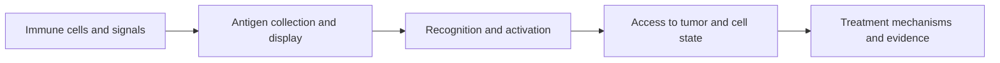

# Understand how the immune system recognizes cancer

**Explain recognition, activation and access before comparing checkpoint drugs, vaccines or engineered cells.**

This is a foundation path for readers new to immunology. Treatment names become easier to understand once we separate what a cell can recognize from whether it is able to act.

## The big ideas

1. Innate immunity uses broad sensing systems; adaptive immunity uses diverse antigen-specific receptors and can form memory.
2. Antigen display, receptor recognition and immune-cell activation are separate steps.
3. More immune cells in a sample do not guarantee tumor-specific killing.
4. Therapy formats solve different problems and can share different failure points.

## The map

*Effective killing needs the whole chain, rather than one positive marker.*

## Meet the cells

Begin with [innate and adaptive immunity](/wiki/education/concepts/immunology/the-immune-system/innate-vs-adaptive-immunity) and [the immune-cell roster](/wiki/education/concepts/immunology/the-immune-system/immune-cell-roster). Then distinguish [cross-presentation](/wiki/education/concepts/immunology/antigen-presentation/cross-presentation), [T-cell priming](/wiki/education/concepts/immunology/t-cells/t-cell-priming-three-signals) and [cell states](/wiki/education/concepts/immunology/t-cells/t-cell-states). These explanations supply the vocabulary for the lessons rather than treating every immune cell as a cancer-killing cell.

A [T-cell receptor (TCR)](/wiki/education/concepts/immunology/t-cells/t-cell-receptor) reads a peptide–display complex; a [chimeric antigen receptor (CAR)](/wiki/education/concepts/therapeutics/cell-therapies/car-anatomy) usually reads an accessible surface target.

## Follow these lessons

Suggested reading budgets, not measured completion times:

| Step | Lesson | Question | Minutes |
|---|---|---|---|
| 1 | [Dendritic cells](/wiki/education/oncology-101/2-dendritic-cells) | How does a T cell encounter a tumor-derived antigen? | 8 |
| 2 | [HLA](/wiki/education/concepts/immunology/antigen-presentation/hla) | What is displayed, and on which molecule? | 5 |
| 3 | [TCRs and sequencing](/wiki/education/molecular-profiling/tcr-and-tcr-sequencing) | What does receptor identity establish? | 10 |
| 4 | [T-cell states](/wiki/education/oncology-101/3-t-cell-states) | What changes a cell’s ability to act? | 8 |
| 5 | [Hot, excluded and cold patterns](/wiki/education/reading-a-tumor/immune-hot-vs-cold) | Where are the immune cells? | 8 |
| 6 | [Escape mechanisms](/wiki/education/oncology-101/4-escape-mechanisms) | Which step can the tumor disrupt? | 8 |
| 7 | [CAR, TCR and TIL comparison](/wiki/education/cellular-therapies/02-car-tcr-til-comparison) | Which recognition system does a cell therapy use? | 8 |

## Where treatments intervene

Checkpoint drugs block inhibitory pathways in existing immune responses. Vaccines aim to prime or expand antigen-reactive responses. Engineered TCR (T-cell receptor)-T gives cells a receptor for a peptide–HLA (human leukocyte antigen) complex. Surface-antigen CAR (chimeric antigen receptor)-T uses an engineered receptor for an accessible surface target. Antibody-based engagers can link a target to immune-cell activation; TCR-based engagers still require a peptide–HLA complex.

Antibodies have binding regions called Fab and a constant region called Fc. Fc can recruit immune functions depending on format. Blocking a signal, recruiting an effector and delivering an attached payload are different uses of antibody binding. An anti-PD-1 antibody is not simply a tumor-targeted cell-killing antibody.

## Try it

A clone expands in blood after a vaccine. What would strengthen the claim that it can kill tumor?

**Answer:** Evidence for specificity to the intended peptide–HLA complex, tumor-cell recognition, appropriate function and access. Expansion alone is a candidate signal.

**Explain it back:** “Recognition selects a target; activation and access determine whether a response can happen.”

## Applied to Diana

Use [[wiki/questions/is-tumor-hot|the immune-context question]] and [[wiki/questions/pembrolizumab-rechallenge|the checkpoint safety decision]] for current interpretation. A favorable mechanism does not authorize a treatment combination.

**Takeaway:** Ask what is recognized, how the cell is activated and whether it reaches the tumor.

**Vocabulary:** TIL means tumor-infiltrating lymphocyte.

## What remains uncertain

A measured cell pattern or response does not identify every bottleneck. Mechanism evidence and treatment effects vary by cancer, product and setting. No single marker establishes useful recognition or clinical benefit.

## Sources and scope

Source check: October 8, 2026; expert and learner review pending. Detailed lessons carry their mechanism sources.

- [NCI immune system and cancer](https://www.cancer.gov/about-cancer/treatment/types/immunotherapy).
- [NCI checkpoint inhibitors](https://www.cancer.gov/about-cancer/treatment/types/immunotherapy/checkpoint-inhibitors).

## Concepts you will use

- [HLA (human leukocyte antigen)](/wiki/education/concepts/immunology/antigen-presentation/hla)
- [Neoantigen](/wiki/education/concepts/immunology/antigen-presentation/neoantigen)
- [Antigen processing](/wiki/education/concepts/immunology/antigen-presentation/antigen-processing-machinery)
- [B2M (beta-2 microglobulin)](/wiki/education/concepts/immunology/antigen-presentation/b2m)
- [TCR (T-cell receptor)](/wiki/education/concepts/immunology/t-cells/t-cell-receptor)
- [Immune escape](/wiki/education/concepts/immunology/tumor-immunology/immune-escape)
