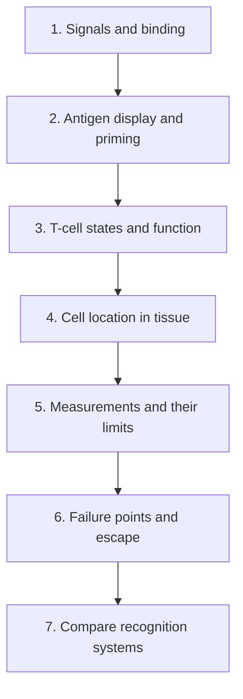

# Understand how the immune system recognizes cancer

**Follow an immune response from its first clue to its possible effect on cancer, and learn why each step needs its own evidence.**

Place a treatment on a biological route: signals, priming, cell states, access, measurement and escape. We will build that route together, with short worked examples to practice.

The suggested reading budget is 66 minutes. It is fine to take longer with a concept that feels new.

## The big ideas

1. **Recognition, activation and killing are different events.** A displayed target needs a suitable responder and a supporting context.
2. **Cells have both identities and states.** A receptor sequence, a cell count and a functional response answer different questions.
3. **Location matters.** Cells in blood, surrounding stroma and cancer-cell regions are different observations.
4. **Immune regulation is normal biology.** A tumor may exploit an inhibitory pathway, but releasing it can also harm healthy tissue.
5. **Each therapy changes selected parts of the route.** A useful mechanism still needs safety and clinical evidence.

## The map

*The map is a learning order. The biological [cancer-immunity cycle](/wiki/education/concepts/immunology/tumor-immunology/cancer-immunity-cycle) overlaps and repeats these jobs.*

## Lessons

| Step | Lesson | Question | Minutes | Learning aid |
|---|---|---|---|---|
| 1 | [Ask what happens after binding](/wiki/education/oncology-101/1-ligands) | What changes after a molecule finds its partner? | 8 | One address, two packages |
| 2 | [How dendritic cells help start a response](/wiki/education/oncology-101/2-dendritic-cells) | How does display become a priming opportunity? | 9 | Two cells, one fragment |
| 3 | [Why a T-cell count does not tell the whole story](/wiki/education/oncology-101/3-t-cell-states) | What separates presence, specificity and function? | 9 | Three samples with many T cells |
| 4 | [Read an immune map](/wiki/education/reading-a-tumor/immune-hot-vs-cold) | What does a hot, excluded or cold pattern establish? | 10 | The edge and the center |
| 5 | [Measure each part of a response](/wiki/education/reading-a-tumor/measuring-t-cell-engagement) | Which assay supports which claim? | 12 | A clone on the evidence ladder |
| 6 | [Find the step a response can lose](/wiki/education/oncology-101/4-escape-mechanisms) | Which dependency failed, and what could [checkpoint blockade](/wiki/education/concepts/therapeutics/immunotherapy/immune-checkpoint-inhibitor) change? | 10 | The target remains; the holder changes |
| 7 | [Compare immune-cell recognition systems](/wiki/education/cellular-therapies/02-car-tcr-til-comparison) | Which rules does each living treatment use? | 8 | Three recognition systems |

## Concepts you will use

- **Foundations:** [innate versus adaptive immunity](/wiki/education/concepts/immunology/the-immune-system/innate-vs-adaptive-immunity), [the immune-cell roster](/wiki/education/concepts/immunology/the-immune-system/immune-cell-roster), [ligands and receptors](/wiki/education/concepts/biology-basics/signaling/ligand-and-receptor), [antibody structure](/wiki/education/concepts/immunology/antibodies-and-b-cells/antibody-structure), [dendritic cells](/wiki/education/concepts/immunology/innate-and-unconventional-cells/dendritic-cells), [lymph nodes and lymphatics](/wiki/education/concepts/immunology/the-immune-system/lymph-nodes-and-lymphatics).
- **T-cell foundations:** [what makes a T cell](/wiki/education/concepts/immunology/t-cells/t-cell) and [CD4 versus CD8](/wiki/education/concepts/immunology/t-cells/cd4-vs-cd8) separate cell identity, receptor and usual recognition partners.
- **Recognition and response:** [human leukocyte antigen (HLA)](/wiki/education/concepts/immunology/antigen-presentation/hla), [T-cell receptor (TCR)](/wiki/education/concepts/immunology/t-cells/t-cell-receptor), [priming](/wiki/education/concepts/immunology/t-cells/t-cell-priming-three-signals), [repertoire](/wiki/education/concepts/immunology/t-cells/t-cell-repertoire), [states](/wiki/education/concepts/immunology/t-cells/t-cell-states), [costimulation](/wiki/education/concepts/immunology/t-cells/costimulation).
- **Regulation and location:** [checkpoints](/wiki/education/concepts/immunology/immune-regulation/immune-checkpoint), [cytokines and chemokines](/wiki/education/concepts/immunology/immune-regulation/cytokine-and-chemokine), [tissue patterns](/wiki/education/concepts/immunology/tumor-immunology/hot-excluded-cold-tumor), [missing self](/wiki/education/concepts/immunology/innate-and-unconventional-cells/nk-cell-and-missing-self), [regulatory T cells](/wiki/education/concepts/immunology/t-cells/regulatory-t-cells), [interferons](/wiki/education/concepts/immunology/the-immune-system/interferons), [cGAS–STING DNA sensing](/wiki/education/concepts/immunology/innate-and-unconventional-cells/cgas-sting) and [tertiary lymphoid structures](/wiki/education/concepts/immunology/antibodies-and-b-cells/tertiary-lymphoid-structures).

- **Interventions and harm:** [immune checkpoint inhibitors](/wiki/education/concepts/therapeutics/immunotherapy/immune-checkpoint-inhibitor), [immune-related adverse events (irAEs)](/wiki/education/concepts/therapeutics/toxicities-and-supportive-care/immune-related-adverse-event).

- **The shared tissue:** [tumor microenvironment](/wiki/education/concepts/cancer-biology/tumor-microenvironment/tumor-microenvironment), [angiogenesis](/wiki/education/concepts/cancer-biology/tumor-microenvironment/angiogenesis), [tumor-associated macrophages](/wiki/education/concepts/cancer-biology/tumor-microenvironment/tumor-associated-macrophages), [macrophage states beyond M1/M2](/wiki/education/concepts/immunology/innate-and-unconventional-cells/macrophage-states), [myeloid-derived suppressor cells](/wiki/education/concepts/cancer-biology/tumor-microenvironment/myeloid-derived-suppressor-cells) and [adenosine and indoleamine 2,3-dioxygenase (IDO) pathways](/wiki/education/concepts/immunology/immune-regulation/adenosine-and-ido).

Optional foundations:

- **Alarms and restraint:** [damage-associated and pathogen-associated molecular patterns (DAMPs and PAMPs)](/wiki/education/concepts/immunology/innate-and-unconventional-cells/pattern-recognition-damps-and-pamps), [inflammation](/wiki/education/concepts/immunology/the-immune-system/inflammation), [anergy](/wiki/education/concepts/immunology/t-cells/anergy), [peripheral tolerance](/wiki/education/concepts/immunology/immune-regulation/peripheral-tolerance) and [thymic output and aging](/wiki/education/concepts/immunology/t-cells/thymic-output-and-aging).
- **Antibody responses:** [B cells and plasma cells](/wiki/education/concepts/immunology/antibodies-and-b-cells/b-cells-and-plasma-cells), [isotypes and Fc silencing](/wiki/education/concepts/immunology/antibodies-and-b-cells/isotypes-and-fc-silencing) and [antibody-guided effector mechanisms](/wiki/education/concepts/immunology/antibodies-and-b-cells/adcc-adcp-cdc).

## Follow a fragment through the route

Start with an [antigen and its epitope](/wiki/education/concepts/immunology/antigen-presentation/antigen-and-epitope). [Processing machinery](/wiki/education/concepts/immunology/antigen-presentation/antigen-processing-machinery) helps produce and load fragments. The [immunopeptidome](/wiki/education/concepts/immunology/antigen-presentation/immunopeptidome) is the biological collection of HLA-associated peptides in a defined context; an [immunopeptidomics experiment](/wiki/education/concepts/measurement/proteins-and-spatial/immunopeptidomics) recovers and identifies a limited measured subset.

[Cross-presentation](/wiki/education/concepts/immunology/antigen-presentation/cross-presentation) lets an antigen-presenting cell display material it took up on HLA class I. Starting a new T-cell response still needs the [priming context](/wiki/education/concepts/immunology/t-cells/t-cell-priming-three-signals). Later, the cancer cell must itself meet the recognition rules of the responding T cell. A successful early step therefore gives you a useful next question; it does not certify the entire route.

## Read a signal and a tissue sample separately

A [cytokine or chemokine](/wiki/education/concepts/immunology/immune-regulation/cytokine-and-chemokine) helps describe communication; its effect depends on the responding cells and context. [Interferons](/wiki/education/concepts/immunology/the-immune-system/interferons) are a family of signals, not one universal tumor-killing switch. [cGAS–STING](/wiki/education/concepts/immunology/innate-and-unconventional-cells/cgas-sting) describes a DNA-sensing route whose consequences also depend on where and for how long it acts.

Now turn to the tissue. [Tumor-infiltrating lymphocytes (TILs)](/wiki/education/concepts/immunology/tumor-immunology/tumor-infiltrating-lymphocytes) name lymphocytes found in the tumor setting. A count or area estimate cannot establish their targets or function. [Tertiary lymphoid structures](/wiki/education/concepts/immunology/antibodies-and-b-cells/tertiary-lymphoid-structures) describe organized immune structures; an immune-cell cluster alone does not establish their maturity.

**Try it:** A fictional section contains many lymphocytes, and a separate assay detects an interferon-related signal. Has this established that those cells kill the cancer?

**One answer:** No. These observations describe tissue presence and a signal. Cell identity, location, recognition and measured function still need their corresponding evidence. Start with what each test actually measured, then name the next question.

## Place a checkpoint drug on the map

Blocking an inhibitory interaction can support a response. It does not supply a missing target or guarantee that every T cell can act. Lesson 3 asks which cells can respond; lesson 6 asks which other requirements may still fail. The checkpoint-inhibitor concept compares [programmed cell death protein 1 (PD-1), programmed death-ligand 1 (PD-L1) and cytotoxic T-lymphocyte-associated protein 4 (CTLA-4)](/wiki/education/concepts/immunology/immune-regulation/immune-checkpoint). They regulate different interactions.

Normal immune regulation also protects healthy organs. An irAE can start during treatment or after it ends. That timing matters when reading a safety report. Symptoms, suspected cause and severity are separate questions, and clinical assessment guides care. The adverse-event concept explains how this differs from the named inflammatory and neurologic syndromes in the engineered-cell safety lesson.

## Check your understanding

A fictional clone becomes more frequent after vaccination. Why is that promising, and what is still open?

**One answer:** It gives a candidate response to investigate. Its antigen, natural tumor recognition, access and function still need testing. Clinical benefit is another claim.

**Explain it back:** “To explain an immune treatment, I would name what it recognizes, which response step it changes and which evidence shows an effect.”

Now imagine two fictional tissue sections with similar macrophage counts. Can you label both populations “suppressive” from the count?

**One answer:** No. The cell family, its state and its measured function are different questions. Location and a marker panel help describe the population; a suitable functional test addresses the proposed suppressive job. Neither result alone chooses a treatment.

## Applied to Diana

Use [the immune-context question](/wiki/questions/is-tumor-hot), [the presentation-loss question](/wiki/questions/hla-b2m-loss) and [the checkpoint safety decision](/wiki/questions/pembrolizumab-rechallenge) for current interpretation. Those pages own case findings and decisions. This guide supplies the shared biological vocabulary.

## What is still uncertain

A response can have several bottlenecks, and different sites can differ. No single marker maps the whole route. Whether changing one step improves an outcome depends on the cancer, treatment and clinical setting.

Continue with [personalized vaccine design](/wiki/education/guides/personalized-cancer-vaccine/index), [engineered cell therapy](/wiki/education/guides/engineered-cell-therapy/index) or [reading cancer evidence](/wiki/education/guides/reading-cancer-evidence/index).

## Sources and scope

Source check: October 10, 2026. A general foundation path; fictional exercises and suggested reading budgets. Expert and learner review remain pending. Lessons and concepts carry their detailed sources.

Tissue-ecosystem concepts and the macrophage exercise added October 10, 2026. The linked concepts separate cell identity, state, location and measured function.

- [National Cancer Institute (NCI): immunotherapy](https://www.cancer.gov/about-cancer/treatment/types/immunotherapy).
- [Chen and Mellman: the cancer-immunity-cycle framework](https://pubmed.ncbi.nlm.nih.gov/23890059/).
- [NCI: checkpoint inhibitors](https://www.cancer.gov/about-cancer/treatment/types/immunotherapy/checkpoint-inhibitors).
- [Brahmer et al., 2021: Society for Immunotherapy of Cancer guideline on checkpoint-related adverse events](https://pmc.ncbi.nlm.nih.gov/articles/PMC8237720/).
