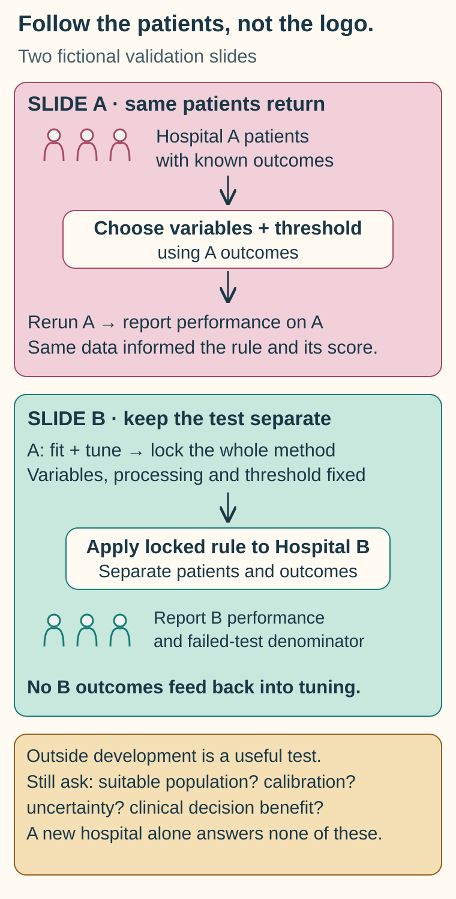

# Read the validation behind the claim

**Validation is strongest when the evidence tests the exact claim on suitable data that were not used to build or tune the method.** A promising chart is a starting point for questions about how the chart was made.

**Before you start:** [Analytical validity, clinical validity and clinical utility](/wiki/education/concepts/measurement/computational-analysis/analytical-validity-clinical-validity-and-utility) identifies the question being tested. [Trial phases and randomization](/wiki/education/concepts/evidence-and-statistics/study-design/trial-phases-and-randomization) explains what a comparison can establish.

## Where this step sits

You have [written the claim](/wiki/education/guides/judging-a-test-or-vendor-claim/01-write-the-exact-claim). Now inspect whether the study supports it. The final lesson will connect the evidence to a decision.

## Follow the sample through the study

Imagine that the impressive chart is the last page of a story. To understand it, go back to the people and samples that entered the study. Use [the five-pass graph method](/wiki/education/concepts/evidence-and-statistics/reasoning-tools/reading-a-graph-in-five-passes) to attach labels to its pattern.

Who was eligible? How were participants chosen? Which samples failed, and where did those failures go? Were researchers given the outcomes before choosing a threshold? Were patients receiving the same care as the population for whom the claim is now made?

These questions are practical. A test that performs well only when a perfect sample is available may struggle in the setting where you need it. A model tested on the same patients used to train it can reward memorization and tuning. Independent testing asks whether the result travels beyond those examples.

**External validation** means evaluating the method on data from outside its development dataset. Look for relevant differences in sites, sample handling, time period and patient care. “Independent” should describe the data and evaluation, rather than simply a new logo on the slide.

## Match the evidence to the proposed use

Use a small evidence table while you read:

| Study feature | What to write down | Why it matters |
|---|---|---|
| Population and setting | Cancer type, stage, treatment context and selection | A study may not match the proposed patient group |
| Specimen and method | Material, handling, test version and quality criteria | A different input can change performance |
| Reference or comparator | What counts as truth, or what care strategy is compared | A weak reference can distort the apparent result |
| Outcome and timing | What was measured and when | Response, recurrence and survival answer different questions |
| Analysis plan | Prespecified rules, tuning and independent test data | Searching many choices can produce a flattering result |
| Missing information | Failed samples, dropout, unavailable outcomes | The visible chart may omit difficult cases |
| Uncertainty | Intervals, sample size and remaining limits | A point estimate is not a promise for a person |

[Prespecified and exploratory analyses](/wiki/education/concepts/evidence-and-statistics/study-design/exploratory-vs-prespecified-analysis) carry different evidentiary roles. Keep the search and tuning history attached to any resulting claim, and look for confirmation that did not reuse it.

If the evidence begins in cells or animals, identify what the [preclinical model](/wiki/education/concepts/evidence-and-statistics/study-design/preclinical-evidence) actually tested. If it comes from patient care without assigned treatment, ask about [confounding](/wiki/education/concepts/evidence-and-statistics/study-design/observational-studies-and-confounding). Neither a useful laboratory result nor an outcome association automatically validates the proposed clinical action.

This guide is about tests. A claim about a drug or compound follows a different path, covered in [from variant to drug](/wiki/education/guides/from-variant-to-drug/index).

## First check that the test measures reliably

Before any clinical claim, a laboratory must show that the test itself works: analytical validation. Professional guidance for tumor sequencing panels asks laboratories to establish performance for each variant type, with reference materials, minimum depth and a minimum number of samples ([Jennings 2017, AMP/CAP](https://pmc.ncbi.nlm.nih.gov/articles/PMC6941185/)). Ask for these five items:

| Item | Question to ask | Why it matters |
|---|---|---|
| [Limit of detection](/wiki/education/concepts/evidence-and-statistics/biomarkers/limits-of-detection-and-quantitation) | At what level is the target detected 95% of the time, at what input amount and in which specimen type? | A limit measured with plenty of input may not hold for a small sample |
| Precision | Do repeat runs agree, across days, operators and instruments? | A result that moves between runs cannot be trended |
| Accuracy against a reference | Was it compared with a different, established method on the same samples? | Agreement with itself proves nothing |
| Failure rate | What share of samples gave no result, and why? | Failures are part of real-world performance |
| Specimen and interference | Was it validated in the same tissue or blood type, preservation and handling? | A blood test validated in fresh plasma may not transfer to delayed samples |

## Then work out what a positive result means here

A test's **positive predictive value (PPV)**, the chance that a positive result is a true positive, depends on how common the condition is in the people tested ([PPV and base rates](/wiki/education/concepts/evidence-and-statistics/tests-and-prediction/ppv-and-base-rates)). Take a fictional test with 90% sensitivity and 95% specificity:

| Group of 1,000 people | With the condition | True positives | False positives | PPV |
|---|---|---|---|---|
| Condition in 10% | 100 | 90 | 45 (5% of 900) | 90 ÷ 135 = 67% |
| Condition in 2% | 20 | 18 | 49 (5% of 980) | 18 ÷ 67 = 27% |

The same test, with the same sensitivity and specificity, gives a positive that is right two times in three in one group and about one time in four in the other. Always ask for performance in a group like the one you are in.

## Worked example: two fictional validation slides

Ask which patients influenced every choice. Reusing Hospital A can check reproducibility but supplies no new independent population test. Hospital B supports evaluation outside development only when its outcomes did not inform the locked method. The new setting still needs suitable patients, failed-test denominators, uncertainty and calibration; it does not by itself establish useful clinical decisions.

The [shared concept map](/wiki/education/concepts/measurement/computational-analysis/model-validation-basics) supplies the background for this closer comparison.

For the reporting distinction, see the [TRIPOD explanation of development and external evaluation](https://www.tripod-statement.org/wp-content/uploads/2023/02/TRIPOD-Cluster-EE.pdf).

Slide A shows the performance of a risk score on the same patients used to choose its variables and threshold. That number is inflated by [overfitting](/wiki/education/concepts/measurement/computational-analysis/overfitting): when five of the seven largest microarray prognosis studies were re-tested with repeated random splits, they classified patients no better than chance ([Michiels 2005](https://doi.org/10.1016/S0140-6736(05)17866-0)). Slide B evaluates a locked version on a separate hospital's patients, with a defined outcome and failed tests reported.

Slide B answers a more useful question about performance outside development. It still needs careful reading. Perhaps that hospital treated advanced disease while the current request concerns patients after surgery. Perhaps the score ranks patients well but overestimates their risk.

Ranking and risk accuracy are different. A method can put higher-risk patients above lower-risk patients while its reported probabilities are poorly calibrated. [Calibration](/wiki/education/concepts/evidence-and-statistics/tests-and-prediction/calibration) asks whether stated probabilities agree with observed outcomes in comparable groups. There is no single performance cutoff that makes every clinical use appropriate.

Even a well-calibrated risk score does not establish benefit from the treatment suggested in the report. The [prognostic versus predictive](/wiki/education/concepts/evidence-and-statistics/biomarkers/prognostic-vs-predictive) distinction remains in place.

## What can go wrong at this step

- **Successful samples become the whole denominator.** Request the number attempted, the number reported and why others failed. [The denominator](/wiki/education/concepts/evidence-and-statistics/reasoning-tools/denominators-and-conditional-probability) changes when only successful samples are counted. A treatment study raises the same question as its [analysis population](/wiki/education/concepts/evidence-and-statistics/study-design/analysis-populations): everyone assigned (intention to treat), or only those treated or evaluable.
- **A chosen threshold travels silently.** Ask whether it was set in advance, tuned here, and evaluated again independently.
- **A cross-disease dataset supports a same-disease claim.** Keep the mismatch attached to the conclusion.
- **Laboratory status replaces clinical evidence.** [Certification and authorization](/wiki/education/concepts/access-and-regulation/approval/ruo-ldt-clia-and-fda-authorization) answer another question.
- **A headline metric hides the decision.** The cost of false positives and false negatives depends on what action follows.

## Try it

A fictional model was tuned using outcomes from Hospital A. The developers then report “validation” after rerunning the unchanged Hospital A samples. What would you request?

**Answer:** Ask for performance on suitable data held out from every tuning choice, ideally from an independent setting. Also request the locked method, target population, outcome, failures and uncertainty. Repeat analysis of the development data can check reproducibility, but it does not provide independent validation.

## Explain it back

Complete: “This study supports ____ in ____. It does not yet support ____.”

**One possible answer:** “It supports risk ranking in treated advanced Cancer X. It does not yet support changing postoperative treatment in early Cancer X.”

## Takeaway

**Keep the population, input, comparison, outcome and independence of the study attached to every performance claim.**

**Next:** [[wiki/education/guides/judging-a-test-or-vendor-claim/03-connect-evidence-to-a-decision|Connect evidence to a decision]].

## Sources and scope

Source check: November 7, 2026. The slides are fictional. This is a reading method, not a universal validation rulebook. Expert and learner review remain pending.

- [FDA–NIH BEST: glossary](https://www.ncbi.nlm.nih.gov/books/NBK338448/) — validation in a specified context of use.
- [FDA: clinical research](https://www.fda.gov/patients/drug-development-process/step-3-clinical-research) — populations, comparators and planned analyses.
- [Jennings et al., 2017: AMP/CAP guidelines for validating oncology sequencing panels](https://pmc.ncbi.nlm.nih.gov/articles/PMC6941185/) — analytical validation by variant type, reference materials, depth and sample numbers (PMID 28341590).
- [TRIPOD (Transparent Reporting of a multivariable prediction model for Individual Prognosis Or Diagnosis) checklist](https://www.tripod-statement.org/resources/) — transparent reporting of prediction-model development and validation.
