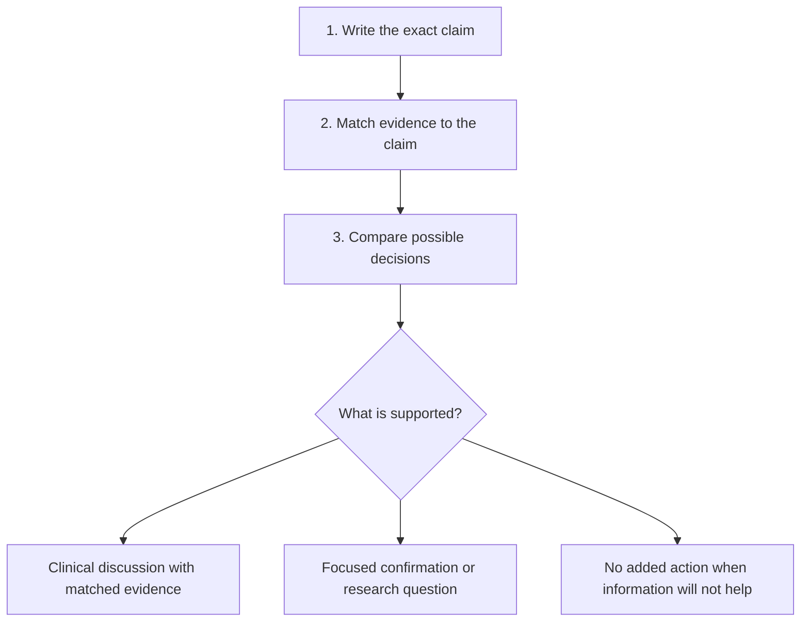

# Judge a test or company claim

**Learn how to turn an impressive claim into a clear question, inspect its evidence, and decide what belongs in a clinical discussion.** You can ask useful questions without becoming a specialist in every assay or technology.

A glossy report can be both interesting and hard to interpret. It may combine sound measurements, plausible biology and a suggested treatment. This guide helps you separate those pieces while keeping curiosity intact. The aim is to understand what has been shown and what still needs checking.

## The big ideas

1. A claim needs a subject, a population, a setting, an outcome and a proposed use. “Accurate” or “personalized” leaves too much unsaid.
2. [Analytical validity, clinical validity and clinical utility](/wiki/education/concepts/measurement/computational-analysis/analytical-validity-clinical-validity-and-utility) answer different questions. A reproducible measurement can still lack evidence that acting on it helps.
3. [Laboratory and product labels](/wiki/education/concepts/access-and-regulation/approval/ruo-ldt-clia-and-fda-tiers) identify oversight or intended use. They cannot substitute for studies of the particular claim.
4. Independent testing matters. A method tuned on the same examples used to evaluate it can appear stronger than it is.
5. A useful next step may be confirmation, a narrow research question, or no extra test. Learning and treatment decisions have different evidence needs.

## The map

*The numbered lesson links follow the same sequence. A gap in the evidence tells you what to ask next.*

## Lessons

The minutes are suggested reading budgets. Each lesson uses a fictional report, a practice question and an answer.

| Step | Lesson | Question it answers | Minutes | Learning aid |
|---|---|---|---|---|
| 1 | [Write the exact claim](/wiki/education/guides/judging-a-test-or-vendor-claim/01-write-the-exact-claim) | What is the company actually saying this result can do? | 10 | Claim translation worksheet |
| 2 | [Read the validation](/wiki/education/guides/judging-a-test-or-vendor-claim/02-read-the-validation) | Was the right question tested on suitable independent data? | 12 | Evidence table and fictional study |
| 3 | [Connect evidence to a decision](/wiki/education/guides/judging-a-test-or-vendor-claim/03-connect-evidence-to-a-decision) | What would change, and is that change supported? | 12 | Decision ledger and stopping rule |

## Concepts you will use

Start with the [three validity questions](/wiki/education/concepts/measurement/computational-analysis/analytical-validity-clinical-validity-and-utility) and [prognostic versus predictive biomarkers](/wiki/education/concepts/evidence-and-statistics/biomarkers/prognostic-vs-predictive). Then read [laboratory and test labels](/wiki/education/concepts/access-and-regulation/approval/ruo-ldt-clia-and-fda-tiers), [actionability](/wiki/education/concepts/evidence-and-statistics/biomarkers/actionability) and [positive predictive value and base rates](/wiki/education/concepts/evidence-and-statistics/tests-and-prediction/ppv-and-base-rates) when inspecting a report.

If the claim includes a drug, the next foundations are [drug labeling and off-label use](/wiki/education/concepts/access-and-regulation/approval/drug-label-and-off-label-use) and [trial phases and randomization](/wiki/education/concepts/evidence-and-statistics/study-design/trial-phases-and-randomization).

## Applied to Diana

Her current test questions and follow-up belong in [[project-management/projects/research/diagnostics|the diagnostics project]]. Tissue tradeoffs belong in [[wiki/questions/tissue-and-data-routing|the tissue and data decision]], and treatment choices belong in [[wiki/care/treatment-plan|the care plan]]. This guide provides the reading method without copying their changing status.

## What is still uncertain

A test may have persuasive biological support but little evidence for a particular treatment choice. Studies may also differ in specimens, care pathways and outcome definitions. Those gaps should stay visible beside the claim.

An unpublished company result can be worth investigating. It remains a company-supplied claim until its methods, population and results can be assessed. A clear “we do not know yet” is a useful conclusion when it points to the evidence that would resolve the question.

## Sources and scope

Source check: October 9, 2026. General education with fictional exercises; expert and learner review pending.

- [MedlinePlus Genetics: valid and useful testing](https://medlineplus.gov/genetics/understanding/testing/validtest/) — measurement, clinical association and usefulness.
- [FDA–NIH BEST: predictive biomarker](https://www.ncbi.nlm.nih.gov/books/NBK402283/) — evidence about a particular treatment effect.
- [FDA: companion diagnostics](https://www.fda.gov/medical-devices/in-vitro-diagnostics/companion-diagnostics) — treatment-linked intended use.
