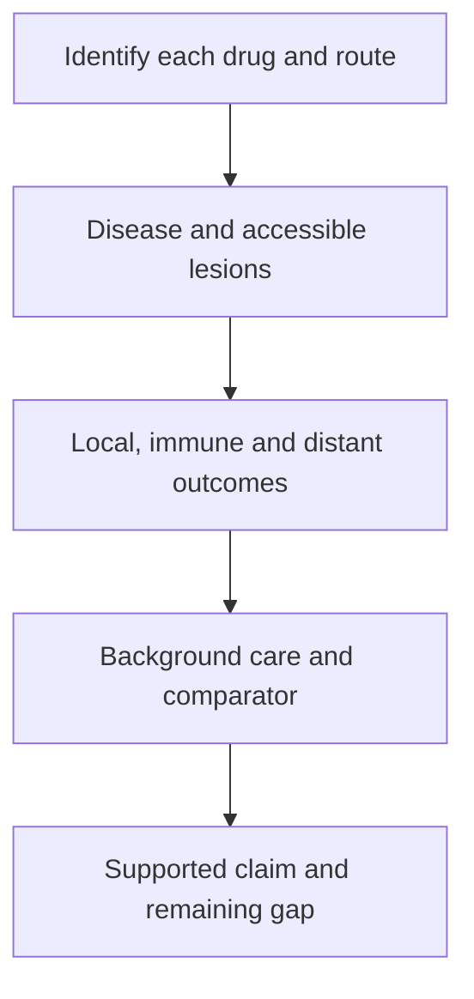

# Read an injected-treatment study

**Identify what entered each site, measure each proposed effect, and ask what the injection added to the rest of treatment.**

## Before you start

- [Intratumoral immunotherapy](/wiki/education/concepts/therapeutics/immunotherapy/intratumoral-immunotherapy) explains the route and its limits.
- [In-situ vaccination](/wiki/education/concepts/immunology/tumor-immunology/in-situ-vaccination) explains a strategy that tries to use the tumor's own antigens.
- [Randomization and trial phases](/wiki/education/concepts/evidence-and-statistics/study-design/trial-phases-and-randomization) explain why a comparison and a development stage answer different questions.

## Where this step sits

This extension applies the guide's measurement and comparison questions to an injection study. You can use the same reading method for an immune signal, virus or another locally administered payload.

*Follow these as reading steps. They do not describe a treatment sequence.*

## Start with the component list

A study title might say “an injected immune stimulus plus an [immune-checkpoint antibody](/wiki/education/concepts/immunology/immune-regulation/immune-checkpoint).” That leaves a useful question unanswered: was the antibody injected into the lesion, or given into a vein? Both arrangements are possible. **Intravenous (IV)** means into a vein; **intratumoral** means inside a tumor. Enter every component in a route table before interpreting a result.

| Component | Route to record | Question to carry forward |
|---|---|---|
| Experimental payload | Into which lesion, using what delivery method? | Was exposure or local activity measured? |
| Accompanying systemic drug | Into a vein, orally, or another stated route? | Could it affect injected and uninjected lesions? |
| Other local procedure | Radiation, ablation or another procedure, if included | Which component's added effect can the comparison identify? |

Electroporation uses electrical pulses to support delivery into cells. If a protocol uses it with an injected gene payload, those are separate parts of the intervention. A route label alone does not describe the delivered material, its distribution or its mechanism. The expert recommendations linked below explain why consistent component and lesion reporting matters.

## Ask whether the biological opportunity exists

Injection requires an identifiable, safely accessible lesion. A visible recurrent tumor and possible microscopic disease after surgery are different situations. Literature about injecting a measurable tumor does not create an injection target where none is identifiable.

Keep the cancer type and disease setting on your note card. [Ductal carcinoma in situ (DCIS)](/wiki/education/concepts/breast-cancer/anatomy-and-histology/dcis), invasive breast cancer and melanoma are not interchangeable evidence populations. If surgery follows preoperative treatment, pathology and longer-term outcomes also answer different questions. A [pathologic complete response](/wiki/education/concepts/breast-cancer/surgery-and-pathology-results/pcr) is not the same endpoint as survival.

A registered study also needs controlled manufacturing, a defined dosing procedure, safety monitoring and a plan for surgery or subsequent care when relevant. These safeguards describe how an intervention is studied; registration alone does not establish clinical benefit.

## A fictional reading exercise

Imagine a small, single-arm study of **12 fictional participants**, each with one injected lesion and a separate uninjected lesion. Everyone also receives a systemic drug. At the prespecified assessment, eight injected lesions meet the study's response definition. Two uninjected lesions meet that definition. A blood assay detects antigen-reactive immune cells in five participants.

Three notes are justified:

1. Injected-lesion responses occurred in eight of the twelve participants under this combination.
2. Uninjected-lesion responses occurred in two. These are separate site-specific observations.
3. The assay detected a defined immune response in five. Each endpoint has a denominator of twelve in this exercise, but the endpoints differ and the participants can overlap.

You cannot add the counts together as “15 responders.” Participants can appear in more than one group. The systemic drug also prevents attributing an uninjected response to the injection alone. Even a participant with all three observations has not supplied a controlled estimate of added clinical benefit.

If the paper reports a patient-level radiographic response, look up its [response criteria](/wiki/education/concepts/measurement/imaging/response-criteria). Selected target-lesion changes, non-target disease and new lesions can all matter. Our fictional lesion counts use the exercise's stated definition; they do not supply the measurements needed to calculate a formal response category. An uninjected-lesion response is also not automatically an injection-caused effect.

## What can go wrong

- A paper's overall response can hide different behavior at injected and uninjected sites.
- A blood assay can show immune activity without showing entry into another tumor or recognition there.
- A study may change which lesions receive injections over time. Track that history before calling a lesion untreated.
- Local delivery can still produce systemic exposure and toxicity. Procedure and product risks require their own measurements.
- A trial listing establishes a study's existence. It does not establish benefit, an open local slot or eligibility.

## Try it

The fictional authors propose a next trial. Which comparison best isolates the injection's added effect: the combination versus no treatment, or the combination versus the same systemic treatment without the injected intervention?

**Answer:** The second comparison addresses what adding the injection changes. Its design must still specify the population, endpoints, assessment timing and adverse-event collection. Depending on the question, blinding and control procedures may also matter. “Randomized” does not make those other details optional.

## Explain it back

“The dose started in ____. We observed ____ locally, ____ in an immune assay, and ____ elsewhere. To attribute added benefit to the injection, we still need ____.”

One possible completion is: “the treated lesion; response; antigen-reactive cells; a separate distant response; an appropriate comparison and patient-relevant follow-up.”

## Takeaway

**An injection site identifies delivery; a separate measurement and comparison must support every wider claim.**

**Next:** Return to [the guide map](/wiki/education/guides/local-therapy-and-the-immune-system/index), or practice [reading cancer evidence](/wiki/education/guides/reading-cancer-evidence/index).

## Sources and scope

Source check: October 10, 2026. The 12-participant exercise is invented. General study-reading education; product protocols govern actual procedures. Expert and learner review pending.

- [Marabelle et al., 2018: human intratumoral immunotherapy development and reporting recommendations](https://pubmed.ncbi.nlm.nih.gov/30295695/).
- [Hammerich et al., 2019: a defined in-situ vaccination regimen in indolent lymphoma](https://pubmed.ncbi.nlm.nih.gov/30962585/).
- [FDA: talimogene laherparepvec prescribing information](https://www.fda.gov/media/94129/download) — a melanoma-specific example of local administration and defined outcome limits.

For published counts and dated registry observations, use the [intratumoral evidence review](/wiki/research/reviews/2026-09-intratumoral-therapy-landscape). Keep its historical status date attached when assessing current access.
