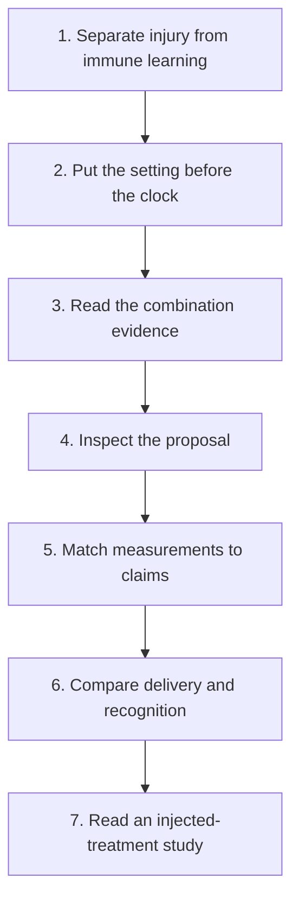

# Understand local therapy and the immune system

**Explain what local treatment can control, how immune learning might follow and what evidence supports an added clinical benefit.**

Local treatment can have an important job at a particular site. A second idea is more uncertain: could injury at that site help the immune system recognize cancer elsewhere? This guide gives you the language to keep those questions separate while reading a study or discussing a proposal.

You do not need to choose a treatment to follow the course. Start with the mechanism, carry the disease setting into the evidence, then practice inspecting a proposal and its measurements.

## The big ideas

1. Local control, immune activity, a distant response and improvement in patient outcomes are different claims.
2. [T-cell priming](/wiki/education/concepts/immunology/t-cells/t-cell-priming-three-signals) needs more than released tumor material. Recognition and access remain important even after an immune response begins.
3. A trial result belongs to its cancer population, disease history, comparison and endpoint. Positive lung-cancer findings do not establish an added breast-cancer benefit.
4. Delivery matters. A probe, externally aimed beams and a radioactive drug distributed through the blood do not provide the same exposure or risks.

## The map

Follow the arrows as a reading order, rather than as a clinical decision algorithm.

*Each lesson adds a question to carry into the next one. Open a lesson from the linked table below.*

## Lessons

| Step | Lesson | Question it answers | Minutes | Learning aid |
|---|---|---|---|---|
| 1 | [Separate local injury from immune learning](/wiki/education/local-treatment-modalities/01-mechanism) | Which immune gates remain after a tumor is injured? | 12 | A fictional treated-site and distant-site example |
| 2 | [Put the disease setting before the clock](/wiki/education/local-treatment-modalities/02-timing) | What job is the treatment meant to do? | 12 | Three fictional treatment-setting cards |
| 3 | [Ask what a combination trial actually proved](/wiki/education/local-treatment-modalities/03-overlap-and-sequencing) | Does the cited comparison support this claim? | 16 | Four real study cards and a fictional attribution exercise |
| 4 | [Read a proposal through five questions](/wiki/education/local-treatment-modalities/04-decision-questions) | Which assumptions need evidence or planning? | 12 | A diameter shortcut and an uptake claim |
| 5 | [Match each measurement to its claim](/wiki/education/local-treatment-modalities/05-tissue-and-sample-budget) | What did this sample or scan actually measure? | 14 | A worked percentage-and-denominator example |
| 6 | [Compare delivery and recognition separately](/wiki/education/local-treatment-modalities/06-comparisons) | How do different tools direct exposure and produce effects? | 14 | Three fictional “targeted” proposals and a capstone |
| 7 | [Read an injected-treatment study](/wiki/education/guides/local-therapy-and-the-immune-system/07-read-an-injected-treatment-study) | What did the injection add to the background treatment? | 14 | A fictional twelve-participant route and outcome exercise |

The full path is about 94 minutes, including practice. The first six lessons take about 80 minutes; the injection-study extension adds 14. If you are reading one proposal today, lesson 4 can help organize your questions; use its prerequisite links to fill in the earlier steps.

## Concepts you will use

The [cancer-immunity cycle](/wiki/education/concepts/immunology/tumor-immunology/cancer-immunity-cycle), [human leukocyte antigen (HLA)](/wiki/education/concepts/immunology/antigen-presentation/hla) and [cross-presentation](/wiki/education/concepts/immunology/antigen-presentation/cross-presentation) explain the immune gates. [Immunogenic cell death](/wiki/education/concepts/cancer-biology/cell-death-and-survival/immunogenic-cell-death), [in-situ vaccination](/wiki/education/concepts/immunology/tumor-immunology/in-situ-vaccination) and the [abscopal effect](/wiki/education/concepts/immunology/tumor-immunology/abscopal-effect) name distinct parts of the local-to-distant hypothesis.

[Intratumoral immunotherapy](/wiki/education/concepts/therapeutics/immunotherapy/intratumoral-immunotherapy) explains the route; [oncolytic viruses](/wiki/education/concepts/therapeutics/immunotherapy/oncolytic-virus) explain one payload category.

For the physical tools, use [ablation](/wiki/education/concepts/therapeutics/local-therapies/ablation), [radiation therapy](/wiki/education/concepts/therapeutics/local-therapies/radiation-therapy-basics), [stereotactic body radiation therapy](/wiki/education/concepts/therapeutics/local-therapies/sbrt) and [hypofractionation](/wiki/education/concepts/therapeutics/local-therapies/hypofractionation). [Survival endpoints](/wiki/education/concepts/evidence-and-statistics/endpoints/survival-endpoints) and [randomization](/wiki/education/concepts/evidence-and-statistics/study-design/trial-phases-and-randomization) help you judge outcome claims.

## Practice with two sites

A fictional study treats one lesion with radiation. That lesion becomes smaller, while an untreated lesion is unchanged. This supports a treated-site observation. It does not show an [abscopal response](/wiki/education/concepts/immunology/tumor-immunology/abscopal-effect).

**Try it:** Later, the untreated lesion shrinks while the participant also receives systemic treatment. Can the scan assign the change to radiation alone?

**One answer:** No. The distant response is worth recording, but attribution needs the treatment context and a suitable comparison. Keep the treated site, untreated sites, measurement times and concurrent therapies visible. An immune marker does not replace a distant-site outcome.

For reported frequencies, keep the numerator, denominator and population together. The abscopal concept walks through a specific combination-study example; its proportion is not a universal probability for radiation or for an individual patient.

## Applied to Diana

Read these lessons alongside [the care plan](/wiki/care/treatment-plan) and [the local-treatment and abscopal question](/wiki/questions/abscopal-effect/index). Those pages own the case application and current decisions. This guide supplies a reusable way to inspect their evidence.

## What remains uncertain

A plausible immune mechanism does not tell us which person will benefit, which sequence is best, or whether an added procedure improves survival. Sampling can reveal one step while leaving others unmeasured. A useful reading result may be a clearly stated missing comparison.

After the course, use [the local-treatment reference shelf](/wiki/education/local-treatment-modalities/index) to find sources by question. Continue with [reading cancer evidence](/wiki/education/guides/reading-cancer-evidence/index) for more practice with endpoints and uncertainty, or [understanding early breast-cancer treatment sequencing](/wiki/education/guides/treating-early-tnbc/index) for established local and systemic roles in that setting.

## Sources and scope

Source check: 2026-10-09; the two-site practice addition was checked October 10, 2026 through the linked concepts. General education; all named practice patients are fictional. Expert and learner review pending. Each lesson identifies the sources supporting its specific claims.

- [National Cancer Institute: radiation therapy](https://www.cancer.gov/about-cancer/treatment/types/radiation-therapy) — treatment goals and physical exposure.
- [Galluzzi et al., 2020: immunogenic cell death guidance](https://pubmed.ncbi.nlm.nih.gov/32209603/) — signals, immune responses and measurement boundaries.
- [Chmura et al., 2026: NRG-BR002](https://ascopubs.org/doi/10.1200/JCO-26-00201) — a breast-cancer-specific comparison of adding metastasis-directed treatment.
