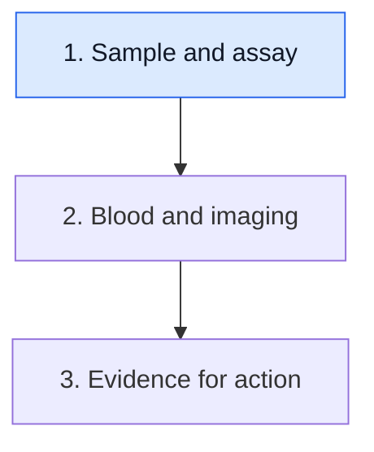

# Read the blood result before reading the trend

**A result becomes interpretable when you attach its sample, targets, date, units and detection rule. Start there before deciding whether a change is large or small.**

**Before you start:** [[wiki/education/concepts/measurement/liquid-biopsy/cfdna-vs-ctdna|Cell-free DNA (cfDNA) versus circulating tumor DNA (ctDNA)]] separates background material from tumor origin. [[wiki/education/concepts/measurement/liquid-biopsy/tumor-informed-mrd-assay|Tumor-informed assays]] explains a reference-based target list. [[wiki/education/concepts/measurement/liquid-biopsy/ctdna-units|Units and detection limits]] explains why numbers from different methods may not share a denominator.

## Where this step sits

This is step 1 of [[wiki/education/guides/monitoring-residual-disease/index|Understand blood tests and imaging after treatment]]. First read the blood measurement. Then compare it with other evidence. Only then ask what a proposed action requires.

## Read the address on the envelope

[Detection limits and finite molecule sampling](/wiki/education/concepts/measurement/liquid-biopsy/limit-of-detection-and-sampling) explains why a blood tube is not a survey of every tumor cell. Keep the specimen and input notes attached to this result. [Molecular residual disease (MRD)](/wiki/education/concepts/measurement/liquid-biopsy/mrd) names an assay-defined signal after treatment; it does not locate disease or select an effective intervention.

Start with the collection date, rather than only the report date. A result drawn during treatment answers a different time-point question from one drawn after surgery. Two reports received together may describe different biological moments.

Next identify the assay's job. A test can look for selected known tumor features, a cancer-associated pattern without a tumor reference, or a broader set of alterations. “Liquid biopsy” names a specimen approach, not one universal method.

[Fragmentomics and methylation](/wiki/education/concepts/measurement/liquid-biopsy/fragmentomics-and-methylation) examine patterns rather than necessarily reporting a mutation list. [Circulating tumor cells (CTCs)](/wiki/education/concepts/measurement/liquid-biopsy/circulating-tumor-cells) are a different captured object from cell-free DNA fragments.

## Build a small result ledger

| Question | What to record | Why it matters |
|---|---|---|
| When and in what setting? | Collection date and relation to treatment or surgery | Keeps time points comparable |
| What method? | Assay and version | Identifies target scope and validation |
| What input? | Sample qualification and relevant input notes | Distinguishes a suitable negative from an uninformative sample |
| What was called? | Detected, not detected, indeterminate or failed | These are different result states |
| What was measured? | Quantity, units and numerical qualifications | Prevents comparing unlike scales |
| What is the limit? | Applicable detection or quantitation criteria | Sets the boundary of the claim |

An invalid or failed sample is not a negative result. [Blank, detection and quantitation limits](/wiki/education/concepts/evidence-and-statistics/biomarkers/limits-of-detection-and-quantitation) answer different analytical questions. A detected signal below a reliable quantitation range may support “present” more strongly than an exact fold change. The report's own qualifications deserve to stay beside its number.

For mutation-based signals, record how the method checks blood-cell origin. [Clonal hematopoiesis and clonal hematopoiesis of indeterminate potential (CHIP)](/wiki/education/concepts/measurement/liquid-biopsy/chip) can contribute DNA to plasma. A white-blood-cell comparison helps within its sensitivity and coverage; it is not a perfect origin certificate.

## A worked trend near the limit

Consider a fictional assay that reports an estimated tumor fraction in parts per million (PPM). Its first result is 6 PPM and its next is 2 PPM. Both are detected, but the laboratory marks the second as below its reliable quantitation range.

You can report the observed values and qualifying calls. You cannot simply announce “the cancer shrank by two-thirds.” The measurements may have substantial uncertainty, and blood tumor fraction is not tumor volume. Changes in shedding and background cfDNA can affect the signal.

Now suppose a different assay reports tumor molecules per milliliter. Its number cannot be placed on the PPM line without an established relationship between quantities. Even the same unit label does not guarantee two versions use the same calibration.

A useful serial comparison keeps the method and input conditions as consistent as possible. This strengthens interpretation; it does not remove biological variability. More observations can clarify a pattern, but a care team or protocol must define whether and when another draw is appropriate.

## What does a negative result say?

“Not detected” means the sample did not meet that assay's qualifying-signal rule. It can be encouraging within a validated setting. It still does not prove that no cancer cells exist.

Three possibilities illustrate the boundary: there may be no remaining tumor signal, too few tumor fragments may have reached the tube, or the tracked features may not represent the relevant remaining cells. The result alone cannot choose among all possibilities.

This is why analytical sensitivity and clinical sensitivity differ. The first concerns performance under specified test conditions. The second concerns disease detection in a population and sampling schedule. A laboratory can perform well while a particular tumor sheds little detectable DNA.

## What can go wrong at this step

- Treating total cfDNA yield as tumor burden.
- Sorting reports by release date while ignoring collection dates.
- Counting a build failure or invalid draw as a negative.
- Comparing a concentration with a fraction as if both counted cells.
- Interpreting a near-limit fold change without quantitation qualifications.

## Try it

A fictional patient has “not detected” on one assay and a low detected signal on another. Can you conclude the second assay is wrong?

**Answer:** No. Compare the samples, dates, target sets, input, controls and criteria. Different assays may detect different qualifying evidence. Their disagreement requires review rather than an automatic verdict.

## Explain it back

“This blood result describes ______ in ______ using ______. Its main limit is ______.”

One possible answer: “a qualifying tumor-associated signal; this dated plasma sample; this assay and its targets; it does not survey every cancer cell or locate disease.”

## Takeaway

**Keep the sample, method, date, units and result qualifications attached to every blood number.**

**Next:** [[wiki/education/molecular-profiling/ctdna-ppm-and-mri|Compare blood results with imaging]].

## Sources and scope

Source check: October 9, 2026. The example and values are fictional. This lesson teaches interpretation, not a draw schedule or treatment decision. Expert and learner review pending.

- [FDA 2024 ctDNA guidance](https://www.fda.gov/media/183874/download) — method and input considerations.
- [ESMO 2022 ctDNA recommendations](https://pubmed.ncbi.nlm.nih.gov/35809752/) — assay limitations and intended use; dated guidance, not a universal current rule.
- [[wiki/education/concepts/measurement/liquid-biopsy/ctdna-units|Units and detection limits]] — quantity definitions and source links.
