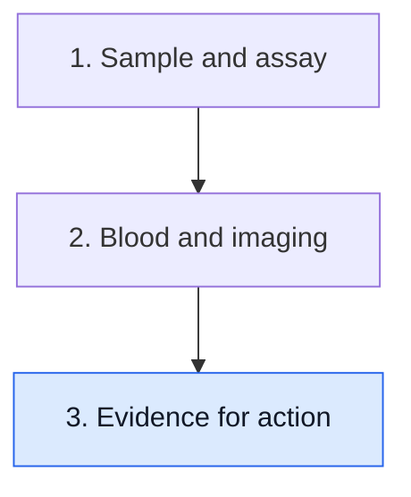

# Ask what a result should change

**Detecting a signal, predicting recurrence and improving outcomes by acting on that signal are three different achievements. A proposed next step needs evidence for its own job.**

**Before you start:** [[wiki/education/concepts/measurement/computational-analysis/analytical-validity-clinical-validity-and-utility|Analytical validity, clinical validity and clinical utility]] separates measurement from useful action. [[wiki/education/concepts/evidence-and-statistics/biomarkers/prognostic-vs-predictive|Prognostic versus predictive evidence]] separates risk association from treatment-effect evidence. [[wiki/education/concepts/evidence-and-statistics/reasoning-tools/lead-time-bias|Lead-time bias]] explains why an earlier starting clock can lengthen measured survival without delaying death.

## Where this step sits

This is step 3 of [[wiki/education/guides/monitoring-residual-disease/index|Understand blood tests and imaging after treatment]]. You have read the sample and compared observations. Now connect a proposed action to the evidence that would justify it.

## Climb one rung at a time

It is understandable to want an early signal to come with a useful treatment. Sometimes it does, in a specific validated setting. Sometimes the signal gives important information while the best response remains a research question. The distinction protects both hope and clear reasoning.

| Evidence rung | What it can establish | What it does not establish alone |
|---|---|---|
| Analytical detection | The assay can detect specified signal under stated conditions | Disease detection in every patient or draw |
| Clinical association | Results relate to outcomes in a defined population | Benefit from changing treatment |
| Clinical localization and assessment | Evaluation identifies the setting and any localizable disease | Sensitivity to a particular new drug |
| Assay-guided intervention evidence | A defined strategy improves relevant outcomes against a suitable comparator | The same benefit in every cancer, assay or treatment setting |

Do not skip the question between rungs. If a blood test predicts recurrence, the next study might ask whether a particular intervention reduces recurrence. It should also examine toxicity, quality of life and unnecessary procedures.

## Put the proposed action in a sentence

Try this structure: “For patients in ______, using assay ______ at time ______, result ______ would lead to ______. Evidence for that strategy is ______.”

The blanks matter. Confirming a low signal, ordering clinically appropriate evaluation, entering a protocol and starting a drug are different actions. The evidence needed for one does not automatically support all the others.

A negative result has its own action question. To omit an otherwise indicated treatment, evidence must address omission in the matched population. Favorable prognosis among assay-negative patients is not enough: those patients may have received the treatment being proposed for omission.

## A worked fictional proposal

Imagine a study where a detectable blood signal is associated with more recurrences after surgery. A report proposes adding Drug Q whenever the signal appears.

First ask whether Drug Q was tested in this assay-defined setting. If the study only observed results, it has not tested the proposed strategy. Drug Q may be effective in another stage or cancer without being proven here.

Next ask what happens before treatment starts. Does the protocol confirm the result, establish disease extent and review relevant safety factors? A “molecular-only” intervention study needs to know whether participants already have radiographically detectable disease. That changes the question being tested.

Finally ask how benefit is measured. A falling blood signal may be a useful research endpoint. It is not automatically a validated substitute for fewer recurrences, longer survival or better quality of life. The strategy needs an appropriate comparison and adequate follow-up.

## What a prospective trial can teach

The 2023 c-TRAK TN report studied [[wiki/education/concepts/measurement/liquid-biopsy/cfdna-vs-ctdna|circulating tumor DNA (ctDNA)]] surveillance and possible intervention in moderate- and high-risk early triple-negative breast cancer. Of 32 people allocated to intervention, 23 had metastases found on staging when ctDNA was detected. Only five started pembrolizumab, and none achieved sustained ctDNA clearance. This small intervention experience cannot establish a survival benefit or settle every later assay or strategy. It shows why timing, staging and feasibility belong inside the test-to-action question. [Primary paper](https://pubmed.ncbi.nlm.nih.gov/36423745/).

[Measured lead time](/wiki/education/concepts/measurement/liquid-biopsy/lead-time) records the interval between two detection events in the studied people and sampling schedule. [Lead-time bias](/wiki/education/concepts/evidence-and-statistics/reasoning-tools/lead-time-bias) explains how moving the starting clock can lengthen measured survival without changing the eventual outcome. A trial must evaluate the outcome that matters, rather than assume extra lead time is itself benefit.

## What can go wrong at this step

- Treating a risk marker as a validated drug-selection marker.
- Generalizing an intended use across cancers or assay versions.
- Treating molecular clearance as an automatically validated survival surrogate.
- Omitting effective treatment because treated assay-negative patients did well.
- Measuring benefit only from the date of earlier detection.

## Try it

A fictional trial randomizes assay-positive patients to a new strategy or usual care and measures recurrence and harms from the same enrollment point. Is this stronger evidence for the strategy than a series showing that positive tests precede recurrence?

**Answer:** Yes, if its methods, population and comparison fit the claim. The randomized strategy trial tests an action. The observational series primarily establishes association and timing. Read uncertainty and applicability before deciding how far either result travels.

## Explain it back

“A positive result may show ______. To say acting on it helps, we still need ______.”

One possible answer: “a qualifying tumor signal associated with risk in a defined setting; evidence that the specified intervention strategy improves patient outcomes with acceptable harms.”

## Takeaway

**Ask what the proposed action is, then look for evidence that tests that action in the matched setting.**

**Next:** [[wiki/education/guides/reading-cancer-evidence/index|Practice reading a cancer study]], or [[wiki/education/guides/judging-a-test-or-vendor-claim/index|inspect a test claim]].

## Sources and scope

Source check: October 9, 2026. The Drug Q example is fictional. This lesson does not determine surveillance or treatment; expert and learner review pending.

- [Turner et al. 2023, c-TRAK TN](https://pubmed.ncbi.nlm.nih.gov/36423745/) — prospective detection and intervention feasibility.
- [FDA 2024 ctDNA guidance](https://www.fda.gov/media/183874/download) — drug-development and endpoint considerations.
- [FDA–NIH BEST: surrogate endpoint](https://www.ncbi.nlm.nih.gov/books/NBK453484/) — outcome substitution requires evidence.
- [NCI: screening and lead-time bias](https://www.cancer.gov/about-cancer/screening/research/what-screening-statistics-mean) — interpretation of earlier detection.
