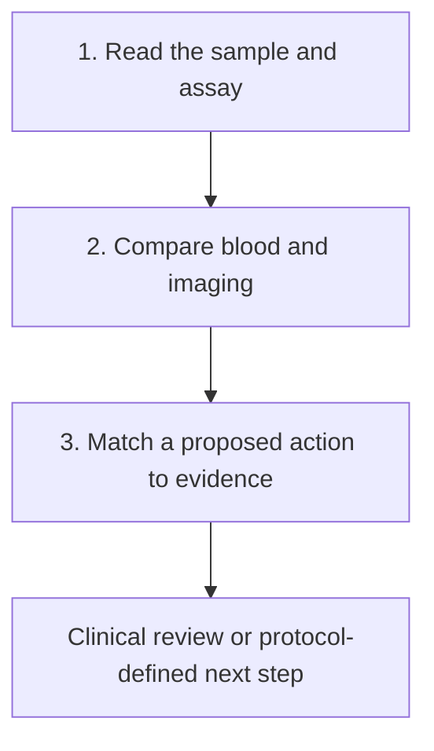

# Understand blood tests and imaging after treatment

**Learn what a residual-disease test can show, how to read it beside imaging, and what evidence a proposed response needs.** The aim is to leave with a clearer question for the care team, even when results disagree.

A small blood-test number can feel like a direct count of cancer. A clear scan can feel like an all-body guarantee. Neither measurement has that reach. This guide connects each result to its actual sample, method and purpose, then shows how to combine information without pretending the gaps are gone.

## The big ideas

1. [[wiki/education/concepts/measurement/liquid-biopsy/cfdna-vs-ctdna|Cell-free DNA and circulating tumor DNA]] describe total material and tumor origin. Plenty of extracted DNA does not guarantee a detectable tumor signal.
2. A [[wiki/education/concepts/measurement/liquid-biopsy/tumor-informed-mrd-assay|tumor-informed assay]] tracks selected features from a reference tumor. Its scope is narrower than every possible molecular change.
3. [[wiki/education/concepts/measurement/liquid-biopsy/ctdna-units|Units and detection limits]] travel with the result. A fraction, a concentration and a detection call have different meanings.
4. Blood testing and magnetic resonance imaging (MRI) look through different windows. Neither replaces surgical pathology when tissue response is the question.
5. Earlier detection, recurrence association and benefit from acting earlier are distinct claims. A useful plan names the evidence for the proposed action.

## The map

*Follow the numbered lessons below. Each result keeps its date, scope and limits attached.*

## Lessons

| Step | Lesson | Question it answers | Minutes | Learning aid |
|---|---|---|---|---|
| 1 | [Read the blood result](/wiki/education/guides/monitoring-residual-disease/01-read-the-blood-result) | What was sampled, tracked and detected? | 11 | Sample-to-report ledger |
| 2 | [Compare blood and imaging](/wiki/education/molecular-profiling/ctdna-ppm-and-mri) | Why can two results disagree? | 12 | Two-window cartoon and four-pattern exercise |
| 3 | [Ask what a result should change](/wiki/education/guides/monitoring-residual-disease/03-ask-what-a-result-should-change) | Does evidence support the proposed next action? | 12 | Evidence ladder and fictional protocol |

## Concepts you will use

**What the blood contains (lesson 1):**
- [[wiki/education/concepts/measurement/liquid-biopsy/cfdna-vs-ctdna|cfDNA versus ctDNA]]: total DNA versus the tumor's share, with a sense of scale.
- [[wiki/education/concepts/measurement/liquid-biopsy/chip|Clonal hematopoiesis]]: blood-cell mutations that imitate tumor signal.
- [Molecular residual disease](/wiki/education/concepts/measurement/liquid-biopsy/mrd): the signal being discussed.

**How the test reads it (lesson 1):**
- [[wiki/education/concepts/measurement/liquid-biopsy/tumor-informed-mrd-assay|Tumor-informed versus tumor-naive assays]]: why tracking many known mutations lowers the detection limit.
- [[wiki/education/concepts/measurement/liquid-biopsy/ctdna-units|Units]], [detection limits and finite sampling](/wiki/education/concepts/measurement/liquid-biopsy/limit-of-detection-and-sampling) and [blank, detection and quantitation limits](/wiki/education/concepts/evidence-and-statistics/biomarkers/limits-of-detection-and-quantitation).

**What a result means (lessons 2 and 3):**
- [Blood–imaging discordance](/wiki/education/concepts/measurement/liquid-biopsy/ctdna-imaging-discordance).
- [Measured lead time](/wiki/education/concepts/measurement/liquid-biopsy/lead-time) and [[wiki/education/concepts/evidence-and-statistics/reasoning-tools/lead-time-bias|lead-time bias]].
- [[wiki/education/concepts/evidence-and-statistics/tests-and-prediction/ppv-and-base-rates|Predictive values and base rates]], [[wiki/education/concepts/evidence-and-statistics/biomarkers/prognostic-vs-predictive|prognostic versus predictive evidence]], [surrogate endpoints](/wiki/education/concepts/evidence-and-statistics/endpoints/surrogate-endpoints) and [[wiki/education/concepts/measurement/computational-analysis/analytical-validity-clinical-validity-and-utility|validity and clinical utility]].

The [[wiki/education/molecular-profiling/06-ctdna-and-mrd|multi-omics blood lesson]] is an optional companion.

## What one study found after neoadjuvant therapy

In the I-SPY2 trial, a tumor-informed test tracking up to 16 mutations was run on serial blood from 84 people with high-risk early breast cancer receiving neoadjuvant chemotherapy ([Magbanua 2021, *Ann Oncol*](https://doi.org/10.1016/j.annonc.2020.11.007)):

| Finding | Number |
|---|---|
| ctDNA detected before treatment | 61 of 84 (73%); 9% just before surgery |
| People with a [pathologic complete response (pCR)](/wiki/education/concepts/breast-cancer/surgery-and-pathology-results/pcr) who were ctDNA-negative after chemotherapy | 17 of 17 |
| Without pCR: metastatic recurrence risk if ctDNA-positive versus negative after chemotherapy | Hazard ratio 10.4 (95% CI 2.3–46.6) |
| Without pCR but ctDNA-negative | Outcomes similar to pCR (hazard ratio 1.4; 95% CI 0.15–13.5) |

This is prognostic association in a small cohort of mixed subtypes; the wide intervals show the uncertainty. It does not show that changing treatment because of the blood result improves outcomes. That is lesson 3's question, and the c-TRAK TN trial there is the early-TNBC test of it.

## Applied to Diana

[[wiki/care/ctdna-monitoring|Monitoring coordination]] owns her draw history and clinical plan. [[wiki/care/results|Results]] owns signed findings, while [[wiki/diagnostics/ctdna-mrd|the clinical evidence reference]] owns dated assay and trial interpretation. This guide teaches a reusable reading method without copying those changing findings.

## What is still uncertain

Different assays, draw schedules and disease settings can produce different detection rates. More frequent or earlier detection may add information while also adding uncertain results, anxiety or unnecessary procedures. Useful studies evaluate the entire strategy, including harms and patient outcomes.

A molecular result may be clinically useful for one indication and investigational for another. An approval, trial or result in another cancer does not automatically settle an early-breast-cancer question. Keep the disease setting and proposed intervention beside the evidence.

## Sources and scope

Source check: November 7, 2026. Interpretation education with fictional exercises; expert and learner review pending. This guide does not set a surveillance schedule.

- [FDA 2024 ctDNA guidance](https://www.fda.gov/media/183874/download) — assay and clinical-trial design.
- [Magbanua et al. 2021, MRI and ctDNA in I-SPY2](https://doi.org/10.1038/s41523-021-00239-3) — complementary measurements in a pilot cohort.
- [Magbanua et al. 2021, ctDNA during neoadjuvant chemotherapy in I-SPY2](https://doi.org/10.1016/j.annonc.2020.11.007) — 84 patients; detection, pCR and recurrence (PMID 33232761).
- [Turner et al. 2023, c-TRAK TN](https://pubmed.ncbi.nlm.nih.gov/36423745/) — prospective detection and intervention feasibility in a defined early-TNBC setting.
