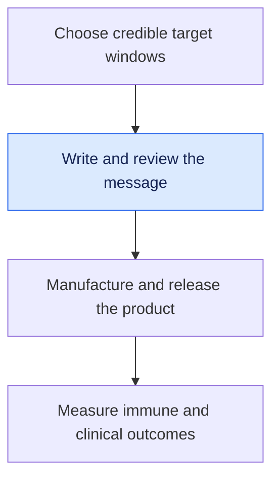

# Turn selected targets into an mRNA message

**A target list becomes a vaccine message only after its sequence, arrangement and RNA features are specified and checked.** This is step six of the [vaccine guide](/wiki/education/guides/personalized-cancer-vaccine/index).

**Before you start:** [mRNA construct anatomy](/wiki/education/concepts/engineering-and-manufacturing/nucleic-acid-design/mrna-construct-anatomy) separates the coding message from its supporting features. [Antigen processing](/wiki/education/concepts/immunology/antigen-presentation/antigen-processing-machinery) explains why encoding a sequence does not guarantee its display. [Multi-epitope constructs](/wiki/education/concepts/engineering-and-manufacturing/nucleic-acid-design/multi-epitope-constructs) introduce the consequences of joining target windows.

## Where this step sits

You have candidate targets and an evidence board. Now you need a versioned message that faithfully encodes them. Manufacturing will make and test that specified material. [In vitro transcription](/wiki/education/concepts/engineering-and-manufacturing/nucleic-acid-design/in-vitro-transcription) makes the RNA; [purification](/wiki/education/concepts/engineering-and-manufacturing/nucleic-acid-design/dsrna-impurities-and-purification) addresses unwanted products. Neither step answers whether the intended peptides will be displayed.

*This lesson concerns the message. Delivery and release remain separate reviews.*

## The intuition: neighbors matter

Putting target windows next to one another changes their neighbors. A window contains the altered sequence and surrounding amino acids; it is not necessarily the short fragment eventually inspected by a T cell. Order, linkers and trafficking features can influence the combined protein and the fragments produced from it.

Messenger ribonucleic acid (**mRNA**) is the instruction molecule. A ribosome translates it into protein. Cellular processing then generates possible peptides for [human leukocyte antigen (HLA)](/wiki/education/concepts/immunology/antigen-presentation/hla) display. Keep those three objects distinct: RNA message, encoded protein and displayed fragments.

## Inspect the design in layers

| Design layer | What can change | What to check |
|---|---|---|
| Source target windows | Altered residue and surrounding protein context | Trace each window to its source event; retain the intended alteration |
| [Order and spacers](/wiki/education/concepts/engineering-and-manufacturing/nucleic-acid-design/multi-epitope-constructs) | Combined protein and new boundaries | Inspect processing predictions, unintended junctions and relevant display evidence |
| [Codon optimization](/wiki/education/concepts/engineering-and-manufacturing/nucleic-acid-design/codon-optimization) | RNA sequence with the same intended amino acids | Confirm full protein-sequence equivalence and test message behavior |
| [Modified nucleosides](/wiki/education/concepts/engineering-and-manufacturing/nucleic-acid-design/modified-nucleosides) | Chemical building blocks | Assess sensing and expression in matched, product-relevant conditions |
| Cap, untranslated regions and poly(A) features | RNA stability and translation | Record the specification and measure the relevant quality and functional properties |

**Synonymous** codons specify the same amino acid. Changing them can still affect RNA lifetime or structure. A changed spacer, by contrast, changes the combined protein sequence. These revisions ask different review questions. “Optimized” describes an intention until the relevant improvement is measured.

A trafficking signal directs the protein toward a cellular compartment. A helper segment may support CD4 T-cell responses in a particular design. Neither feature is universally required, and better bulk expression does not establish better presentation of every selected target.

## Worked example: three versions of the same target list

A fictional design includes windows A and B, each with a verified altered residue. The team receives three proposals:

1. **Version 1:** Change synonymous codons inside the coding region. The protein sequence should remain unchanged. Confirm that it does, then compare relevant RNA and protein behavior.
2. **Version 2:** Shorten the spacer between A and B. The combined protein now differs. Review the new boundary and possible changes in processing, not just the retained target names.
3. **Version 3:** Use a modified uridine building block. The intended protein can remain the same, but sensing and translation may differ. Purity and delivery must be held appropriately comparable in the test.

Suppose Version 1 produces more protein in a reporter assay. That is useful expression evidence. It does not tell the team whether A and B are both displayed, whether responding T cells recognize the tumor, or whether recurrence is prevented. Name the measured gate before moving to the next one.

## Make the handoff reviewable

The approved record needs the complete sequence, each window's source, the intended protein, supporting RNA features and the rationale for changes. Predictions should retain their method and version. Measured results should retain the specimen, assay and conditions.

Keep this record separate from the delivery specification. An [LNP (lipid nanoparticle)](/wiki/education/concepts/engineering-and-manufacturing/delivery-vehicles/lipid-nanoparticle) or an [RNA-lipoplex](/wiki/education/concepts/engineering-and-manufacturing/delivery-vehicles/rna-lipoplex) describes a lipid-based delivery formulation. These names can overlap in the literature; inspect composition and architecture rather than treating the label as the specification. The same message can behave differently with a new formulation or route. The released lot must remain traceable to the approved design and manufacturing specification.

## What can go wrong at this step

A handoff can lose an altered residue, reuse the wrong sequence version or conceal a biologically relevant edit as a routine production change. A new junction may create an unintended candidate fragment. A strong expression result may concern a model that does not reproduce the intended presentation pathway.

These are reasons to ask specific questions, not reasons to assume the construct fails. A prediction identifies an uncertainty to investigate; a relevant assay answers part of it.

## Try it

A manufacturer says: “The target list is unchanged, so our new linker and RNA chemistry need no renewed assessment.” Which part of the record should the reviewer request?

**Answer:** The exact old and new RNA and protein specifications, the rationale for each change, and evidence addressing expression, sensing and processing where affected. Retained target names do not establish product equivalence.

## Explain it back

“Codon choice changes ___; a spacer change can alter ___; chemistry changes can affect ___; none alone proves ___.”

One answer: “the RNA sequence while preserving the intended amino acids; the combined protein and its processing; RNA sensing and translation; tumor recognition or clinical benefit.”

## Takeaway

**Review each change at the biological layer it can affect, and connect the final message to the exact version manufactured.**

**Next:** [Manufacture a defined product](/wiki/education/designing-a-vaccine/05-how-vaccines-are-manufactured).

## Sources and scope

Source check: October 9, 2026; expert and learner review pending. The worked example is fictional. These sources explain design mechanisms and specific study methods; they do not prescribe a clinical construct.

- [Schubert and Kohlbacher, 2016: computational spacer design](https://doi.org/10.1186/s13073-016-0263-6).
- [Wu et al., 2019: codon-dependent RNA stability in human cells](https://elifesciences.org/articles/45396).
- [Karikó et al., 2005: nucleoside modification and innate sensing](https://pubmed.ncbi.nlm.nih.gov/16111635/).
- [Rojas et al., 2023: primary personalized RNA-vaccine methods](https://www.nature.com/articles/s41586-023-06063-y).
