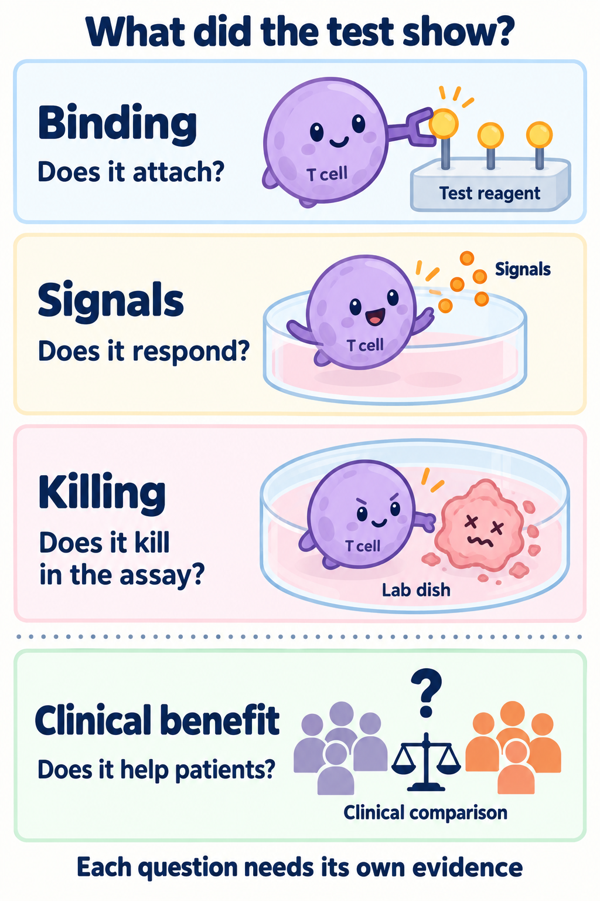

# Dose a vaccine and measure its response

**Immune monitoring tests whether a response occurred; clinical comparison tests whether the intervention helped patients.** This is step eight of the [vaccine guide](/wiki/education/guides/personalized-cancer-vaccine/index).

**Before you start:** [T-cell receptor (TCR)](/wiki/education/concepts/immunology/t-cells/t-cell-receptor) [sequencing](/wiki/education/concepts/measurement/immune-monitoring/tcr-sequencing) reads sampled receptor sequences; a sequence alone does not identify its antigen. [T-cell states](/wiki/education/concepts/immunology/t-cells/t-cell-states) describe functional programs. [Human leukocyte antigen (HLA)](/wiki/education/concepts/immunology/antigen-presentation/hla) provides peptide display. The [evidence guide](/wiki/education/guides/reading-cancer-evidence/index) separates endpoints and comparisons.

## Where this step sits

A defined product has passed its release requirements. The clinical protocol now owns administration, monitoring and stopping rules. Batch release does not establish a safe dose or a beneficial treatment schedule.

## The intuition: ask which response was measured

A vaccine might increase peptide-reactive cells, alter a blood receptor repertoire or cause inflammation. These are different observations. They must be connected to recognition of naturally presenting tumor cells and, eventually, to outcomes that matter to patients.

**Immunogenicity** means the ability to elicit an immune response. **Efficacy** concerns clinical benefit in the tested setting. A positive immune assay can coexist with relapse; a weak blood signal may also miss activity in another compartment.

## Route and calendar belong to the product

The protocol specifies dose, route, cadence, duration, combination treatment and safety monitoring. Changing formulation or route can change distribution and inflammation. Published RNA-lipoplex regimens cannot be assigned automatically to an intramuscular lipid-nanoparticle product.

There is no general rule that every cancer vaccine belongs in a chemotherapy off-week, that checkpoint treatment should overlap it, or that a targeted drug should be taken concurrently. Mechanistic compatibility and clinical evidence are different questions. Current combination evidence belongs to the exact protocol and cancer setting.

## Match each assay to a claim

*Binding, signaling, killing in a test and patient benefit each need their own evidence.*

| Measurement | What it supports | What remains unresolved |
|---|---|---|
| [TCR sequencing](/wiki/education/concepts/measurement/immune-monitoring/tcr-sequencing) | Sampled identities and abundance changes | Antigen specificity and useful function |
| [Peptide–HLA multimer binding](/wiki/education/concepts/measurement/immune-monitoring/peptide-hla-multimer-staining) | Cells bind the tested peptide–human leukocyte antigen complex | Functional response and natural tumor recognition |
| [Enzyme-linked immunospot (ELISpot)](/wiki/education/concepts/measurement/immune-monitoring/elispot) or [intracellular cytokine staining](/wiki/education/concepts/measurement/immune-monitoring/intracellular-cytokine-staining) | A response under defined stimulation | Killing, tissue access and clinical benefit |
| [Controlled tumor-cell killing assay](/wiki/education/concepts/measurement/immune-monitoring/functional-cytotoxicity-assays) | Function against those cells under those conditions | Distribution, durability and safety in patients |
| Clinical outcome with a suitable comparison | Benefit estimate in the enrolled setting | Transferability to another product or population |

Assays need controls, a baseline when informative, prespecified interpretation and an adequate sampling plan. Technical repeats on one sample do not establish reproducibility across people.

The starting material also matters. [Peripheral blood mononuclear cells (PBMCs)](/wiki/education/concepts/measurement/immune-monitoring/peripheral-blood-mononuclear-cells) are a mixed blood-cell fraction. [Flow cytometry](/wiki/education/concepts/measurement/immune-monitoring/flow-cytometry) helps identify tested populations. A change in [TCR clonality](/wiki/education/concepts/measurement/immune-monitoring/tcr-clonality-metrics) describes a frequency distribution, not the antigen or absolute expansion of each clone.

## A real example: the assay changes the answer

The exploratory TNBC-MERIT study evaluated a personalized RNA vaccine after standard therapy in triple-negative breast cancer. Among 14 evaluable participants, overnight ELISpot detected responses in 12. Eight participants had enough remaining cells for additional testing after culture and stimulation. A response appeared in every participant using at least one ELISpot approach. These denominators describe different assay opportunities, not competing estimates of the same direct blood measurement. [Primary report, immune-monitoring methods and Figure 2](https://www.nature.com/articles/s41586-025-10004-2).

Culture can reveal rare responders by changing their number and state. It also changes what the sample represents. Ask whether a result concerns freshly tested cells or an expanded culture before comparing response frequencies. This non-comparative study demonstrates immune responses; its assay results cannot isolate a recurrence-prevention effect.

## Worked example: a positive assay and a recurrence

In a fictional single-arm study, several patients develop peptide-reactive cells and some later recur. The immune result can remain real. The study still needs to investigate display, access, state and other escape routes. Without a suitable clinical comparison, recurrence frequency cannot isolate the vaccine’s effect from standard care or patient selection.

## What can go wrong at this step

Blood may miss tissue-resident responses. Artificial peptide loading may bypass deficient natural processing. Stimulation conditions can exaggerate responses. Changing tests after seeing results can also favor a positive story. Safety events require systematic collection rather than inference from an immune-response curve.

## Try it

[[about/Terminology#ctdna|Circulating tumor DNA (ctDNA)]] becomes undetectable after standard treatment plus vaccine. Does that establish the vaccine caused clearance?

**Answer:** No. Timing, assay limits, standard treatment and a suitable comparison matter. A blood result does not isolate one component of a combined intervention.

## Explain it back

“The immune assay shows ___ under ___; the clinical-benefit claim still needs ___.” One answer: “a measured response; the assay conditions; suitable outcome evidence and comparison.”

## Takeaway

**Keep protocol administration, immune response, safety and clinical benefit as separate claims.**

**Next:** [Read cancer evidence](/wiki/education/guides/reading-cancer-evidence/index).

## Sources and scope

Source check: October 9, 2026; expert and learner review pending. The TNBC-MERIT example retains its assay-specific denominators. The cartoon is a question map, not a guaranteed sequence. No schedule or combination is recommended.

- [TNBC-MERIT primary study](https://www.nature.com/articles/s41586-025-10004-2) — small single-arm intravenous RNA-lipoplex study in triple-negative breast cancer.
- [Primary pancreatic-cancer RNA-lipoplex study](https://www.nature.com/articles/s41586-023-06063-y) — a different population and combined treatment setting.
- [TCR sequencing lesson](/wiki/education/molecular-profiling/tcr-and-tcr-sequencing) — assay mechanics and primary references.
