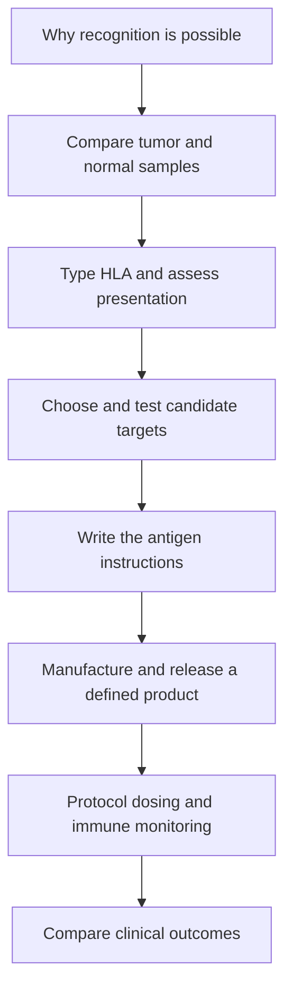

# How a personalized cancer vaccine is designed

**Follow a tumor alteration through discovery, target selection, manufacture and testing of the immune response.** A vaccine is a defined intervention. A list of mutations is only one input.

## The big ideas

1. [A neoantigen](/wiki/education/concepts/immunology/antigen-presentation/neoantigen) comes from altered sequence, but most candidate sequences still face expression, processing and display gates.
2. [Human leukocyte antigen (HLA)](/wiki/education/concepts/immunology/antigen-presentation/hla) displays fragments; a [T-cell receptor (TCR)](/wiki/education/concepts/immunology/t-cells/t-cell-receptor) recognizes the fragment together with its holder.
3. Priming, tumor recognition and clinical benefit require different evidence.
4. A [messenger RNA (mRNA) construct](/wiki/education/concepts/engineering-and-manufacturing/nucleic-acid-design/mrna-construct-anatomy) and its delivery formulation are separate design choices. A clean batch can still encode weak targets.
5. Immune expansion is not proof of recurrence prevention. Dose, route and schedule belong to the specific protocol.

## The map

*Follow the numbered links below through the same sequence. Each gate asks a new question.*

## Lessons

Times are suggested reading budgets, not measured completion times. The final evidence guide is a shared capstone.

| Step | Lesson | Question | Minutes | Learning aid |
|---|---|---|---|---|
| 1 | [Why vaccination can help](/wiki/education/designing-a-vaccine/index) | How does a pre-existing receptor become a larger response? | 8 | Priming-versus-killing example |
| 2 | [Read tumor and normal data](/wiki/education/guides/personalized-cancer-vaccine/02-reading-tumor-and-normal-data) | Which alterations are credible candidate sources? | 12 | Evidence ledger |
| 3 | [Match HLA and presentation](/wiki/education/designing-a-vaccine/02-hla-and-antigen-presentation) | What does an HLA type constrain? | 12 | HLA allele and presentation exercise |
| 4 | [Read a target design board](/wiki/education/designing-a-vaccine/04-how-to-read-a-neoantigen-design-board) | Which gates are measured, predicted or missing? | 15 | Ten-row candidate board |
| 5 | [Measure presentation, binding and response](/wiki/education/designing-a-vaccine/03-immunopeptidomics) | Which immune question did the assay answer? | 12 | Three-assay cartoon and worked notebook |
| 6 | [Write the message](/wiki/education/guides/personalized-cancer-vaccine/06-writing-the-message) | What changes when targets become one construct? | 12 | Three-version construct review |
| 7 | [Make the product](/wiki/education/designing-a-vaccine/05-how-vaccines-are-manufactured) | How do sequence, formulation and release differ? | 14 | Formulation-and-protocol comparison |
| 8 | [Dose and measure response](/wiki/education/guides/personalized-cancer-vaccine/08-dosing-and-measuring-response) | What shows immunogenicity, safety or benefit? | 12 | Assay-to-claim exercise |
| 9 | [Read cancer evidence](/wiki/education/guides/reading-cancer-evidence/index) | What comparison can establish clinical benefit? | 10 | Endpoint and denominator check |

## Concepts you will use

**Foundations:** [DNA → RNA → protein](/wiki/education/concepts/biology-basics/genetics/central-dogma), [innate and adaptive immunity](/wiki/education/concepts/immunology/the-immune-system/innate-vs-adaptive-immunity), [the immune-cell roster](/wiki/education/concepts/immunology/the-immune-system/immune-cell-roster).

**Recognition:** [neoantigen](/wiki/education/concepts/immunology/antigen-presentation/neoantigen), [antigen processing](/wiki/education/concepts/immunology/antigen-presentation/antigen-processing-machinery), [beta-2 microglobulin (B2M)](/wiki/education/concepts/immunology/antigen-presentation/b2m), [cross-presentation](/wiki/education/concepts/immunology/antigen-presentation/cross-presentation), [T-cell priming](/wiki/education/concepts/immunology/t-cells/t-cell-priming-three-signals) and [T-cell states](/wiki/education/concepts/immunology/t-cells/t-cell-states).

**Measurement:** [immunopeptidomics](/wiki/education/concepts/measurement/proteins-and-spatial/immunopeptidomics), [enzyme-linked immunospot (ELISpot)](/wiki/education/concepts/measurement/immune-monitoring/elispot), [peptide–HLA multimer staining](/wiki/education/concepts/measurement/immune-monitoring/peptide-hla-multimer-staining) and [TCR sequencing](/wiki/education/concepts/measurement/immune-monitoring/tcr-sequencing).

**Message design:** [mRNA construct anatomy](/wiki/education/concepts/engineering-and-manufacturing/nucleic-acid-design/mrna-construct-anatomy), [multi-epitope constructs](/wiki/education/concepts/engineering-and-manufacturing/nucleic-acid-design/multi-epitope-constructs), [codon optimization](/wiki/education/concepts/engineering-and-manufacturing/nucleic-acid-design/codon-optimization) and [modified nucleosides](/wiki/education/concepts/engineering-and-manufacturing/nucleic-acid-design/modified-nucleosides).

**Manufacturing and delivery:** [in vitro transcription](/wiki/education/concepts/engineering-and-manufacturing/nucleic-acid-design/in-vitro-transcription), [double-stranded RNA impurities and purification](/wiki/education/concepts/engineering-and-manufacturing/nucleic-acid-design/dsrna-impurities-and-purification), [lipid nanoparticles (LNPs)](/wiki/education/concepts/engineering-and-manufacturing/delivery-vehicles/lipid-nanoparticle), [RNA-lipoplex](/wiki/education/concepts/engineering-and-manufacturing/delivery-vehicles/rna-lipoplex) and [good manufacturing practice (GMP) and batch release](/wiki/education/concepts/engineering-and-manufacturing/cmc-and-quality/gmp-and-batch-release).

**Downstream targeting and failure:** [delivery targeting versus cancer targeting](/wiki/education/concepts/engineering-and-manufacturing/delivery-vehicles/delivery-targeting-vs-cancer-targeting) and [immune escape](/wiki/education/concepts/immunology/tumor-immunology/immune-escape). Return to the linked concept whenever a lesson uses an unfamiliar term.

## Applied to Diana

[The molecular profile](/wiki/care/molecular-profile), [vaccine readiness](/project-management/projects/vendors/personalized-vaccine), [vaccine evidence](/wiki/treatment/therapeutics/cancer-vaccines) and [the care plan](/wiki/care/treatment-plan) own current findings, decisions and logistics. This guide supplies the questions for reading those owners.

## What is still uncertain

Target-ranking methods differ in what they predict and how they were validated. A measured immune response may fail to control a tumor. Small studies cannot isolate vaccine benefit from standard care, selection and other treatments. Formulation and combination results must retain their original cancer population and protocol.

## Sources and scope

Source check: October 9, 2026; expert and learner review pending. Individual lessons supply their sources. [TNBC-MERIT](https://www.nature.com/articles/s41586-025-10004-2) and [the pancreatic-cancer RNA-lipoplex study](https://www.nature.com/articles/s41586-023-06063-y) are specific clinical examples, not universal product specifications.
