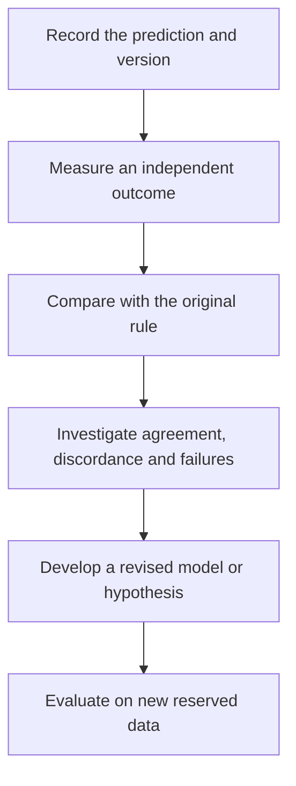

# Test clinical relevance and learn from feedback

**A model response earns a clinical prediction through independent, intended-use validation; improving care is a further question.**

**Before you start:** [Analytical validity, clinical validity and utility](/wiki/education/concepts/measurement/computational-analysis/analytical-validity-clinical-validity-and-utility) separates reliable measurement, relevant prediction and improved decisions. [Controlled perturbation](/wiki/education/concepts/evidence-and-statistics/study-design/perturbation-and-controls) supports an interpretable experiment. [Prognostic versus predictive evidence](/wiki/education/concepts/evidence-and-statistics/biomarkers/prognostic-vs-predictive) separates outcome association from treatment selection.

## Where this step sits

This is step 3 of [Understand what a tumor model can predict](/wiki/education/guides/predicting-response-before-treating/index). The first lessons chose and checked a model. This final step asks what independent evidence connects its result to the proposed decision, and how later observations should update that evidence. It covers laboratory and computer models; blood and imaging signals measured during treatment belong to [understand blood tests and imaging after treatment](/wiki/education/guides/monitoring-residual-disease/index).

## Climb one claim at a time

[How a model earns trust](/wiki/education/concepts/measurement/functional-models/how-a-model-earns-trust) begins with a precise purpose. Think of a rehearsal that successfully tests one scene. It helps prepare the performance, but the audience response remains a new observation. A tumor model can also do its job well without answering every clinical question.

| Evidence rung | What it supports | What remains open |
|---|---|---|
| Characterized model and reliable readout | A trustworthy measurement in a stated preparation | Whether the intervention response is interpretable |
| Controlled perturbation | A response under the tested conditions | How closely it represents the relevant patient biology |
| Mechanistic evidence | A particular explanation within the model | Delivery, achievable exposure and normal-tissue toxicity |
| Independent clinical prediction study | Performance for the specified assay, population and endpoint | Whether acting on its result improves care |
| Appropriate study of model-guided decisions | Clinical utility for its evaluated strategy and setting | Applicability to other settings and individuals |

This is an evidence map, not a demand that every validated clinical biomarker be retested through every rung. Follow the evidence pathway for the actual intended use. Keep research discoveries and established treatment-selection tests accurately labeled.

## Match the validation to the decision

A clinical validation names its disease, treatment, setting, specimen timing, assay version and outcome. Change any one and the result may not transfer. Imaging shrinkage, pathology, blood signals and survival are different outcomes; a [surrogate endpoint](/wiki/education/concepts/evidence-and-statistics/endpoints/surrogate-endpoints) needs its own evidence bridge. The comparison standard is itself imperfect, so studies report **agreement**, not true accuracy ([FDA statistical guidance, 2007](https://www.fda.gov/regulatory-information/search-fda-guidance-documents/statistical-guidance-reporting-results-studies-evaluating-diagnostic-tests-guidance-industry-and-fda)).

## Work through a real study

Ladan and colleagues tested whether breast-cancer tissue slices could predict response to chemotherapy given before surgery ([Ladan 2023](https://pmc.ncbi.nlm.nih.gov/articles/PMC10542784/)). Biopsy cores were cut into thin slices and exposed for 3 days to 5-fluorouracil, doxorubicin and the active form of cyclophosphamide. Each tumor was called sensitive, intermediate or resistant. The comparison was the tumor's size change on magnetic resonance imaging (MRI) after four cycles of anthracycline-containing chemotherapy, measured with [Response Evaluation Criteria in Solid Tumors (RECIST)](/wiki/education/concepts/measurement/imaging/response-criteria) but grouped by the study's own cutoffs: "sensitive" meant more than 50% shrinkage, a stricter bar than RECIST's 30% for partial response. Before starting, the team set a target of at least 55% agreement.

Follow the patients through each step:

| Step | Count | What it teaches |
|---|---|---|
| Consented | 41 | Three had no biopsy and 8 biopsies held no tumor cells |
| Biopsies containing tumor | 30 | The group offered the test |
| Usable assay result | 23 (77%) | Six failed a quality rule on the untreated slice and one was lost to infection. A failure is not resistance |
| Treated and compared with MRI | 20 | Three did not receive the chemotherapy |
| Assay and MRI agreed | 15 of 20 (75%; 95% confidence interval 53–89%) | Agreement with an imperfect comparator, not proof of accuracy |

Here are the 20 compared patients. The cells are derived from the paper's reported totals: 4 tumors sensitive on MRI, 3 called sensitive in the dish but intermediate on MRI, and 2 the reverse.

| Dish call | MRI sensitive | MRI intermediate | Total |
|---|---|---|---|
| Sensitive | 2 | 3 | 5 |
| Intermediate | 2 | 13 | 15 |
| Total | 4 | 16 | 20 |

No tumor was resistant, either in the dish or on MRI. A [denominator](/wiki/education/concepts/evidence-and-statistics/reasoning-tools/denominators-and-conditional-probability) names the group being counted, and a [positive predictive value (PPV)](/wiki/education/concepts/evidence-and-statistics/tests-and-prediction/ppv-and-base-rates) asks how often a positive call was right. Complete the answer card:

| Question | Calculation and answer |
|---|---|
| Of the 20 compared, how many agreed? | (2 + 13) / 20 = 75% |
| Of the 4 MRI-sensitive tumors, how many did the dish call sensitive? | 2 / 4 = 50% |
| Of the 5 "sensitive" dish calls, how many were MRI-sensitive? | 2 / 5 = 40%, the PPV of a "sensitive" call |
| Of the 30 biopsies with tumor, how many gave a usable result? | 23 / 30 = 77%, the coverage |
| Of the 30 biopsies with tumor, how many gave a result that matched MRI? | 15 / 30 = 50% |

**What 15/30 means.** The last row divides the same 15 agreeing results by everyone who was offered the test: the 30 biopsies with tumor, including the 7 assay failures and the 3 people never treated. It answers "if this test were offered, how often would it give a call that matched the scan?" The 75% answers a narrower question: how often it matched among people who got both a result and the treatment.

Four lessons follow. Most of the agreement, 13 of 15, came from the common "intermediate" category. The dish's "sensitive" call was right 2 times out of 5. Because nothing was ever called resistant, the study could not test whether the assay detects resistance. And the comparator was MRI shrinkage after four cycles, not [pathologic complete response](/wiki/education/concepts/breast-cancer/surgery-and-pathology-results/pcr) or survival. The authors met their own 55% target; that supports a larger study, not use in care.

## Write the prediction before the outcome

A **prospective** evaluation fixes predictions before observing the relevant outcomes. A **retrospective** study examines already observed material and outcomes. Either needs a suitable independent comparison; its name alone establishes no utility.

Keep the original version 1 record for every patient: specimen, assay version, exposure and time, quality checks, call or no-result, threshold, comparison method and timing, and any disagreement. [Model validation](/wiki/education/concepts/measurement/computational-analysis/model-validation-basics) separates development from reserved evaluation.

Now imagine a fictional next step. A team studies the three "sensitive" calls that MRI rated intermediate and raises the cutoff for "sensitive." That is **version 2**. The version 1 errors and all failed assays stay in the original record. Checking version 2 on the same 20 patients only measures how well it fits data it was tuned on; new patients are needed to test it.

*Learning from the test set creates a new model. That model needs another independent evaluation.*

## Treat disagreement as information

If the model responds and the patient does not, check model selection, exposure, cell composition, timing and the clinical endpoint. If a computer prediction differs from a living experiment, inspect inputs, task and portability. A disagreement need not have one simple explanation.

[Blood monitoring](/wiki/education/concepts/measurement/liquid-biopsy/mrd), imaging and clinical assessment can supply complementary observations. A changing blood signal does not identify the effect of one drug, establish that every cancer site responded or measure every surviving population. Feedback should preserve those limits.

## What can go wrong at this step

- A validated drug or disease setting is replaced by an untested one.
- A model establishes a growth response, but the report promises patient survival.
- Only successful cultures or favorable cases enter the headline.
- The prediction is changed until it matches the observed outcome.
- A revised model is evaluated on the same data used to revise it.
- One person's course is treated as proof of comparative clinical benefit.

## Try it

A brochure says a tumor-slice test "showed 75% concordance with clinical response" and offers it to choose treatment after surgery. Using the study above, list what to ask.

**Answer:** Concordance among whom: 20 of the 30 offered, after 7 assay failures and 3 people never treated. Which comparator: MRI shrinkage after four cycles, not recurrence or survival. Which calls: no tumor was ever called resistant, and "sensitive" calls were right 2 of 5 times. Which setting and drugs: a pre-treatment biopsy and one chemotherapy combination, not a postoperative choice among different drugs. Agreement in one setting does not make the test a [treatment-predictive biomarker](/wiki/education/concepts/evidence-and-statistics/biomarkers/prognostic-vs-predictive) in another, or show that choosing by it improves care.

## Explain it back

“The model supports ______ in ______. To use it for this decision, the missing evidence is ______. After updating it, we must ______.”

One answer: “an interpretable laboratory response; the tested model and exposure; intended-use clinical validation; evaluate on independent new data.”

## Takeaway

**Preserve the original prediction, validate the actual decision and let feedback create a new testable claim.**

**Next:** [See what real concordance studies show](/wiki/education/guides/predicting-response-before-treating/04-what-concordance-studies-show).

## Sources and scope

Source check: November 8, 2026, against the full text of Ladan 2023 (PMC10542784). Model validation and feedback principles, not treatment advice. Expert and learner review remain pending.

- [Ladan et al., 2023: ex vivo chemotherapy assay on breast biopsies versus MRI response](https://pmc.ncbi.nlm.nih.gov/articles/PMC10542784/) — 41 consented, 30 with tumor, 23 usable, 20 compared, 15 concordant; no resistant calls; 55% go/no-go target (PMID 37777518). A table footnote gives a slightly different count of patients without MRI results; the main text's 20 is used here.
- [FDA statistical guidance on reporting diagnostic test studies, 2007](https://www.fda.gov/regulatory-information/search-fda-guidance-documents/statistical-guidance-reporting-results-studies-evaluating-diagnostic-tests-guidance-industry-and-fda) — agreement versus accuracy with an imperfect reference.
- [NCI biomarker testing: methods, clinical context and treatment evidence](https://www.cancer.gov/about-cancer/treatment/types/biomarker-testing-cancer-treatment).

The two-by-two cells are derived from the paper's reported totals. The version 2 scenario is fictional.
