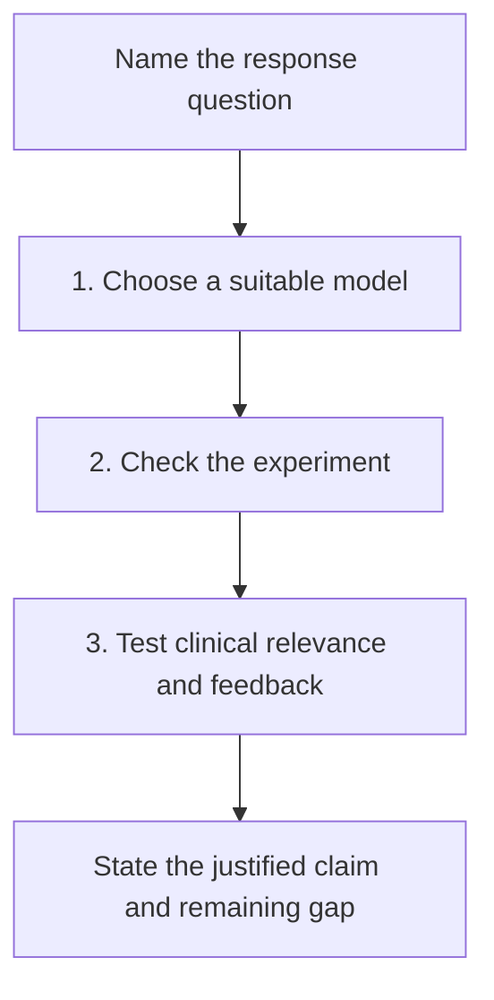

# Understand what a tumor model can predict

**Learn to read a tumor-model result: choose the question, check the experiment and identify the evidence needed for its clinical use.**

It is natural to want to try a medicine on a tumor before giving it to a person. A dish, animal or computer model can answer useful parts of that question. Each preserves some biology and leaves other parts out. This course gives you a way to ask what the result actually earned.

Plan about 36 minutes, or take one lesson at a time. If the model names are new, read their short concepts first. You do not need to master laboratory methods to explain the evidence boundary.

## The big ideas

1. A model is chosen for a particular question. Complexity alone does not establish fidelity or accuracy.
2. Identity, retained cell populations, exposure and controls determine what a response means.
3. Growth, metabolic viability, cell death and computed [ribonucleic acid (RNA) predictions](/wiki/education/concepts/biology-basics/genetics/central-dogma) are different readouts.
4. Clinical prediction belongs to an assay version, disease, treatment setting and outcome. Clinical utility asks whether acting on its result helps.
5. Feedback starts with a recorded prediction and independent outcome. Updating a model creates a new claim to evaluate.

## The map

*Each box asks a new question. A positive result does not automatically complete the next box.*

## Lessons

| # | Lesson | Question it answers | Minutes | Learning aid |
|---|---|---|---|---|
| 1 | [Choose a tumor model for the question](/wiki/education/modeling-tumor-response/index) | Which biology must the model contain? | 12 | Three fictional model choices |
| 2 | [Check what the experiment actually tests](/wiki/education/guides/predicting-response-before-treating/02-check-the-experiment) | Whose response was measured, under which conditions? | 12 | Experiment card and growth-versus-death example |
| 3 | [Test clinical relevance and learn from feedback](/wiki/education/modeling-tumor-response/verification-and-feedback-loops) | What validates the intended prediction and use? | 12 | Evidence ladder and independent feedback loop |

Follow the lessons in order: choose the model, inspect the experiment, then test how far its result can travel.

## Concepts you will use

**Living models:** [Organoid](/wiki/education/concepts/measurement/functional-models/organoid), [patient-derived xenograft (PDX)](/wiki/education/concepts/measurement/functional-models/patient-derived-xenograft) and [ex vivo drug screen](/wiki/education/concepts/measurement/functional-models/ex-vivo-drug-screen).

**Prediction and comparison:** [Virtual cell model](/wiki/education/concepts/measurement/computational-analysis/virtual-cell-model), [controlled perturbation](/wiki/education/concepts/evidence-and-statistics/study-design/perturbation-and-controls) and [analytical validity, clinical validity and utility](/wiki/education/concepts/measurement/computational-analysis/analytical-validity-clinical-validity-and-utility).

**Foundations:** [Tumor heterogeneity](/wiki/education/concepts/cancer-biology/what-cancer-is/tumor-heterogeneity) explains selection and sampling. [Multi-omics](/wiki/education/reading-a-tumor/omics-and-multi-omics) separates the objects measured.

## Check your understanding

In a fictional culture, a drug reduces growth under good controls. Researchers then predict postoperative patient benefit using a validation study of another drug in advanced disease.

The culture response can remain sound while the clinical transfer remains untested. The third lesson shows how to name the changed drug, setting and outcome before asking for closer validation.

## Applied to Diana

[Functional drug testing](/wiki/diagnostics/functional-drug-testing) owns assay and provider evidence. [Tissue and data](/wiki/care/tissue-and-data) and [tissue-routing questions](/wiki/questions/tissue-and-data-routing) own case-specific material and decisions. [Tissue and data custody](/project-management/projects/research/tissue-allocation) owns operational follow-up; no testing order or treatment choice follows from this course.

## What is still uncertain

A model may omit a relevant population, change during establishment or use an exposure that does not translate to patients. Computation may fail in a new context. Even a strong clinical prediction may lack evidence that its use improves care. Keep those gaps beside the useful result.

## Sources and scope

Source check: October 9, 2026. General model-reading education; each lesson supplies its primary and method sources. Expert and learner review remain pending.

- [Neal et al., 2018: selected immune-containing organoid experiments](https://pubmed.ncbi.nlm.nih.gov/30550791/).
- [Ladan et al., 2023: a specified ex vivo breast-cancer assay and clinical-response comparison](https://pubmed.ncbi.nlm.nih.gov/37777518/).
- [Ahlmann-Eltze et al., 2025: task-specific perturbation-prediction evaluation](https://pmc.ncbi.nlm.nih.gov/articles/PMC12328236/).
