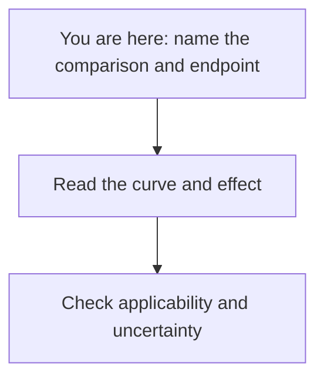

# Name the comparison and endpoint

**Before interpreting a study's result, say who was studied, what was compared, what counted as an event, and when follow-up began.**

**Before you start:** [Trial phases and randomization](/wiki/education/concepts/evidence-and-statistics/study-design/trial-phases-and-randomization) explain how a study builds its comparison. [Survival endpoints](/wiki/education/concepts/evidence-and-statistics/endpoints/survival-endpoints) define the event and starting time. [Prognostic versus predictive biomarkers](/wiki/education/concepts/evidence-and-statistics/biomarkers/prognostic-vs-predictive) separate associations with outcome from differences in treatment effect.

## Where this step sits

This is the first step in [reading cancer evidence](/wiki/education/guides/reading-cancer-evidence/index). You will use the same question card when reading the numbers and judging applicability.

## The question comes before the percentage

Imagine two weather reports. One says there was rain on five days this month. Another says five towns had rain yesterday. Both contain the number five, but they answer different questions. A cancer outcome percentage also needs a label: what event, in whom, over which period?

An **endpoint** is the outcome a study measures under a defined rule. Some endpoints count death from any cause. Others count the first of several events, such as recurrence or death. A combined endpoint can be useful, but its components are not interchangeable. An improvement in one combined endpoint does not establish an improvement in every component.

## Make a study question card

You can usually find these details in the methods, trial protocol, or registration. If an abstract omits them, leave a blank instead of filling it with a guess.

| Field | Question to write down |
|---|---|
| Population | Which disease setting and prior treatments defined entry? Who was excluded? |
| Intervention | Which drug, schedule, procedure, or whole sequence was assigned? |
| Comparator | What alternative did the other group receive? Was it concurrent? |
| Endpoint | What exact events counted, and how were they assessed? |
| Starting time | Did the clock start at diagnosis, randomization, surgery, or another point? |
| Follow-up and changes | What time horizon was assessed? How were stopping treatment, switching treatment, and missing observations handled? |

The last row matters because patients' paths can change after assignment. An analysis of everyone as assigned asks a different question from an analysis restricted to people who completed treatment. Read the stated question and analysis plan together. The [FDA's framework for treatment-effect questions](https://www.fda.gov/media/148473/download) makes these choices explicit.

## Read the comparison as a whole

Randomization makes assignment independent of baseline patient characteristics through a chance process. It helps balance groups in expectation; a particular trial can still have imbalances. Consistent outcome assessment and follow-up also matter.

A study with one treated group can describe what happened in that group. It has no concurrent untreated or differently treated group to show what would otherwise have happened. Comparing its result with an older published cohort introduces differences in entry criteria, treatment era, and assessment. A larger sample does not remove those differences. [Cross-trial comparison](/wiki/education/concepts/evidence-and-statistics/reasoning-tools/cross-trial-comparison) keeps those mismatches beside the numbers. The phase label is a useful orientation, but you still need the actual comparison. [NCI: how trials work](https://www.cancer.gov/research/participate/clinical-trials/how-trials-work).

## Check what the response label counts

[Objective response rate (ORR)](/wiki/education/concepts/evidence-and-statistics/endpoints/response-rates) counts participants meeting the study's defined complete or partial response criteria. **Disease control rate (DCR)** may also count stable disease. **Clinical benefit rate (CBR)** often includes stable disease lasting a specified period. Read the actual protocol: the assessment rule, required duration, confirmation and denominator belong to the result. The name “clinical benefit rate” alone does not establish longer survival or better quality of life. [Denominators and conditional probability](/wiki/education/concepts/evidence-and-statistics/reasoning-tools/denominators-and-conditional-probability) helps identify who enters each reported fraction.

In a fictional cohort of 20 assessed people, the only responses are four qualifying partial responses. Six others have qualifying stable disease. Under a stated DCR definition counting both, ORR is 4/20 and DCR is 10/20. A CBR result requiring durable stable disease still needs the duration record. Neither proportion is a percentage of tumor cells killed.

## Ask whether an earlier endpoint carries another claim

A [surrogate endpoint](/wiki/education/concepts/evidence-and-statistics/endpoints/surrogate-endpoints) stands in for a different clinical outcome. The needed evidence goes beyond finding that people with a favorable marker also have better outcomes. Does changing treatment improve the marker and reliably predict an improvement in the clinical outcome?

[Pathological complete response (pCR)](/wiki/education/concepts/breast-cancer/surgery-and-pathology-results/pcr) illustrates this distinction. The Collaborative Trials in Neoadjuvant Breast Cancer (CTNeoBC) pooled analysis asked both questions. It found favorable outcome associations among people achieving pCR. It did not validate treatment effects on pCR as a surrogate for effects on event-free or overall survival in its included trials. That finding does not turn pCR into a personal prognosis or make every use of it meaningless. Read its definition, context and the later clinical outcomes together. [Cortazar et al., 2014](https://pubmed.ncbi.nlm.nih.gov/24529560/).

## A worked example: a sequence is the tested intervention

Consider a fictional randomized trial in adults with operable cancer. Both groups receive the same chemotherapy and surgery. Strategy A adds a study drug before surgery and continues it afterward. Strategy B adds placebo on the same schedule. The primary endpoint is time from randomization to the first recurrence or death from any cause.

The study question is: **Does assignment to the entire A sequence change this endpoint compared with the entire B sequence in these participants?**

Suppose A has a better result. A reader proposes: “This proves that starting the drug only after surgery helps.” That is a different question. The trial did not separately randomize the postoperative component. Its contribution cannot be isolated from this comparison alone.

Now consider two fictional participants. Alex has a recurrence and remains alive. Sam dies without a recorded recurrence. Both have an event under this trial's combined endpoint. Only Sam has an event under an endpoint counting death alone. The same participants can therefore contribute to different outcome percentages. Endpoint definitions determine which interpretation is available. [FDA: cancer trial endpoints](https://www.fda.gov/regulatory-information/search-fda-guidance-documents/clinical-trial-endpoints-approval-cancer-drugs-and-biologics).

## What can go wrong at this step

- **Starting the clock twice:** a five-year result from diagnosis and a five-year result from surgery cover different periods and may include different people.
- **Renaming the outcome:** “free of recurrence or death” cannot quietly become “cured.”
- **Changing the tested action:** a whole sequence does not answer every question about its parts.
- **Selecting people after treatment:** comparing outcomes only among those who responded can lose the protection of the original randomization. Response also reflects patient and tumor characteristics.

## Try it

One report says 95% were alive three years after surgery. Another says 90% were free of recurrence or death three years after randomization. Can you conclude the first treatment is better?

**Answer:** No. The endpoints and starting times differ. You also need the populations, assigned strategies, and comparators. A person alive with recurrence can count toward the first percentage but not the second. These fictional figures illustrate a mismatch, not a treatment ranking.

## Explain it back

Finish: “This study compared ___ with ___ in ___. It counted ___ from ___.”

**One answer:** “This study compared assignment to A's whole treatment sequence with assignment to B's sequence in eligible adults with operable cancer. It counted first recurrence or death from randomization.”

## Takeaway

**A percentage becomes interpretable only when its study question stays attached.**

**Next:** [Read the curve and effect](/wiki/education/guides/reading-cancer-evidence/02-read-the-curve-and-effect).

## Sources and scope

Source check: 2026-10-09. General study-reading methods; expert and learner review pending. The trial, participants, and outcome figures are fictional.

- [National Cancer Institute: how cancer clinical trials work](https://www.cancer.gov/research/participate/clinical-trials/how-trials-work).
- [FDA 2018: clinical trial endpoints for cancer drugs and biologics](https://www.fda.gov/regulatory-information/search-fda-guidance-documents/clinical-trial-endpoints-approval-cancer-drugs-and-biologics).
- [FDA 2021, ICH E9(R1): treatment-effect questions and sensitivity analysis](https://www.fda.gov/media/148473/download).
- [CONSORT 2025: reporting randomized trials](https://www.bmj.com/content/389/bmj-2024-081123).
- [Cortazar et al., 2014: CTNeoBC patient-level associations and trial-level surrogacy analysis](https://pubmed.ncbi.nlm.nih.gov/24529560/) — primary pooled analysis of specified neoadjuvant breast-cancer trials; checked October 10, 2026.
