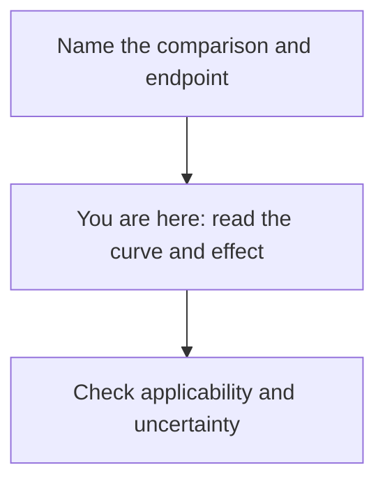

# Read the curve and effect

**Read the event, time horizon, and uncertainty before translating a treatment effect into words.**

**Before you start:** A [Kaplan–Meier curve](/wiki/education/concepts/evidence-and-statistics/endpoints/kaplan-meier) handles incomplete follow-up. A [hazard ratio](/wiki/education/concepts/evidence-and-statistics/effect-measures/hazard-ratio) compares conditional event rates. [Absolute risk, relative risk, and number needed to treat](/wiki/education/concepts/evidence-and-statistics/effect-measures/absolute-relative-risk-and-nnt) describe differences by a specified time. A [confidence interval](/wiki/education/concepts/evidence-and-statistics/effect-measures/confidence-interval) expresses an estimate's precision under the analysis.

## Where this step sits

You have [named the comparison and endpoint](/wiki/education/guides/reading-cancer-evidence/01-name-the-comparison-and-endpoint). Now put the results back into that question card.

## Give the graph a careful first look

Start with [the five-pass graph method](/wiki/education/concepts/evidence-and-statistics/reasoning-tools/reading-a-graph-in-five-passes). For this survival figure, carry the event definition and starting clock into every comparison. The [Kaplan–Meier concept](/wiki/education/concepts/evidence-and-statistics/endpoints/kaplan-meier) explains the number at risk, censoring marks and assumptions; keep those beside the curve, especially when few people remain in late follow-up.

## A small curve you can check by hand

Five fictional participants are followed from enrollment for first recurrence. No one dies during this example. One recurrence occurs at month one. Another participant leaves observation without recurrence at month two. A second recurrence occurs at month three.

| Moment | What happens | Estimated recurrence-free probability |
|---|---|---|
| Start | Five participants are at risk | 100% |
| Month one | One recurrence among five at risk | 4/5 = 80% |
| Month two | One of the remaining four is censored | Still 80% |
| Month three | One recurrence among three now at risk | 80% × 2/3 = about 53.3% |

The censoring mark does not create a downward step. It changes who remains in the later risk set. Simply dividing two recorded recurrences by five people would ignore the incomplete observation. This tiny example teaches the arithmetic; it would not support a reliable clinical forecast.

## A larger worked example: keep both effect sizes

Now use a separate fictional randomized trial of two postoperative strategies in eligible adults with operable cancer. The endpoint is first recurrence or death from randomization. Its estimated five-year event risks are 20% with B and 14% with A. Assume the report supplies adequate follow-up and appropriate outcome estimates; these are invented teaching figures.

| Measure at five years | Calculation | Meaning in this comparison |
|---|---|---|
| Absolute risk reduction | 20% − 14% = 6 percentage points | Six fewer events per 100 people, on average, by five years |
| Risk ratio | 14% / 20% = 0.70 | A's estimated five-year event risk is 70% of B's |
| Relative risk reduction | 1 − 0.70 = 30% | A 30% relative reduction in this five-year event risk |
| Number needed to treat | 1 / 0.06 = about 17 | About 17 people assigned to A instead of B per additional event prevented by five years |

The last number describes an average difference between strategies. It does not identify which person benefits. It also does not summarize harms or prove that an event is prevented forever. Its endpoint and time horizon must travel with it. [Cook and Sackett: number needed to treat](https://doi.org/10.1136/bmj.310.6977.452).

Suppose the same trial separately reports a **hazard ratio (HR)** of 0.68, with a 95% confidence interval from 0.50 to 0.92, under a proportional-hazards model. That describes an estimated 32% lower instantaneous event rate among those still at risk in each group. It is not the 30% fixed-time risk reduction above. Never calculate number needed to treat as `1/HR` or `1/(1 − HR)`. [Cox: proportional-hazards regression](https://doi.org/10.1111/j.2517-6161.1972.tb00899.x).

## Keep the interval in the sentence

For a binary response endpoint, a report may use an [odds ratio (OR)](/wiki/education/concepts/evidence-and-statistics/effect-measures/odds-ratio). In a separate fictional comparison, 40 responses among 100 people versus 20 among 100 give a risk ratio of two and an odds ratio of 2.67. Odds divide responses by non-responses. Calling 2.67 “times the chance” changes the denominator. Keep this distinct from both the five-year risk ratio and the hazard ratio above.

Suppose the fictional five-year absolute reduction has a 95% confidence interval from 2 to 10 percentage points. The corresponding number-needed-to-treat limits are 10 to 50, reversing the positive risk-difference limits. Do not report 17 as though it were exact. If a risk-difference interval crosses zero, the transformed interval can span benefit, infinity, and harm. Reporting the risk difference and its interval is often clearer. [Altman: confidence intervals for number needed to treat](https://doi.org/10.1136/bmj.317.7168.1309).

A confidence interval is not a range containing 95% of patients. Its coverage describes the method across repeated studies under its assumptions, not a 95% probability assigned to a fixed effect after seeing this interval.

## What can go wrong at this step

- **Reading only the ratio:** a relative effect does not supply the absolute event difference.
- **Treating the curve's end as certain:** check the shrinking number at risk and interval.
- **Equating medians:** median follow-up is not median survival. A median survival “not reached” means the estimated curve has not fallen to 50%.
- **Counting every departure as an event:** censoring ends observation; it does not record an event.

## Try it

A report gives HR 0.70 for recurrence or death. Can you calculate a five-year number needed to treat? A tick on its curve appears at year two. Did that participant recur?

**Answer:** Neither conclusion follows. You need the absolute outcome difference at five years and its uncertainty. The tick means the participant was censored without a recorded event up to that point.

## Explain it back

Finish: “By ___, A had ___ fewer defined events per 100 people than B. The interval was ___. The hazard ratio describes ___.”

**One answer:** “By five years, A had an estimated six fewer recurrences or deaths per 100 people. The absolute-reduction interval was two to ten percentage points. The hazard ratio describes conditional event rates during follow-up.”

## Takeaway

**State the absolute effect at a defined time, and keep the ratio and uncertainty beside it.**

**Next:** [Check applicability and uncertainty](/wiki/education/guides/reading-cancer-evidence/03-check-applicability-and-uncertainty).

## Sources and scope

Source check: 2026-10-09. General statistical interpretation; expert and learner review pending. All participants, trials, and numerical results are fictional.

- [Kaplan and Meier 1958: estimation with incomplete observations](https://doi.org/10.1080/01621459.1958.10501452).
- [Cox 1972: proportional-hazards regression](https://doi.org/10.1111/j.2517-6161.1972.tb00899.x).
- [Cook and Sackett 1995: number needed to treat](https://doi.org/10.1136/bmj.310.6977.452).
- [Altman 1998: confidence intervals for number needed to treat](https://doi.org/10.1136/bmj.317.7168.1309).
- [Altman and Andersen 1999: time-specific effects in survival analysis](https://pmc.ncbi.nlm.nih.gov/articles/PMC1117211/).
- [NIST: the repeated-study interpretation of confidence intervals](https://www.itl.nist.gov/div898/handbook/eda/section3/eda352.htm).
