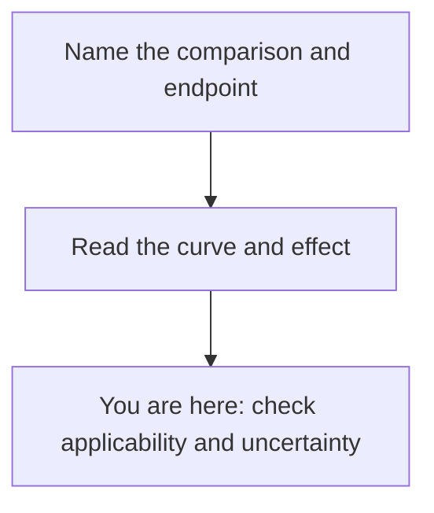

# Check applicability and uncertainty

**A useful conclusion says what the study supports, which proposed action it actually tested, and what remains uncertain.**

**Before you start:** [Confidence intervals](/wiki/education/concepts/evidence-and-statistics/effect-measures/confidence-interval) describe precision under an analysis. [Prognostic versus predictive biomarkers](/wiki/education/concepts/evidence-and-statistics/biomarkers/prognostic-vs-predictive) distinguish outcome associations from treatment-effect differences. [Analytical validity, clinical validity, and clinical utility](/wiki/education/concepts/measurement/computational-analysis/analytical-validity-clinical-validity-and-utility) separate a sound measurement from evidence that using it improves care. [Trial phases and randomization](/wiki/education/concepts/evidence-and-statistics/study-design/trial-phases-and-randomization) explain the strength of a comparison.

## Where this step sits

You have [read the curve and effect](/wiki/education/guides/reading-cancer-evidence/02-read-the-curve-and-effect). Now ask whether that result answers the question in front of you.

## Three checks belong side by side

Think of a study as a photograph. It can be sharp but taken from the wrong angle. It can show the right subject but blur an important detail. This analogy helps separate precision from relevance; it does not capture every source of bias.

| Check | What to ask | What a reassuring answer cannot fix |
|---|---|---|
| Precision | How wide is the interval? How many relevant events informed the result? | A narrow interval cannot remove systematic error |
| Bias | Did assignment, assessment, missing data, or selective reporting distort the comparison? | Randomization cannot answer an endpoint the trial never measured |
| Applicability | Do the population, treatment sequence, comparator, and endpoint match the proposed action? | A similar patient description cannot create a missing comparison |

Read the planned outcomes and analysis beside the published result. Find how many people were assigned, followed, and analyzed, and why some were missing. Check whether important outcomes or harms were omitted. Reporting standards help readers find these details; compliance with a checklist is not itself proof that a study is sound. [CONSORT 2025](https://www.bmj.com/content/389/bmj-2024-081123).

In an [observational study](/wiki/education/concepts/evidence-and-statistics/study-design/observational-studies-and-confounding), treatment choice can share causes with outcome. Check how that confounding was addressed. A [case report](/wiki/education/concepts/evidence-and-statistics/study-design/case-reports-and-n-of-1) offers a timeline and a hypothesis, with much less ability to isolate a treatment effect.

Also check the [publication version](/wiki/education/concepts/evidence-and-statistics/study-design/abstract-vs-peer-reviewed). A conference abstract, a full report and later follow-up from the same participants provide different amounts of information; they are not independent replications. [Preclinical evidence](/wiki/education/concepts/evidence-and-statistics/study-design/preclinical-evidence) answers questions in the studied model before clinical applicability is tested.

## A worked comparison: two different questions

Consider two fictional evidence cards. Neither supplies an individual prognosis.

| Feature | Card A | Card B |
|---|---|---|
| Population | Adults with metastatic cancer after several treatments | Adults with operable cancer starting a defined treatment sequence |
| Design | One treated group | Random assignment to two strategies |
| Reported result | Some measurable tumors shrank | Fewer recurrences or deaths by a stated time with one strategy |
| Question left open | How does the treatment compare with an alternative, and how durable is the response? | Does starting only the last component after surgery provide the same benefit? |

Card A can establish observed activity under its response definition. Tumor shrinkage matters, but it does not by itself establish longer survival, better quality of life, or prevention of recurrence after surgery.

Card B can support a comparative conclusion about its assigned sequence and measured endpoint, subject to the trial's methods and uncertainty. It still cannot isolate an unrandomized component of the sequence. Strong evidence for one question can leave another question unanswered. [FDA: defining the treatment-effect question](https://www.fda.gov/media/148473/download).

## A subgroup result needs another question

A **subgroup** is a smaller category within a study, such as participants with a baseline marker. Suppose a fictional subgroup has a [hazard ratio (HR)](/wiki/education/concepts/evidence-and-statistics/effect-measures/hazard-ratio) of 0.70, with a 95% confidence interval from 0.35 to 1.40, for recurrence or death from randomization. The estimate favors the new strategy, but the interval includes substantially lower hazard, equal hazard, and higher hazard. It is imprecise evidence, not proof of no effect.

Now suppose an article labels the effect “statistically significant” in marker-positive participants and “not significant” in marker-negative participants. Those labels alone do not demonstrate different treatment effects. That requires a direct comparison of effects, often called an **interaction test**. Ask whether the subgroup was defined before treatment, the question was planned, and many subgroup comparisons were examined. A surprising result is more credible when supported by a coherent prior hypothesis and further evidence. [Sun and colleagues: evaluating subgroup claims](https://www.bmj.com/content/340/bmj.c117.long).

Groups defined by response after treatment raise another problem. Treatment and underlying biology both affect who enters those groups. Better outcomes among responders do not isolate the benefit of an additional treatment given later.

## A test result is not yet a treatment strategy

A marker may reliably measure something and identify people with different outcomes. That establishes different evidence from testing whether changing care based on the marker helps. Even a negative result associated with favorable outcomes does not, by itself, establish that another treatment can safely be omitted.

For earlier detection, ask whether the study measured a benefit from the earlier action. [Lead-time bias](/wiki/education/concepts/evidence-and-statistics/reasoning-tools/lead-time-bias) can increase measured survival from detection without changing the time of death. The starting point matters again.

## Bring harms into the same comparison

Look for the absolute frequency of important harms in each group, their severity, and the observation period. Ask whether symptoms, treatment discontinuation, and quality of life were assessed. A report that does not mention a harm has not shown its absence. Longer follow-up can reveal different harms from those observed during treatment. [CONSORT 2025 explanation and elaboration](https://www.bmj.com/content/389/bmj-2024-081124).

An updated report from the same participants adds follow-up, not an independent replication. Results from different populations also cannot simply be added to create a combined benefit estimate.

## What can go wrong at this step

- **“The interval includes no effect, so the treatments are equivalent.”** Equivalence needs its own design and limits. An imprecise result leaves several effects unresolved.
- **“The estimate is precise, so it is true.”** Precision does not account for every bias or untested assumption.
- **“This marker predicts outcome, so it selects the helpful treatment.”** A prognostic association does not establish a treatment-effect difference or clinical utility.
- **“This population resembles mine, so this action was tested.”** Similarity matters, but the intervention and comparator must match too.

## Try it

A fictional cohort finds favorable five-year outcomes after a negative blood test. Everyone received standard treatment, and the study did not assign care based on the result. A headline says the test proves treatment can be stopped. What is missing?

**Answer:** A comparison of the proposed treatment strategy after that result. The cohort can describe an association in treated people. It does not test the safety or benefit of stopping treatment. You also need test timing, event definition, precision, missing follow-up, and the population to interpret the association.

## Explain it back

Finish: “The study supports ___ in ___. It does not directly test ___. The main uncertainty is ___.”

**One answer:** “The cohort supports an association between a negative test and favorable outcomes among people receiving standard treatment. It does not directly test stopping treatment. The effect of that change remains unknown.”

## Takeaway

**Match the conclusion to the tested comparison, and name the gap before proposing an action.**

**Next:** [Practice on cell-therapy evidence](/wiki/education/cellular-therapies/09-reading-cell-therapy-evidence), or apply the framework to [a test or vendor claim](/wiki/education/guides/judging-a-test-or-vendor-claim/index).

## Sources and scope

Source check: 2026-10-09. General evidence appraisal; expert and learner review pending. All evidence cards, studies, and numerical results are fictional. This lesson does not calculate a personal prognosis or choose treatment.

- [CONSORT 2025: reporting randomized trials](https://www.bmj.com/content/389/bmj-2024-081123).
- [CONSORT 2025: explanation and elaboration, including outcomes and harms](https://www.bmj.com/content/389/bmj-2024-081124).
- [FDA 2021, ICH E9(R1): treatment-effect questions and sensitivity analysis](https://www.fda.gov/media/148473/download).
- [Sun and colleagues 2010: credibility of subgroup analyses](https://www.bmj.com/content/340/bmj.c117.long).
- [Greenland and colleagues 2016: statistical tests and confidence-interval misinterpretations](https://pmc.ncbi.nlm.nih.gov/articles/PMC4877414/).
- [FDA–NIH BEST: biomarker evidence definitions](https://www.ncbi.nlm.nih.gov/books/NBK326791/).
