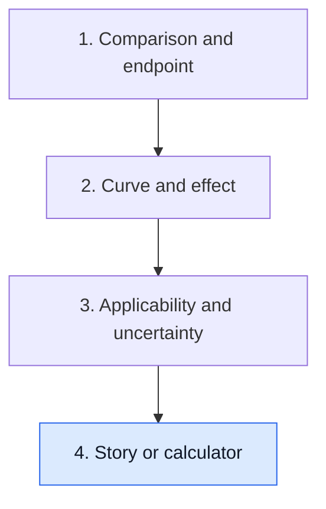

# Read a single success story or a calculator

**One person's remarkable outcome shows that something is possible, not how often it happens or what caused it. A calculator turns population data into one number, which is only as good as its inputs and validation.**

**Before you start:** [Case reports and N-of-1 studies](/wiki/education/concepts/evidence-and-statistics/study-design/case-reports-and-n-of-1) explains what a single timeline can support. [Population versus individual risk](/wiki/education/concepts/evidence-and-statistics/reasoning-tools/population-vs-individual-risk) explains what a model's probability means.

## Where this step sits

This is the last step of [Read trial claims and survival statistics](/wiki/education/guides/reading-cancer-evidence/index). Lessons 1–3 read comparisons between groups. This lesson reads the two things families meet most often outside a trial: a story and a calculator.

## What a story can and cannot establish

A case report, a peer's journey or a company's patient testimonial is a **timeline**: what was given, in what order, and what was measured. It can establish that an outcome occurred and suggest a question worth testing. It usually cannot establish three things:

1. **Cause.** Other treatments, the disease's own course and the timing of tests can all explain the change.
2. **Frequency.** Remarkable outcomes are more likely to be shared and published. Without the number who tried the same thing, one success says nothing about the chance of success.
3. **Comparison.** Nobody knows what would have happened to that person on another path.

Ask the **denominator question** every time: how many people received this, under what conditions, and what happened to all of them? A story's value rises when it comes with a full timeline, a measurement at more than one time and, ideally, a link to a study that counted everyone.

## A worked story

A fictional blog describes a person whose metastatic tumor shrank after an off-label drug added to standard chemotherapy. The post includes before-and-after scan reports.

- **Established:** the tumor shrank during the combined course, on those scans.
- **Not established:** that the added drug caused it, how often it works, or whether it is safe.
- **Next question:** Is there a trial or case series that counted everyone given this combination, with a comparison?

## Check a calculator before its number

A calculator can make uncertain inputs look settled. [Population versus individual risk](/wiki/education/concepts/evidence-and-statistics/reasoning-tools/population-vs-individual-risk) explains what a model can estimate and what a probability cannot promise. Keep this record beside its output:

- **Identity:** exact model, software version and any recalibration; a familiar name is insufficient.
- **Inputs:** required values, units, definitions, specimen dates and the model's documented handling of missing values. Unknown is not automatically negative.
- **Setting:** treatment era, received treatments and intended population. Older treatment context needs an applicability check.
- **Question:** [endpoint](/wiki/education/concepts/evidence-and-statistics/endpoints/survival-endpoints), time origin and prediction horizon.
- **Validation:** independent evaluation in relevant populations. [Calibration](/wiki/education/concepts/evidence-and-statistics/tests-and-prediction/calibration) checks probabilities; [discrimination](/wiki/education/concepts/evidence-and-statistics/tests-and-prediction/auc-and-c-index) checks ranking. Retain the [cutpoint](/wiki/education/concepts/evidence-and-statistics/tests-and-prediction/thresholds-and-cutpoints) and how it was chosen when a score becomes a category or proposed action.

[TRIPOD+AI](https://doi.org/10.1136/bmj-2023-078378) describes the reporting needed to inspect prediction models. It covers regression and machine-learning methods. A checklist or published calculator is not proof of usefulness for every setting. Do not adjust its output by multiplying unrelated prognostic hazard ratios or adding benefits from other trials.

## What can go wrong at this step

- **"It worked for her, so it will work for me."** One outcome is not a frequency or a personal forecast.
- **"Many people online say it helped."** A collection of successes without the failures has no denominator.
- **"The calculator says 85%, so that is my chance."** The number is an estimate for people like those in the model's data, under its inputs.
- **"I'll adjust the calculator for my extra treatment."** Multiplying in hazard ratios from other trials builds a model nobody validated.

## Try it

A fictional company video features three patients whose cancer disappeared on its therapy. What single question most changes how much the video tells you?

**Answer:** How many patients received the therapy in total, and what happened to all of them? Three successes out of 5 and three out of 500 mean very different things.

**Calculator card:** A fictional model requires a residual-tissue marker after surgery. Only a pretreatment biopsy result is available. Can the reader substitute it?

**Answer:** No. Check the specified input and missing-value rules. An earlier specimen does not supply the required postoperative value, and an improvised hazard-ratio adjustment cannot fix that mismatch.

## Explain it back

"A single story can show ___, but it cannot show ___ without ___."

**One possible answer:** "That an outcome is possible; how often it happens or what caused it; a count of everyone treated and a comparison."

## Takeaway

**Ask for the denominator behind every story and the validation behind every calculator.**

**Next:** Apply the framework to [a test or vendor claim](/wiki/education/guides/judging-a-test-or-vendor-claim/index), or practise on [cell-therapy evidence](/wiki/education/cellular-therapies/09-reading-cell-therapy-evidence).

## Sources and scope

Source-checked November 7, 2026. General evidence appraisal; expert and learner review pending. All stories, models and numbers are fictional.

- [Gagnier and colleagues 2013: consensus case-report guidelines](https://pmc.ncbi.nlm.nih.gov/articles/PMC3784031/) — timeline and attribution reporting.
- [Collins and colleagues 2024, TRIPOD+AI: reporting prediction-model inputs, outcomes and evaluation](https://doi.org/10.1136/bmj-2023-078378).
