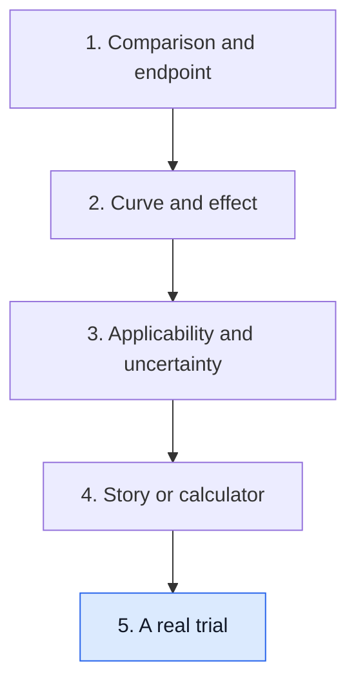

# Read a real trial: KEYNOTE-522

**Carry one published trial through every step of this guide: the comparison, the endpoints, the effect sizes, the timing of each result, who it applies to and what it leaves open.**

**Before you start:** [The KEYNOTE-522 regimen](/wiki/education/concepts/breast-cancer/treatment-setting/the-keynote-522-regimen) gives the treatment schedule. [Interim analysis](/wiki/education/concepts/evidence-and-statistics/study-design/interim-analysis) explains why results arrive at planned looks. [Analysis populations](/wiki/education/concepts/evidence-and-statistics/study-design/analysis-populations) explains who was counted. A [hazard ratio (HR)](/wiki/education/concepts/evidence-and-statistics/effect-measures/hazard-ratio) compares event rates among people still at risk.

## Where this step sits

Lessons 1–4 used mostly fictional studies. This lesson practises on a real one, using its published numbers.

## Step 1: fill the study card

| Field | KEYNOTE-522 |
|---|---|
| Population | Previously untreated stage II–III triple-negative breast cancer (TNBC): T1c with N1–N2, or T2–T4 with N0–N2, no distant spread, performance status 0–1 [4] |
| Intervention | Pembrolizumab every 3 weeks with paclitaxel and carboplatin for 4 cycles, then with an anthracycline and cyclophosphamide for 4 cycles; surgery; then pembrolizumab alone for up to 9 cycles [1] |
| Comparator | The same chemotherapy and surgery with placebo instead of pembrolizumab [1] |
| Assignment | Randomized 2:1; 784 to pembrolizumab, 390 to placebo [1] |
| Primary endpoints | [Pathologic complete response (pCR)](/wiki/education/concepts/breast-cancer/surgery-and-pathology-results/pcr): no invasive cancer in breast or nodes at surgery (ypT0/Tis ypN0). [Event-free survival (EFS)](/wiki/education/concepts/evidence-and-statistics/endpoints/survival-endpoints) from randomization: progression preventing surgery, local or distant recurrence, a second primary cancer, or death from any cause [1, 2] |
| Secondary endpoint | Overall survival [3] |
| Analysis population | Intention-to-treat: everyone randomized, in the assigned group [1] |

Write the study question in one sentence: **in these participants, did assigning the whole pembrolizumab strategy, before and after surgery, change pCR and EFS compared with chemotherapy alone?** As [lesson 1](/wiki/education/guides/reading-cancer-evidence/01-name-the-comparison-and-endpoint) showed, the postoperative phase was not randomized on its own.

## Step 2: state each effect two ways

Each row keeps its own endpoint, population and analysis. CI is the [confidence interval](/wiki/education/concepts/evidence-and-statistics/effect-measures/confidence-interval).

| Result | Pembrolizumab | Placebo | Absolute difference | Ratio or test | Report |
|---|---|---|---|---|---|
| pCR, first 602 randomized | 64.8% | 51.2% | 13.6 points (95% CI 5.4–21.8) | — | First interim analysis [1] |
| EFS at 36 months, all 1,174 | 84.5% | 76.8% | 7.7 points | HR 0.63 (95% CI 0.48–0.82) | Fourth interim analysis, median follow-up 39.1 months [2] |
| Overall survival at 60 months, all 1,174 | 86.6% | 81.7% | 4.9 points | HR 0.66 (95% CI 0.50–0.87); P = 0.002 | Final overall-survival analysis, median follow-up 75.1 months [3] |

Translate each row into people:

- **pCR:** about 14 more people per 100 had no invasive cancer left at surgery.
- **EFS:** about 8 more per 100 were alive and event-free at 3 years. The [number needed to treat](/wiki/education/concepts/evidence-and-statistics/effect-measures/absolute-relative-risk-and-nnt) at 3 years is about 1 / 0.077 ≈ 13.
- **Overall survival:** about 5 more per 100 were alive at 5 years, a number needed to treat of about 20 at 5 years.

The three differences shrink from 13.6 to 7.7 to 4.9 points. That is expected: they measure different endpoints at different times, and a pCR gain is not a survival gain of the same size. The HR of 0.63 means a 37% lower hazard over follow-up, not 37% fewer events. The 36-month event risk fell from 23.2% to 15.5%, a relative reduction of about 33%.

## Step 3: watch the estimates mature

The same comparison was analyzed more than once.

| Analysis | Information | EFS hazard ratio (95% CI) |
|---|---|---|
| First interim | Median follow-up 15.5 months; 104 events | 0.63 (0.43–0.93) [1] |
| Fourth interim | Median follow-up 39.1 months | 0.63 (0.48–0.82) [2] |
| Protocol-specified final analysis, posted to the trial registry | Later follow-up; no formal significance test | 0.68 (0.54–0.86) [4] |

The point estimate barely moved while the interval narrowed, because more events give more information. pCR moved more. Among the first 1,002 randomized, the registry reports 64.0% versus 54.7%, a difference of 9.2 points (95% CI 2.8–15.6) [4], smaller than the 13.6 points among the first 602. The direction held, but early estimates can drift as more people are counted. Registry results are posted by the sponsor and are not a peer-reviewed paper.

The phase 2 signal was larger still. The I-SPY2 platform had estimated pCR of 60% versus 22% for pembrolizumab in triple-negative disease, against a control without carboplatin [7]; see [Bayesian and adaptive designs](/wiki/education/concepts/evidence-and-statistics/study-design/bayesian-and-adaptive-designs).

## Step 4: read the curve, not only the ratio

The registry lists median EFS and median overall survival as not estimable in either arm [4]: fewer than half of each arm had an event. Report fixed-time percentages, as in Step 2, rather than medians. When you look at the published curves, check the number-at-risk table at the time point you quote. Check, too, whether the curves stay apart; an HR averages the effect over follow-up. Because EFS counts death as an event, death does not compete with it. A component reported alone, such as distant recurrence, would need [competing-risk methods](/wiki/education/concepts/evidence-and-statistics/endpoints/competing-risks).

## Step 5: check who it applies to

- **Covered:** stage II–III TNBC as defined above, without earlier treatment.
- **Not covered:** smaller node-negative tumors outside the entry criteria, metastatic disease, earlier checkpoint-inhibitor treatment, or active autoimmune disease needing systemic treatment within 2 years [4].
- **No biomarker selection:** enrollment did not require a programmed death-ligand 1 (PD-L1) result. The approved early-stage use does not depend on one either [5].
- **Harms:** grade 3 or higher treatment-related adverse events occurred in 78.0% versus 73.0% across all phases. Treatment-related deaths occurred in 0.4% versus 0.3% [1]. Immune-related effects can be lasting; see [immune-related adverse events](/wiki/education/concepts/therapeutics/toxicities-and-supportive-care/immune-related-adverse-event).
- **Surrogate check:** pCR is strongly prognostic but was not validated as a trial-level substitute for survival; see [surrogate endpoints](/wiki/education/concepts/evidence-and-statistics/endpoints/surrogate-endpoints). Here survival was measured directly, so the claim does not rest on pCR alone.

## Step 6: name what remains open

- **The postoperative phase on its own.** OptimICE-pCR (NCT05812807) randomizes people who reached pCR to pembrolizumab or observation; it is recruiting [6].
- **What to add after residual disease.** Capecitabine, and olaparib for carriers of germline *BRCA1* or *BRCA2* variants, were proven before checkpoint inhibitors; see [post-neoadjuvant escalation](/wiki/education/concepts/breast-cancer/treatment-setting/post-neoadjuvant-escalation).
- **Who benefits most.** No biomarker from this trial has been validated to choose who should receive pembrolizumab; see [prognostic versus predictive](/wiki/education/concepts/evidence-and-statistics/biomarkers/prognostic-vs-predictive).
- **Less chemotherapy.** The trial did not test dropping a chemotherapy component.

## What can go wrong at this step

- **Reading the pCR gain as a survival gain.** The 13.6-point pCR difference is not the 4.9-point survival difference.
- **Comparing responders.** Better outcomes after pCR describe responders, not the drug's effect; that is a [prognostic](/wiki/education/concepts/evidence-and-statistics/biomarkers/prognostic-vs-predictive) association.
- **Mixing analyses.** The 602-person pCR result, the 1,002-person registry figure and the intention-to-treat survival results come from different looks.
- **Cross-trial shortcuts.** KEYNOTE-522's control arm cannot be swapped for another trial's; see [cross-trial comparison](/wiki/education/concepts/evidence-and-statistics/reasoning-tools/cross-trial-comparison).

## Try it

A friend writes: "KEYNOTE-522 proved that pembrolizumab after surgery cuts recurrence by 37%." Find three errors.

**Answer:** First, the trial tested the whole strategy before and after surgery, not postoperative pembrolizumab alone. Second, 37% is a lower hazard (HR 0.63), not 37% fewer recurrences; the 36-month event risk fell by 7.7 points, about 33% in relative terms. Third, EFS counts more than recurrence: progression before surgery, second cancers and death also count.

## Explain it back

"In ___, assigning ___ instead of ___ raised pCR by ___, 3-year EFS by ___ and 5-year overall survival by ___; it did not test ___."

**One possible answer:** "Previously untreated stage II–III TNBC; pembrolizumab with chemotherapy before and after surgery; chemotherapy with placebo; 13.6 points; 7.7 points; 4.9 points; the postoperative phase on its own."

## Takeaway

**A real trial result is a set of numbers, each with its own endpoint, time point, population and analysis; read them together, then name the question the trial did not ask.**

**Next:** You have finished the guide. Apply it to [a test or vendor claim](/wiki/education/guides/judging-a-test-or-vendor-claim/index), or practise on [cell-therapy evidence](/wiki/education/guides/engineered-cell-therapy/08-reading-cell-therapy-evidence).

## Sources and scope

Source-checked November 8, 2026 against the primary abstracts, the ClinicalTrials.gov record and the DailyMed label. General evidence-reading practice; expert and learner review pending. Not a treatment recommendation or a personal forecast.

1. [Schmid and colleagues, NEJM 2020: pCR, design and adverse events](https://pubmed.ncbi.nlm.nih.gov/32101663/).
2. [Schmid and colleagues, NEJM 2022: event-free survival](https://pubmed.ncbi.nlm.nih.gov/35139274/).
3. [Schmid and colleagues, NEJM 2024: overall survival](https://pubmed.ncbi.nlm.nih.gov/39282906/) — the hazard ratio is reported in the full text, not the abstract.
4. [ClinicalTrials.gov NCT03036488: eligibility and sponsor-posted results](https://clinicaltrials.gov/study/NCT03036488) — the 1,002-person pCR figure and the protocol-specified final analyses.
5. [KEYTRUDA prescribing information, DailyMed version 228](https://dailymed.nlm.nih.gov/dailymed/lookup.cfm?setid=9333c79b-d487-4538-a9f0-71b91a02b287&version=228) — section 1, early-stage TNBC indication without a PD-L1 requirement.
6. [ClinicalTrials.gov NCT05812807: OptimICE-pCR](https://clinicaltrials.gov/study/NCT05812807).
7. [Nanda and colleagues, JAMA Oncology 2020: pembrolizumab in I-SPY2](https://pubmed.ncbi.nlm.nih.gov/32053137/).
