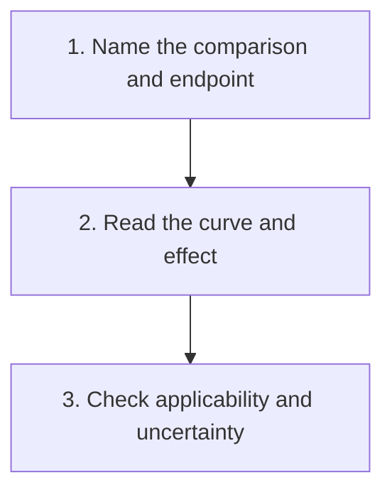

# Read trial claims and survival statistics

**Identify what a study compared and measured, describe its effect with uncertainty, and judge how far the result can be applied.**

A paper can feel persuasive before you know what its main number means. This guide gives you a slower way to read it. Start with the question, look at the result, then ask which conclusion the study supports. You do not need to calculate a personal prognosis to do this well.

## The big ideas

1. A result belongs to its population, comparison, event definition, and starting time.
2. A relative effect and an absolute difference answer different questions. Keep the time horizon attached to both.
3. Precision, study design, and relevance each matter. A narrow interval cannot repair the wrong comparison.
4. An outcome association does not establish that acting on a marker improves care.

## The map

*Keep the study's question attached to its result through all three steps.*

## Lessons

| Step | Lesson | Question it answers | Minutes | Learning aid |
|---|---|---|---|---|
| 1 | [Name the comparison and endpoint](/wiki/education/guides/reading-cancer-evidence/01-name-the-comparison-and-endpoint) | What was actually tested? | 11 | A study question card and two event examples |
| 2 | [Read the curve and effect](/wiki/education/guides/reading-cancer-evidence/02-read-the-curve-and-effect) | How much changed, by when, and with what precision? | 13 | A censoring example and worked risk arithmetic |
| 3 | [Check applicability and uncertainty](/wiki/education/guides/reading-cancer-evidence/03-check-applicability-and-uncertainty) | What can this result justify? | 12 | A claim comparison and an explain-it-back sentence |

## Concepts you will use

Start with [trial phases and randomization](/wiki/education/concepts/evidence-and-statistics/study-design/trial-phases-and-randomization) for how comparisons are built. [Survival endpoints](/wiki/education/concepts/evidence-and-statistics/endpoints/survival-endpoints) explain which events count and when the clock starts. [Prognostic versus predictive biomarkers](/wiki/education/concepts/evidence-and-statistics/biomarkers/prognostic-vs-predictive) separate an outcome association from evidence about treatment differences.

For the numbers, use the [Kaplan–Meier curve](/wiki/education/concepts/evidence-and-statistics/endpoints/kaplan-meier), [hazard ratio](/wiki/education/concepts/evidence-and-statistics/effect-measures/hazard-ratio), [absolute risk, relative risk, and number needed to treat](/wiki/education/concepts/evidence-and-statistics/effect-measures/absolute-relative-risk-and-nnt), and [confidence interval](/wiki/education/concepts/evidence-and-statistics/effect-measures/confidence-interval) pages. They are reference stops, not extra lessons you must memorize.

For a response result, check the [odds ratio](/wiki/education/concepts/evidence-and-statistics/effect-measures/odds-ratio). For a statistical claim, bring in [p-values and multiple testing](/wiki/education/concepts/evidence-and-statistics/effect-measures/p-values-and-multiple-testing) and [planned versus exploratory analysis](/wiki/education/concepts/evidence-and-statistics/study-design/exploratory-vs-prespecified-analysis). [Meta-analysis](/wiki/education/concepts/evidence-and-statistics/study-design/meta-analysis) explains what pooling studies adds and what it leaves unresolved.

When a test result becomes a proposed action, bring in [analytical validity, clinical validity, and clinical utility](/wiki/education/concepts/measurement/computational-analysis/analytical-validity-clinical-validity-and-utility). [Lead-time bias](/wiki/education/concepts/evidence-and-statistics/reasoning-tools/lead-time-bias) explains why earlier detection needs its own benefit comparison.

## A claim to carry through the guide

A fictional trial reports fewer recurrences or deaths with strategy A than strategy B by five years. First, identify the participants and both strategies. Next, describe the size of the difference and its uncertainty. Finally, ask whether the trial tested the action now being proposed. A trial of an entire treatment sequence does not automatically isolate the value of its last component.

## Applied to Diana

Use these reading steps alongside [the survival evidence review](/wiki/research/reviews/2026-10-postoperative-pathology), [the care plan](/wiki/care/treatment-plan), and [the adjuvant treatment question](/wiki/questions/adjuvant-treatment). Those pages own the case application and decisions. This guide teaches how to inspect a study without turning another group's outcome into her personal forecast.

## What is still uncertain

Studies can leave the durability of an effect, less common harms, or relevance to a smaller group unresolved. More follow-up may sharpen one answer while a different comparison remains untested. Writing that missing question down is useful progress.

After the three lessons, [practice on cell-therapy evidence](/wiki/education/cellular-therapies/09-reading-cell-therapy-evidence). For a test or commercial claim, continue with [judging a test or vendor claim](/wiki/education/guides/judging-a-test-or-vendor-claim/index).

## Sources and scope

Source check: 2026-10-09. General evidence-reading education; expert and learner review pending. All worked studies and numbers in this guide are fictional.

- [National Cancer Institute: how cancer clinical trials work](https://www.cancer.gov/research/participate/clinical-trials/how-trials-work).
- [FDA 2018: clinical trial endpoints for cancer drugs and biologics](https://www.fda.gov/regulatory-information/search-fda-guidance-documents/clinical-trial-endpoints-approval-cancer-drugs-and-biologics).
- [CONSORT 2025: reporting randomized trials](https://www.bmj.com/content/389/bmj-2024-081123).
