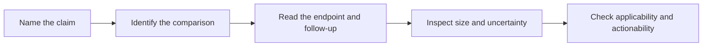

# Read trial claims and survival statistics

**Identify what a study measured, how strong its comparison is and how far its result can be applied.**

This guide is for anyone reading a paper abstract, an assay report or a treatment claim. Its goal is to make the claim assessable, not to turn every percentage into a personal forecast.

## The big ideas

1. Population, intervention, comparator and endpoint travel together.
2. A marker associated with outcome does not necessarily tell us what action helps.
3. Relative effects and absolute differences answer different questions.
4. Earlier detection and longer measured follow-up are not automatically added benefit.

## The map

*The study design determines which conclusion is available.*

## Lessons

| Step | Concept | What you will learn |
|---|---|---|
| 1 | [Prognostic versus predictive](/wiki/education/concepts/evidence-and-statistics/biomarkers/prognostic-vs-predictive) | Association, treatment effect and clinical utility |
| 2 | [Survival endpoints](/wiki/education/concepts/evidence-and-statistics/endpoints/survival-endpoints) | What event and starting time define the percentage |
| 3 | [Kaplan–Meier](/wiki/education/concepts/evidence-and-statistics/endpoints/kaplan-meier) | Censoring, risk tables and uncertain tails |
| 4 | [Hazard ratio](/wiki/education/concepts/evidence-and-statistics/effect-measures/hazard-ratio) | Relative hazards versus absolute event differences |
| 5 | [PPV and base rates](/wiki/education/concepts/evidence-and-statistics/tests-and-prediction/ppv-and-base-rates) | Why specificity alone does not establish a positive’s reliability |
| 6 | [Lead-time bias](/wiki/education/concepts/evidence-and-statistics/reasoning-tools/lead-time-bias) | Why earlier detection needs a separate benefit comparison |
| 7 | [Clinical actionability](/wiki/education/concepts/evidence-and-statistics/biomarkers/actionability) | How assay validity, clinical evidence and eligibility differ |

## What trial phases contribute

Phase I usually examines dose, safety and feasibility. Phase II can examine activity and may be randomized. Phase III usually tests a comparative clinical question in a larger population. The phase label does not replace reading the actual design. A randomized phase II can provide stronger comparative evidence than a large uncontrolled series for a particular question.

Randomization helps balance baseline differences on average. Blinding and consistent assessment can reduce other biases. A single-arm cohort lacks a concurrent comparator. Confounding occurs when another factor affects both the exposure or marker and the outcome, creating or changing an apparent relationship.

## A worked claim

A small cohort reports favorable five-year outcomes in patients whose blood marker is negative. Before applying it, find the draw timing, cancer stage, treatment era, assay, group size and confidence interval. Then ask whether the study merely observed outcomes or tested a strategy after the result. It cannot establish safe treatment omission unless that question was actually addressed.

## Try it

A hypothetical treatment lowers five-year event risk from 20% to 14%. State the absolute and relative risk changes.

**Answer:** Six percentage points absolute and 30% relative risk reduction. Neither is automatically the trial’s hazard reduction.

**Explain it back:** “I can say what happened in this comparison; I still need to check whether it supports this person’s proposed action.”

## Applied to Diana

Current evidence interpretation belongs in [[wiki/prognosis/survival-statistics|the survival evidence review]] and [[wiki/care/treatment-plan|the care plan]]. The concepts explain how to inspect those claims without importing another cohort’s percentage as her prognosis.

**Takeaway:** Keep the design, population, endpoint and uncertainty attached to every result.

## Sources and scope

Source check: October 8, 2026; expert and learner review pending. Hypothetical arithmetic is not clinical data.

- [NCI clinical trial phases](https://www.cancer.gov/about-cancer/treatment/clinical-trials/what-are-trials/phases).
- [FDA–NIH biomarker evidence definitions](https://www.ncbi.nlm.nih.gov/books/NBK326791/).

## Concepts you will use

- [[wiki/education/concepts/evidence-and-statistics/biomarkers/prognostic-vs-predictive|Prognostic versus predictive biomarkers]]
- [[wiki/education/concepts/evidence-and-statistics/endpoints/survival-endpoints|Survival endpoints]]
- [[wiki/education/concepts/evidence-and-statistics/endpoints/kaplan-meier|Kaplan–Meier curves]]
- [[wiki/education/concepts/evidence-and-statistics/effect-measures/hazard-ratio|Hazard ratio]]
- [[wiki/education/concepts/evidence-and-statistics/tests-and-prediction/ppv-and-base-rates|Positive predictive value and base rates]]
- [[wiki/education/concepts/evidence-and-statistics/reasoning-tools/lead-time-bias|Lead-time bias]]
