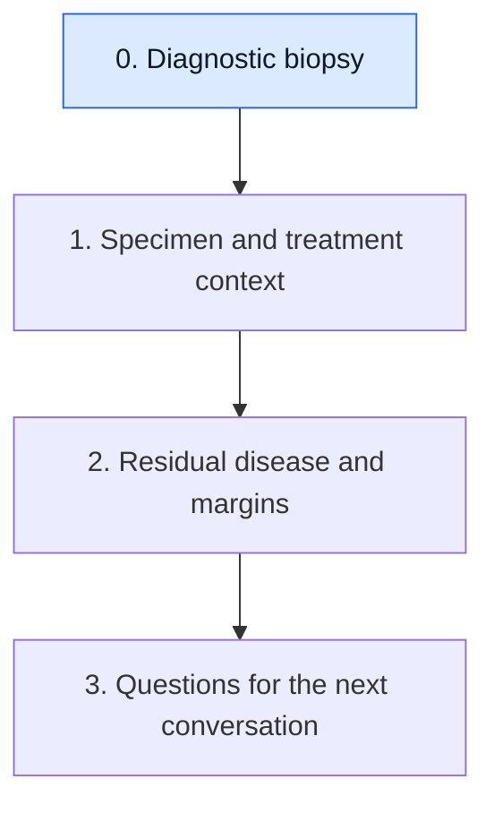

# Read the diagnostic biopsy report

**The first biopsy report answers five questions in order: what kind of cancer, how abnormal it looks, which of the three main receptors it has, how fast it is dividing, and how many immune cells are around it. Stage is a separate question answered with imaging and, later, surgery.**

**Before you start:** [Invasive ductal carcinoma](/wiki/education/concepts/breast-cancer/anatomy-and-histology/invasive-ductal-carcinoma) is the most common histologic type. [Triple-negative breast cancer (TNBC)](/wiki/education/concepts/breast-cancer/receptors-and-subtypes/tnbc) is defined by three receptor results.

## Where this step sits

This lesson comes first in [Read pathology and surgery results](/wiki/education/guides/reading-pathology-and-surgery-results/index). It reads the core-needle biopsy taken before any treatment. The next lessons read the surgical specimen.

## Read the fields in this order

| Field | What it says | How to read it |
|---|---|---|
| 1. Histologic type | Invasive ductal carcinoma (no special type), lobular or another type; whether ductal carcinoma in situ (DCIS) is also present | "Invasive" means it has crossed the basement membrane; [DCIS](/wiki/education/concepts/breast-cancer/anatomy-and-histology/dcis) alone has not |
| 2. [Histologic grade](/wiki/education/concepts/breast-cancer/grade-and-stage/histologic-grade) | Nottingham grade 1, 2 or 3 | Three features (tubule formation, nuclear pleomorphism, mitotic count) are each scored and summed; higher grade looks less like normal tissue [1] |
| 3. Receptors | [Estrogen receptor (ER)](/wiki/education/concepts/breast-cancer/receptors-and-subtypes/estrogen-receptor), [progesterone receptor (PR)](/wiki/education/concepts/breast-cancer/receptors-and-subtypes/progesterone-receptor), [HER2](/wiki/education/concepts/breast-cancer/receptors-and-subtypes/her2) | ER is positive at 1% or more of tumor nuclei, "low positive" at 1–10%, negative below 1% [2]. HER2 by immunohistochemistry (IHC) is scored 0, 1+, 2+ or 3+; 2+ is equivocal and goes to in situ hybridization [3] |
| 4. [Ki-67](/wiki/education/concepts/breast-cancer/grade-and-stage/ki-67) | Percentage of tumor cells with a proliferation marker | A measure of dividing cells; read the method, because estimates vary |
| 5. [Stromal tumor-infiltrating lymphocytes (sTILs)](/wiki/education/concepts/measurement/pathology-readouts/stil-scoring) | Percentage of the tumor's supporting tissue occupied by lymphocytes | Not always reported; an immune-environment finding, not a receptor |

**Triple-negative** means ER and PR are negative and HER2 is negative (IHC 0 or 1+, or 2+ with a negative in situ hybridization test). IHC 1+, or 2+ without amplification, is also called HER2-low; the [HER2 concept](/wiki/education/concepts/breast-cancer/receptors-and-subtypes/her2) explains why that matters for some drugs.

## A worked report

A fictional core biopsy reads: "Invasive ductal carcinoma, no special type, Nottingham grade 3 (3+3+3). ER 0%, PR 0%. HER2 IHC 2+, in situ hybridization not amplified. Ki-67 about 80%. sTILs 50%. No ductal carcinoma in situ seen."

- **Type:** invasive cancer, the common type, with no in situ component in this sample.
- **Grade:** 3 + 3 + 3 = 9, which is grade 3, the most abnormal-looking category.
- **Receptors:** ER and PR negative; HER2 2+ with no amplification is HER2-negative: triple-negative, and HER2-low.
- **Ki-67 and sTILs:** a very high share of dividing cells; a high immune-cell presence, which in triple-negative breast cancer is linked to better outcomes.
- **Missing:** stage. Size and node status come from imaging and node sampling.

## What can go wrong at this step

- Reading "grade 3" as "stage III" merges appearance with extent.
- Reading HER2 1+ as "HER2-positive" reverses the result; only 3+, or 2+ with amplification, is positive.
- Treating ER 1–10% as negative skips the low-positive category, which is not triple-negative by the guideline.
- Treating a single Ki-67 or sTILs number as exact ignores method and sampling.

## Try it

A fictional report says "ER 5%, PR 0%, HER2 IHC 0." Is this triple-negative?

**Answer:** Not by the guideline definition. ER at 5% is reported as "ER low positive," not negative, with a comment that endocrine-therapy benefit data are limited [2]. Ask the care team how they classify it.

## Explain it back

"A biopsy report tells me ___, ___, ___, ___ and ___; stage needs ___."

**One possible answer:** "The cancer's type, grade, receptor status, proliferation and immune-cell content; imaging, node sampling and later surgery."

## Takeaway

**Read type, grade, receptors, Ki-67 and sTILs in order, and keep stage as a separate question.**

**Next:** [Place the specimen in time](/wiki/education/guides/reading-pathology-and-surgery-results/01-place-the-specimen-in-time).

## Sources and scope

Source-checked November 7, 2026 against the guideline abstracts; expert and learner review pending. The report is fictional.

1. [Elston and Ellis, Histopathology 1991](https://pubmed.ncbi.nlm.nih.gov/1757079/) — Nottingham grading of three features.
2. [Allison and colleagues, ASCO/CAP ER and PR guideline, JCO 2020](https://pubmed.ncbi.nlm.nih.gov/31928404/) — 1% threshold and ER low positive.
3. [Wolff and colleagues, ASCO/CAP HER2 guideline, JCO 2018](https://pubmed.ncbi.nlm.nih.gov/29846122/) — IHC categories and in situ hybridization for 2+.
- [NCI: Pathology reports](https://www.cancer.gov/about-cancer/diagnosis-staging/diagnosis/pathology-reports-fact-sheet).
