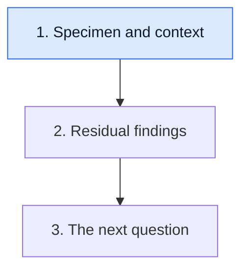

# Place the specimen in time

**Before interpreting a response label, identify the submitted tissue, its collection date and what treatment preceded it.**

**Before you start:** [Neoadjuvant versus adjuvant therapy](/wiki/education/concepts/breast-cancer/treatment-setting/neoadjuvant-vs-adjuvant) names timing around local treatment. [TNM staging](/wiki/education/concepts/breast-cancer/grade-and-stage/tnm-staging) explains tumor, regional nodes and distant metastasis, including prefixes for assessment context.

## Where this step sits

This is step 1 of [Read pathology and surgery results](/wiki/education/guides/reading-pathology-and-surgery-results/index). Identify the specimen first, read residual findings next and then build a clinical question.

## Read the label on the container before the result

A [core needle biopsy](/wiki/education/concepts/measurement/specimens/core-needle-biopsy) preserves small tissue cylinders; [fine needle aspiration](/wiki/education/concepts/measurement/specimens/fine-needle-aspiration) usually collects cells and fluid. A [vacuum-assisted biopsy](/wiki/education/concepts/measurement/specimens/vacuum-assisted-biopsy) collects tissue using a vacuum-assisted device. These approaches differ in the material and architecture available to examine.

A [surgical specimen](/wiki/education/concepts/measurement/specimens/surgical-resection-specimen) can include the operation's breast tissue, nodes or a separately submitted margin. Keep each part's site and collection context. More tissue does not mean every region in the body was examined.

The gross description records features visible during examination of the specimen. The microscopic description records tissue observations under the microscope. The final diagnosis integrates the pathologist's interpretation. A dramatic word in one description should not replace that final interpretation.

Also read qualifications. “Pending,” “cannot assess” and “additional sections examined” convey different states. A preliminary note, a final signed report and an addendum are different parts of the evidence record. Keep the final interpretation and any outstanding work explicit.

## Three dates describe different events

| Date | What it means | A common misreading |
|---|---|---|
| Collection | When tissue was removed | Assuming the tissue reflects the report's later date |
| Treatment | When relevant therapy was delivered | Assuming planned treatment was completed |
| Report or addendum | When an interpretation became available | Assuming a new specimen was collected |

This distinction is especially useful after treatment before surgery. The pathologist evaluates the tissue that was removed at the operation, informed by the treatment context. An addendum may test the stored specimen rather than represent a new biological time point.

## A worked report card

Imagine a fictional biopsy collected before systemic treatment. It identifies invasive breast cancer and records receptor tests. Months later, breast and regional-node specimens are collected at surgery after treatment. A receptor-test addendum to the biopsy is then issued after that operation.

The addendum's issue date is the newest date, but its tissue is the oldest. It cannot be described as a new post-treatment receptor measurement. The surgical specimens provide the postoperative tissue findings. The treatment record establishes the intervening delivery.

Build a card for each report: specimen and site, collection date, treatment context, method, final interpretation and pending qualifications. Do not combine fields from different cards until you can say which specimen each field came from.

Imagine a fictional core showing invasive cancer, followed later by a resection with a treated bed. The core establishes findings in its sampled tissue; the operation adds a different extent of examination. A negative finding in one sampled region cannot cancel a positive finding in another by averaging the reports.

## Clinical and pathologic categories keep their context

A clinical assessment can combine examination, imaging and biopsy findings. A pathologic category uses examined tissue in its defined setting. A y prefix indicates assessment after treatment. The linked staging concept explains the combinations in more detail.

A suspicious node on a scan is not automatically a pathologically positive node. A negative sampled node also does not directly examine every node or every distant organ. Read the assigned category and its scope, rather than completing missing fields from intuition.

[Histologic grade](/wiki/education/concepts/breast-cancer/grade-and-stage/histologic-grade) and [Ki-67](/wiki/education/concepts/breast-cancer/grade-and-stage/ki-67) are other measurements that need their own method and specimen context. Neither is a synonym for stage or an exact personal growth rate.

## What can go wrong at this step

- Merging report and collection dates creates a false biological sequence.
- Treating a planned course as delivered loses interruptions and substitutions.
- Treating an addendum as a fresh sample creates a false change in tumor biology.
- Completing an unreported stage field from another isolated observation skips the required interpretation.

## Try it

A fictional receptor addendum is issued after surgery but states that it tested the original pretreatment biopsy block. Is it a post-treatment receptor result?

**Answer:** No. Its interpretation was issued later, but it describes the pretreatment specimen. Retain both the tissue's collection context and the addendum date.

## Explain it back

“This result was issued ___, but it describes tissue collected ___, after ___.”

**One possible answer:** “This result was issued after surgery, but it describes tissue collected before treatment, with no preoperative therapy preceding that collection.”

## Takeaway

**Attach every pathology finding to its specimen and treatment moment.**

**Next:** [Read residual disease and margins](/wiki/education/guides/reading-pathology-and-surgery-results/02-read-residual-disease-and-margins).

## Sources and scope

Source-checked October 10, 2026; expert and learner review pending. The chronology is fictional.

- [NCI: Pathology reports](https://www.cancer.gov/about-cancer/diagnosis-staging/diagnosis/pathology-reports-fact-sheet), for specimen, description and interpretation.
- [NCI: Breast cancer stages](https://www.cancer.gov/types/breast/stages), for clinical and pathological staging contexts.
- [International working group on postneoadjuvant specimens, 2015](https://doi.org/10.1038/modpathol.2015.74), for treatment-context reporting.
