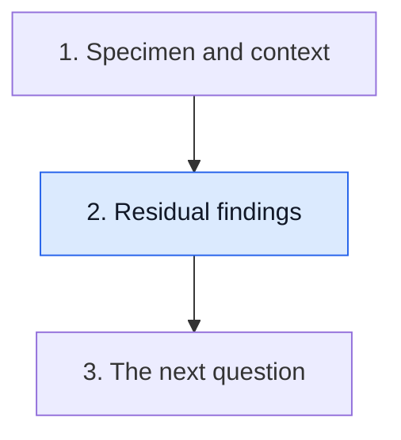

# Read residual disease and margins

**Residual disease, response categories and margins describe related but different features. Read the components before compressing them into a summary.**

**Before you start:** [Pathologic complete response (pCR)](/wiki/education/concepts/breast-cancer/surgery-and-pathology-results/pcr) is a defined tissue endpoint. [Residual cancer burden (RCB)](/wiki/education/concepts/breast-cancer/surgery-and-pathology-results/residual-cancer-burden) combines bed and node measurements. [Surgical margins](/wiki/education/concepts/breast-cancer/surgery-and-pathology-results/surgical-margins) concerns evaluated cut edges.

## Where this step sits

This is step 2 of [Read pathology and surgery results](/wiki/education/guides/reading-pathology-and-surgery-results/index). You know the specimen and treatment context. Now read what remains and where it sits.

## A footprint is not a count of remaining cells

A treated tumor bed is the region where the tumor and its [treatment effects](/wiki/education/concepts/breast-cancer/surgery-and-pathology-results/treatment-effect-in-pathology) are evaluated. Its dimensions describe a footprint. Scarring or other treatment changes and viable invasive cancer are separate observations. [Tumor-bed cellularity](/wiki/education/concepts/breast-cancer/surgery-and-pathology-results/tumor-bed-cellularity) describes how much of the evaluated bed is occupied by cancer under the scoring method. Invasive and in situ components also need separation. Label each percentage: overall cancer uses the defined bed area; the in situ share uses the cancer component.

Imagine two fictional treated beds with the same dimensions. One contains sparse invasive cells; the other contains dense invasive cancer. The footprints match, but their residual findings differ. A large bed is not automatically an equally large dense invasive mass.

RCB combines specified breast measurements with regional-node findings. The size of the bed alone cannot supply its score. Nor can a sequencing estimate of sample purity replace the pathologist's cellularity assessment; these have different denominators and purposes.

## Read breast and nodes before the combined endpoint

A commonly used pCR definition requires no residual invasive cancer in the breast or sampled regional nodes. It can permit [ductal carcinoma in situ (DCIS)](/wiki/education/concepts/breast-cancer/anatomy-and-histology/dcis), a distinct in situ finding. Check the actual endpoint definition because protocols can differ.

If invasive cancer remains in an examined node, a clear breast alone does not establish this combined pCR endpoint. Conversely, negative nodes do not erase residual invasive cancer in the breast. Keep the component findings visible.

| Finding | What it contributes | What it does not establish alone |
|---|---|---|
| Bed dimensions | Extent of the evaluated treated bed | Remaining invasive cancer quantity or an RCB score |
| Cancer-occupied bed area and in situ share of cancer | Two percentages with different denominators | Sequencing purity or whether nodes or margins are clear |
| Node findings | Residual regional disease | Distant metastasis or all breast findings |
| Margin interpretation | Cancer at an evaluated edge and relevant distances | Whole-body absence of disease |

## A worked response and margin example

A fictional report finds DCIS in the breast, no residual invasive cancer in breast or nodes, and an involved DCIS margin. Under a pCR definition permitting residual DCIS, the invasive response can meet pCR while a local margin question remains.

Now change the fictional report: one node has a residual invasive deposit. The combined pCR endpoint is no longer met, even if the breast has no invasive cancer. This change also contributes to residual burden and nodal staging. It does not by itself establish distant spread.

Separately submitted margins may affect the final margin interpretation. Do not decide which edge is final from one specimen's isolated line. The operative context and integrated pathology interpretation matter. Different recommendations apply to invasive cancer and pure DCIS in defined treatment settings.

A report can also describe [extranodal extension](/wiki/education/concepts/breast-cancer/surgery-and-pathology-results/extranodal-extension): cancer extending beyond a node's capsule into surrounding tissue. This describes a local feature of the involved node. It does not turn a regional-node finding into distant metastasis. Keep the node location, deposit and final interpretation beside that detail.

## Response, anatomic extent and local edges remain distinct

RCB summarizes residual burden; ypTNM classifies residual tumor and nodal extent in the post-treatment setting. Margins describe evaluated edges. Their answers overlap in relevance without being identical measurements.

A negative blood assay adds a result from another sampling method. It cannot remove invasive cells actually identified in the submitted tissue. A favorable scan also cannot supply an unreported margin result.

## What can go wrong at this step

- Calling the bed dimension the invasive cancer size ignores composition.
- Calculating RCB from incomplete fields creates a score the report does not support.
- Calling breast-only clearance combined pCR ignores nodes.
- Calling pCR a clear-margin result ignores the endpoint definition and local findings.

## Try it

A fictional report has no invasive breast cancer, one involved regional node and a negative blood assay. Does the blood result turn this into combined pCR?

**Answer:** No. The invasive node finding prevents the common combined tissue endpoint. The blood test answers a different sampling question.

## Explain it back

“Response describes ___; margins ask ___; neither alone establishes ___.”

**One possible answer:** “Response describes residual tissue findings; margins ask about evaluated edges; neither alone establishes whole-body absence of disease.”

## Takeaway

**Read the bed, invasive component, nodes and margins as separate observations before using a summary label.**

**Next:** [Build the next question](/wiki/education/guides/reading-pathology-and-surgery-results/03-build-the-next-question).

## Sources and scope

Source-checked October 10, 2026; expert and learner review pending. All examples are fictional and do not calculate an individual's score or final margins.

- [MD Anderson: detailed RCB pathology method](https://www.mdanderson.org/content/dam/mdanderson/documents/for-physicians/clinical-calculators/PLM_protocol_RCB_calculators_BRO.pdf), pages 1–4, for bed-area and cancer-component denominators.
- [Symmans and colleagues, 2007](https://doi.org/10.1200/JCO.2007.10.6823), for the measure and prognostic evidence.
- [CTNeoBC pooled analysis](https://pubmed.ncbi.nlm.nih.gov/24529560/), for response definitions.
- [SSO–ASTRO invasive margin guideline](https://pubmed.ncbi.nlm.nih.gov/24516019/) and [SSO–ASTRO–ASCO DCIS margin guideline](https://pubmed.ncbi.nlm.nih.gov/27528719/), for distinct population-specific recommendations.
