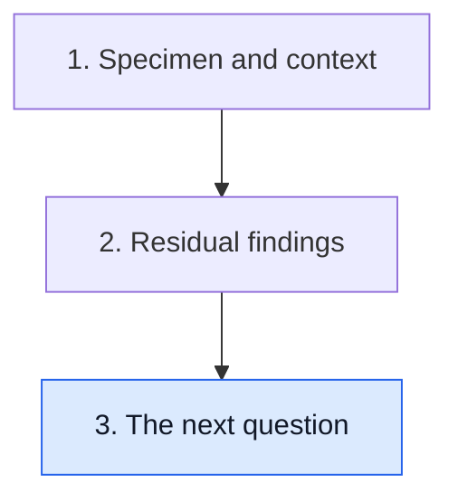

# Build the next question

**A useful question begins with what the report establishes, names the decision and identifies the additional evidence needed.**

**Before you start:** [Prognostic versus predictive evidence](/wiki/education/concepts/evidence-and-statistics/biomarkers/prognostic-vs-predictive) separates outcome information from a treatment comparison. [Clinical actionability](/wiki/education/concepts/evidence-and-statistics/biomarkers/actionability) asks whether the evidence supports an action in its actual setting.

## Where this step sits

This is the final lesson of [Read pathology and surgery results](/wiki/education/guides/reading-pathology-and-surgery-results/index). You have identified the specimen and read its components. Now make the next question precise.

## Begin with a statement that stays true

Use the final signed interpretation and its qualifications. A report may describe residual invasive disease, an evaluated margin or a regional-node deposit. Start with that observation rather than a forecast such as “this means the treatment failed.”

Then name the question. Is it about completing local treatment, estimating risk, adding systemic treatment or whether a plan can be delivered safely? One observation can inform several questions, but it does not answer all of them.

This approach makes an appointment easier to follow. You can ask why a finding matters without needing to choose the entire plan yourself. It also keeps a changing interpretation visible when an addendum remains pending.

## Use an observation-to-question worksheet

| Observation | Question it may inform | Additional evidence or context |
|---|---|---|
| Final margin is involved | What local completion is appropriate? | Which edge, disease type, submitted margins and operative/radiation context |
| Residual invasive disease is found | How does this inform risk and systemic options? | Prior therapy, subtype, relevant cohorts and comparative treatment evidence |
| A new receptor result differs | What explains the difference and changes interpretation? | Specimen, methods, controls, sampling and integrated assessment |
| A safety problem interrupted treatment | Which continuing options remain feasible? | Cause, severity, recovery and clinician assessment |

These are examples, not a required decision tree. The clinical team integrates the report with the other findings and the person's goals.

## A worked conversation: risk is not a drug test

Imagine a fictional patient has residual invasive disease after treatment. A study associates that residual category with higher recurrence risk than a complete-response group. Someone then claims that a new drug is especially effective in the residual category.

The first study provides prognostic information in its population. It does not establish the new drug's benefit. To test the second claim, ask which relevant comparison studied the new intervention, with what prior treatments, outcomes and follow-up. A subgroup claim also needs its uncertainty and analysis method.

Now imagine a clinical trial accepts people with that residual category. Eligibility can make the trial worth examining. It is not proof that the intervention works or that it is the best choice. Consent, access, safety and the clinical decision remain distinct from the report's finding.

## Say where personal-risk estimates come from

A cohort describes people with a range of stages, biological features and treatments. A numerical estimate needs its population, treatment era, follow-up and uncertainty. It should not be presented as a clock counting down for one individual.

[Residual cancer burden (RCB)](/wiki/education/concepts/breast-cancer/surgery-and-pathology-results/residual-cancer-burden) is useful prognostic information, but its category is not a universal personal percentage. [Pathologic complete response (pCR)](/wiki/education/concepts/breast-cancer/surgery-and-pathology-results/pcr) is associated with favorable outcomes in relevant groups, but is not a promise of cure.

The same discipline applies to a proposed additional test. Ask what its result would establish and what decision has been validated around it. More measurements do not automatically make every remaining uncertainty answerable.

## End with a concrete next question

A useful form is: “The report establishes ___; for the decision about ___, what evidence and context still matter?” It invites an explanation of the bridge between a finding and an action.

If two clinicians describe different parts of the plan, keep those questions separate enough to understand how they connect. A local completion question and a systemic benefit question can have different evidence owners while still requiring coordinated care.

## What can go wrong at this step

- Treating residual disease as inevitable recurrence turns a group association into a certainty.
- Treating favorable response as certainty of cure makes the opposite mistake.
- Treating eligibility as efficacy skips the intervention's comparison.
- Ordering a new assay without a defined question can add information without clarifying an action.

## Try it

A fictional treatment study reports overall benefit but a small residual-disease subgroup has a wide [confidence interval](/wiki/education/concepts/evidence-and-statistics/effect-measures/confidence-interval). Can you claim precise benefit for every person in that subgroup?

**Answer:** No. The subgroup estimate has its own uncertainty and applicability limits. Read the overall comparison and subgroup analysis without converting either into a personal guarantee.

## Explain it back

“The report establishes ___; the decision needs ___.”

**One possible answer:** “The report establishes residual tissue findings; an added-treatment decision needs matched benefit evidence, safety assessment and clinical context.”

## Takeaway

**Build a question that preserves the finding and names the evidence needed for action.**

**Next:** [Read cancer evidence](/wiki/education/guides/reading-cancer-evidence/index), or return to [treatment sequencing](/wiki/education/guides/treating-early-tnbc/index).

## Sources and scope

Source-checked October 9, 2026; expert and learner review pending. Scenarios are fictional.

- [CTNeoBC pooled analysis](https://pubmed.ncbi.nlm.nih.gov/24529560/), for response-outcome association and the separate treatment-surrogacy question.
- [Symmans and colleagues, 2007](https://doi.org/10.1200/JCO.2007.10.6823), for residual-burden prognostic evidence.
- [FDA–NIH BEST: understanding prognostic versus predictive biomarkers](https://www.ncbi.nlm.nih.gov/books/NBK402284/), for the distinction between predicting outcome and treatment effect.
- [NCI: Clinical trials](https://www.cancer.gov/research/participate/clinical-trials), for questions tested in clinical research.
