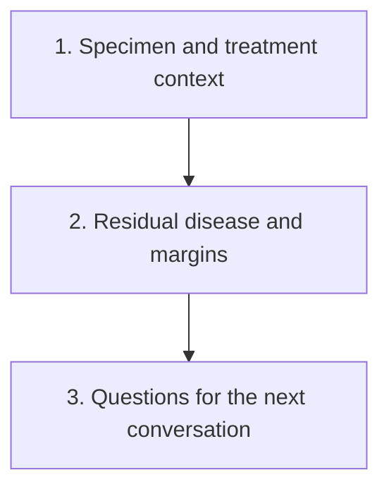

# Read pathology and surgery results

**Read what was sampled, what remained and which clinical question each finding informs.**

A pathology report describes submitted tissue. Its observations and final interpretation help establish diagnosis, response and local findings. It does not directly inspect every part of the body or select a whole treatment plan.

This path begins with the specimen and its treatment context. It then separates breast response, nodes and margins before turning those findings into questions. Each lesson has a fictional report excerpt and a short exercise. You can use the linked concepts as a reference without memorizing a staging or scoring formula.

The lessons focus on breast specimens, particularly after treatment before surgery. A biopsy, a surgery-first specimen and a post-treatment specimen are different settings. Keep that distinction visible rather than treating every pathology label as interchangeable.

## The big ideas

1. Collection date, report date and treatment timing provide different information. Read the specimen before the summary label.
2. A treated tumor bed's footprint is not the same as the amount of invasive cancer within it.
3. Breast and regional-node findings jointly inform some response endpoints, but margins ask about evaluated cut edges.
4. A response or risk category does not by itself identify the best added treatment. Local completion, systemic benefit and safety need their own questions.

## The map

## Lessons

| Step | Lesson | The question it answers | Minutes | Learning aid |
|---|---|---|---|---|
| 1 | [Place the specimen in time](/wiki/education/guides/reading-pathology-and-surgery-results/01-place-the-specimen-in-time) | Which tissue and treatment moment does this report describe? | 10 | Report card and three-date exercise |
| 2 | [Read residual disease and margins](/wiki/education/guides/reading-pathology-and-surgery-results/02-read-residual-disease-and-margins) | What do breast, node, bed and edge findings establish? | 12 | Two-bed comparison and combined-response example |
| 3 | [Build the next question](/wiki/education/guides/reading-pathology-and-surgery-results/03-build-the-next-question) | What decision needs which additional evidence? | 10 | Observation-to-question worksheet |

## Concepts you will use

**Timing and classification:** [Neoadjuvant versus adjuvant](/wiki/education/concepts/breast-cancer/treatment-setting/neoadjuvant-vs-adjuvant), [histologic grade](/wiki/education/concepts/breast-cancer/grade-and-stage/histologic-grade), [Ki-67](/wiki/education/concepts/breast-cancer/grade-and-stage/ki-67) and [TNM staging](/wiki/education/concepts/breast-cancer/grade-and-stage/tnm-staging).

**Residual findings:** [Pathologic complete response](/wiki/education/concepts/breast-cancer/surgery-and-pathology-results/pcr), [residual cancer burden](/wiki/education/concepts/breast-cancer/surgery-and-pathology-results/residual-cancer-burden) and [surgical margins](/wiki/education/concepts/breast-cancer/surgery-and-pathology-results/surgical-margins).

**Interpretation:** [Prognostic versus predictive evidence](/wiki/education/concepts/evidence-and-statistics/biomarkers/prognostic-vs-predictive) and [clinical actionability](/wiki/education/concepts/evidence-and-statistics/biomarkers/actionability).

## Applied to Diana

[The diagnosis record](/wiki/care/diagnosis), [results](/wiki/care/results), [the surgical residual-burden calculation](/wiki/prognosis/rcb-calculation-and-diana) and [the treatment plan](/wiki/care/treatment-plan) own the current findings and decisions. This path teaches the terms without copying a changing result table.

## What is still uncertain

A report can require addenda or integration of separately submitted margins. A specimen describes sampled tissue; recurrence risk and additional treatment benefit require clinical context and appropriate evidence. A teaching example cannot supply a final stage, margin interpretation or treatment decision for an individual.

## Sources and scope

Source-checked October 9, 2026; expert and learner review pending. The lessons cite the definitions and primary evidence they use.

- [NCI: Pathology reports](https://www.cancer.gov/about-cancer/diagnosis-staging/diagnosis/pathology-reports-fact-sheet).
- [MD Anderson: residual cancer burden method](https://www3.mdanderson.org/app/medcalc/index.cfm?pagename=jsconvert3).
- [CTNeoBC pooled analysis](https://pubmed.ncbi.nlm.nih.gov/24529560/).
