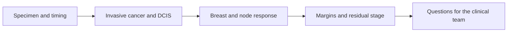

# Read pathology and surgery results

**Understand what remains after treatment, what the margins mean and which findings affect the next clinical conversation.**

A pathology report describes tissue the laboratory received. It gives both measurements and interpretations. You do not need to learn every abbreviation before reading it; begin with the question each section answers.

## The big ideas

1. The breast and nodes are evaluated separately, then combined for some response endpoints.
2. The tumor bed’s footprint and its cancer cellularity are different quantities.
3. A margin asks about a cut edge; a node category asks about regional spread.
4. Grade, TNM stage and residual cancer burden describe different aspects of the disease.

## The map

*Read the components before compressing them into a stage or response label.*

## Lessons

| Step | Lesson | Question |
|---|---|---|
| 1 | [pCR](/wiki/education/concepts/breast-cancer/surgery-and-pathology-results/pcr) | Is there residual invasive cancer in breast or nodes? |
| 2 | [RCB](/wiki/education/concepts/breast-cancer/surgery-and-pathology-results/residual-cancer-burden) | How are the bed, cellularity and nodes combined? |
| 3 | [Surgical margins](/wiki/education/concepts/breast-cancer/surgery-and-pathology-results/surgical-margins) | Does cancer reach an evaluated edge? |
| 4 | [TNM staging](/wiki/education/concepts/breast-cancer/grade-and-stage/tnm-staging) | What do c, p, y, T, N and M mean? |
| 5 | [Prognostic versus predictive evidence](/wiki/education/concepts/evidence-and-statistics/biomarkers/prognostic-vs-predictive) | Which findings describe risk, and which select a treatment? |

## A worked report

A hypothetical report describes a 40 mm treated tumor bed, sparse invasive cells, one involved regional node, residual ductal carcinoma in situ (DCIS) and an involved invasive margin. This is not pCR (pathologic complete response) because invasive disease remains. A large bed with sparse cells is not the same as a dense 40 mm invasive mass. The margin creates a local completion question; the involved node contributes to RCB and ypN. Neither alone establishes distant metastasis.

DCIS means abnormal cancer cells remain confined within ducts. Invasive cancer has crossed that boundary. Extranodal extension means cancer extends outside a node’s capsule; it is a local nodal feature, not a synonym for distant spread. A sentinel-node suffix records how nodes were sampled.

## Questions to bring to the appointment

Ask which report is signed and whether addenda remain pending. Clarify the final interpretation of separately submitted margins, node findings and receptor tests. Then ask how those findings affect completion surgery, radiation and postoperative systemic care. Keep those three decisions separate enough to understand how they constrain each other.

## Try it

A blood assay is negative while the surgical report contains invasive cancer. Which is wrong?

**Answer:** Neither necessarily is. They sample different compartments and answer different questions. Tissue establishes the residual local findings; blood detection depends on shedding and assay limits.

**Explain it back:** “The report tells me what was found in the removed tissue; its components guide the next clinical questions.”

## Applied to Diana

[[wiki/care/diagnosis|The diagnosis record]], [[wiki/prognosis/rcb-calculation-and-diana|the surgical RCB calculation]] and [[wiki/care/treatment-plan|the treatment plan]] own current findings and choices. This guide teaches the terms without copying a changing status table.

**Takeaway:** Read breast, nodes and margins individually before interpreting the combined summary.

## Sources and scope

General teaching, source-checked October 8, 2026; expert and learner review pending. Each concept links to its measurement definition and primary evidence.

- [NCI pathology reports](https://www.cancer.gov/about-cancer/diagnosis-staging/diagnosis/pathology-reports-fact-sheet).
- [MD Anderson RCB method](https://www3.mdanderson.org/app/medcalc/index.cfm?pagename=jsconvert3).

## Concepts you will use

- [[wiki/education/concepts/breast-cancer/surgery-and-pathology-results/pcr|Pathologic complete response (pCR)]]
- [[wiki/education/concepts/breast-cancer/surgery-and-pathology-results/residual-cancer-burden|Residual cancer burden (RCB)]]
- [[wiki/education/concepts/breast-cancer/surgery-and-pathology-results/surgical-margins|Surgical margins]]
- [[wiki/education/concepts/breast-cancer/grade-and-stage/tnm-staging|TNM staging]]
- [[wiki/education/concepts/evidence-and-statistics/biomarkers/prognostic-vs-predictive|Prognostic versus predictive biomarkers]]
