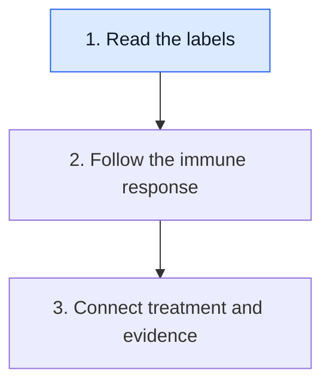
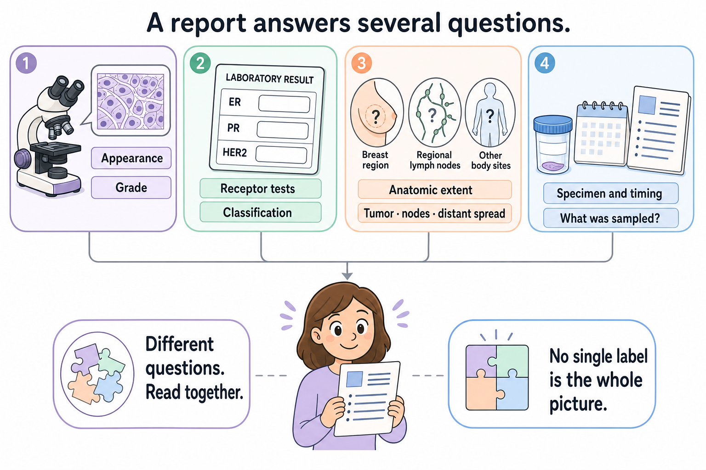

# Read each label as an answer to a question

**A cancer report gives several answers about one specimen. Keep each answer attached to its question before combining them into a picture.**

**Before you start:** [Tumor heterogeneity](/wiki/education/concepts/cancer-biology/what-cancer-is/tumor-heterogeneity) explains why different cells and regions can differ. This matters whenever a small specimen is used to describe a larger tumor.

## Where this step sits

This is step 1 of [Start here](/wiki/education/guides/start-here/index). First read the labels. Next follow an immune response. Then connect a treatment claim with its evidence.

## Begin with the specimen

Cancer develops when cells acquire changes that let them grow and survive outside normal controls. Some can invade nearby tissue and spread. A tumor can also contain immune cells, support cells and treated or damaged tissue. The name of a tumor does not mean every cell in a sample is a cancer cell.

Ask where the specimen came from and when it was collected. A biopsy before treatment and a surgical specimen after treatment describe different moments. A report date tells you when a report was issued; it does not replace the collection date. An addendum may answer a new question about the earlier specimen.

A pathologist examines the tissue and integrates the relevant tests. The final interpretation deserves priority over a striking word in the microscopic description. If a field is pending or qualified, keep that qualification beside it.

## Give each label a job

| Question | A label or result you may see | What it does not answer by itself |
|---|---|---|
| What tissue pattern is present? | Histologic type and invasive versus in situ disease | The full extent throughout the body |
| What does the cancer look like microscopically? | [Histologic grade](/wiki/education/concepts/breast-cancer/grade-and-stage/histologic-grade) | The stage or an exact growth rate |
| What receptor features were found? | Estrogen receptor, progesterone receptor and [HER2 (human epidermal growth factor receptor 2)](/wiki/education/concepts/breast-cancer/receptors-and-subtypes/her2) tests | Every possible treatment target |
| What expression pattern was assigned? | [Intrinsic molecular subtype](/wiki/education/concepts/breast-cancer/receptors-and-subtypes/intrinsic-subtype) | A replacement for the receptor test |
| What extent is established? | [Tumor, node and metastasis (TNM) staging](/wiki/education/concepts/breast-cancer/grade-and-stage/tnm-staging) | A certain personal outcome |

*Each panel asks a different question. Some breast prognostic staging systems combine anatomic extent with grade and biomarkers. This cartoon organizes those observations; it is not a patient report, a stage assignment or a forecast.*

HER2 means human epidermal growth factor receptor 2. It is a protein and its associated testing category, rather than a name for all growth signals. [Estrogen receptor](/wiki/education/concepts/breast-cancer/receptors-and-subtypes/estrogen-receptor) and [progesterone receptor](/wiki/education/concepts/breast-cancer/receptors-and-subtypes/progesterone-receptor) are separate hormone receptors. Their reports help define hormone-receptor status.

[Triple-negative breast cancer (TNBC)](/wiki/education/concepts/breast-cancer/receptors-and-subtypes/tnbc) is a receptor-based category. The name does not mean the cancer has no proteins, no molecular differences or no treatment options. Different tumors within the category can have different biology.

## A worked report: two descriptions can both be true

Imagine a fictional biopsy describes a high-grade invasive breast cancer with triple-negative receptor classification. Imaging also identifies a breast lesion and a suspicious regional node. The node has not yet been sampled.

“High grade” describes microscopic features. It does not establish distant spread. “Triple-negative” describes the tested receptor category. It does not establish a particular [ribonucleic acid (RNA)](/wiki/education/concepts/biology-basics/genetics/central-dogma) expression subtype. The suspicious node is a clinical finding that needs its own interpretation; it is not automatically a signed positive-node pathology result.

Now imagine a later surgical report finds sparse residual invasive cancer in a treated tumor bed. That later finding does not rewrite the earlier biopsy into a post-treatment measurement. You need both dates and settings to understand the change.

## What can go wrong at this step

- Treating grade as stage merges appearance with extent. Some breast prognostic staging systems also incorporate grade and biomarkers; read the named staging system.
- Treating receptor status as a whole molecular portrait leaves out other measured features.
- Treating a sample result as a survey of every cell ignores sampling and heterogeneity.
- Treating an unsigned estimate or pending result as final removes information the report still needs.

## Try it

A fictional report says “grade 3.” A friend reads this as “stage III” and assumes distant spread. Which two steps in that reasoning fail?

**Answer:** Grade 3 is a microscopic grade, not a stage assignment. Stage III breast cancer also does not mean distant metastasis; distant spread is a separate part of staging. The actual clinical or pathologic staging assessment is needed.

## Explain it back

“This label describes ___, in a specimen collected ___; it does not by itself tell me ___.”

**One possible answer:** “Histologic grade describes microscopic features, in a specimen collected before treatment; it does not by itself tell me the disease's extent.”

## Takeaway

**Keep the specimen, date, method and question beside every cancer label.**

**Next:** [Follow the route to immune recognition](/wiki/education/guides/start-here/02-follow-immune-recognition).

## Sources and scope

General report-reading education, source-checked October 9, 2026; expert and learner review pending. The report is fictional and is not a staging calculation.

- [NCI: What is cancer?](https://www.cancer.gov/about-cancer/understanding/what-is-cancer), for altered cell behavior and tumor diversity.
- [NCI: Pathology reports](https://www.cancer.gov/about-cancer/diagnosis-staging/diagnosis/pathology-reports-fact-sheet), for specimen, description and final diagnosis.
- [NCI: Breast cancer stages](https://www.cancer.gov/types/breast/stages), for staging dimensions. The linked receptor and grade concepts provide their testing sources.
